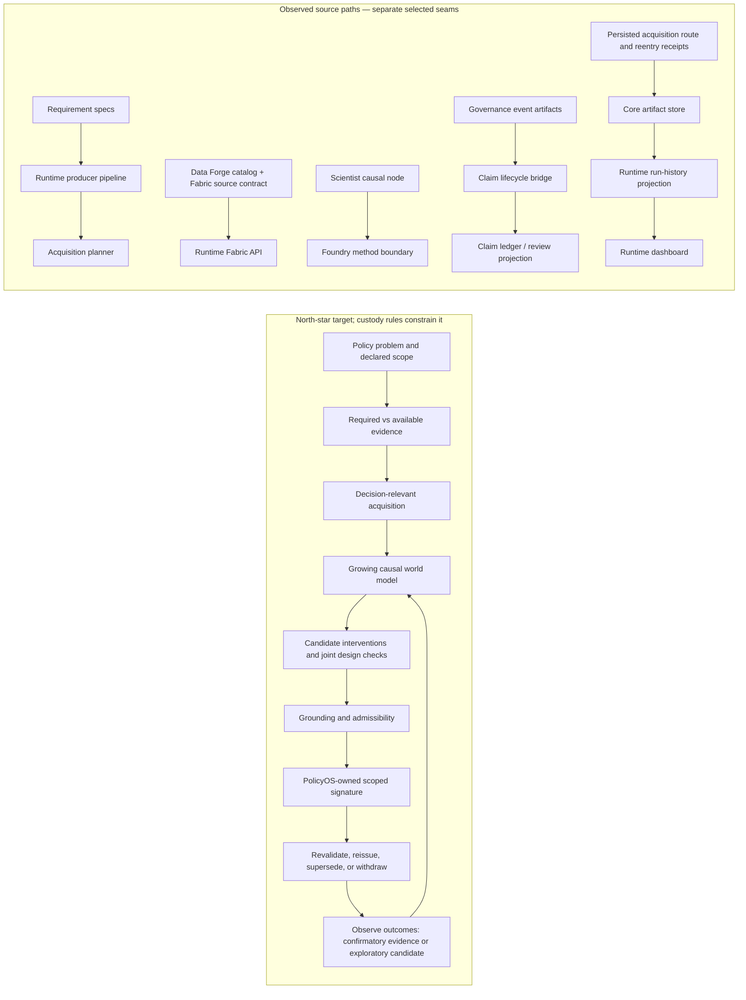

# PolicyOS architecture: target and current code

Owner: team-architecture
Source pin: `bafca83bff9ff49eef1466bc491a8420b5cd1dbb`
Source of truth:
  `docs/system-design-decisions/policy-design-causal-operating-system-north-star.md`,
  `docs/system-design-decisions/policyos-identity-and-custody-boundary.md`,
  `docs/system-design-decisions/stage0-custody-kernel-ratification.md`,
  `docs/reference/policy-design-case-failure-patterns.md`,
  `architecture/imports/policy.toml`, `architecture/packages/boundaries.toml`,
  `architecture/public_surface/contract.toml`,
  `src/polisyos/core/contracts/**/*.py`, `src/polisyos/core/artifacts/**/*.py`,
  `src/polisyos/core/security/**/*.py`, `src/polisyos/ir/**/*.py`,
  `src/polisyos/data_forge/read_api/**/*.py`, `src/polisyos/data_forge/domains/legal/**/*.py`,
  `src/polisyos/fabric/**/*.py`, `src/polisyos/lex/**/*.py`,
  `src/polisyos/foundry/compile/**/*.py`, `src/polisyos/foundry/execute/**/*.py`,
  `src/polisyos/foundry/agent_sim/world/**/*.py`,
  `src/polisyos/scientist/orchestration/workflows/**/*.py`,
  `src/polisyos/scientist/nodes/**/*.py`, `src/polisyos/scientist/governance/**/*.py`,
  `src/polisyos/scientist/evidence/claims/**/*.py`,
  `src/polisyos/runtime/http/**/*.py`, `src/polisyos/runtime/quality/**/*.py`,
  `packages/runtime-api-client/**/*.ts`,
  `apps/runtime-dashboard/src/**/*.ts`, `apps/runtime-dashboard/src/**/*.tsx`,
  `tests/unit/runtime/quality/test_wave7_requirement_pipeline_integration.py`,
  `tests/unit/runtime/quality/test_acquisition_owner_store_requirement.py`,
  `tests/integration/data_forge_runtime/test_catalog_to_runtime_bridge.py`,
  `tests/integration/foundry_scientist/test_method_node_bridge.py`,
  `tests/unit/scientist/governance/continuous/test_lifecycle_bridge.py`,
  `tests/integration/core_runtime/test_acquisition_authority_served.py`,
  `apps/runtime-dashboard/e2e/journeys/catalog-profile-source-bound.spec.ts`

The declared source paths bind only these selected owners; paths mentioned later in the body are not
automatically added to the binding set. Source and test paths below were inspected at this snapshot.
This documentation refresh did not run those tests. A test reference identifies a test's scope; it
is not a fresh pass receipt, a completeness claim, or institutional authority.

The declared source set differs from the separately observed E02 commit. This page still describes its inspected source pin; its affected claims require [re-review after integration](../reference/e02-documentation-snapshot.md#source-drift-in-handbook-maps).

This page answers three different questions: what boundary was ratified, what the north-star asks
the system to become, and what selected paths exist in the inspected source. It is an orientation
map, not a new architecture decision or a capability register. For task-specific owners and checks,
start with [Contributor Start Here](../reference/contributor-start-here.md) and the nearest package
README; use the [Reference index](../reference/index.md) for subsystem contracts. Read the
[north star](../system-design-decisions/policy-design-causal-operating-system-north-star.md)
for the strategic model, the [identity and custody decision](../system-design-decisions/policyos-identity-and-custody-boundary.md)
for PolicyOS's scope, and the
[Stage-0 ratification](../system-design-decisions/stage0-custody-kernel-ratification.md) for the
custody invariants. Ratification establishes a rule or direction; it does not establish that a
capability is implemented.

---

## 1. Product identity and authority boundary

The strategic frame is a **causal operating system for policy**. A policy design is treated as a
program over a structural causal model: an intervention changes a target directly and predicts a
distribution over downstream effects; the effects of a composed design need to be checked jointly.
Required data can exceed available data, so acquisition should address the gaps that matter to the
decision. The growing world model, rather than a text generator, is the north-star product. This
is a direction for the build, not a claim that the repository already contains a universal causal
world model or a complete post-deployment learning loop.

The ratified identity is **epistemic custodian of policy justification**. PolicyOS owns everything
it signs for as long as those signatures publicly stand, consumes other institutions' signatures
as typed evidence, and does not claim acts it cannot custody. Its scope includes design authority,
lifetime custody of its own justification, and a safe learning loop; it does not make PolicyOS the
administrator, executor, court, payment system, notification channel, or case-management system.
See the identity decision's §1 and §5 for the signature rule and four-way `own / integrate /
observe / out_of_scope` test.

Stage-0 makes the boundary operational. **S0-K03** is a classification rule: identify the external
institutional act, evidence emission, our receipt and verification, admission, our scoped claim
reaction, and public projection as separate planes. Split a path that crosses planes before assigning
an owner. The four-way `own / integrate / observe / out_of_scope` test then determines our role;
integration means we own the typed evidence contract and its fail-closed absence behavior, not the
partner's function. **S0-K05** and **S0-K07** prohibit authority by observation, transport, or
projection. **S0-K06** applies fail-closed behavior to protected actions, published claims, and
custody facts; candidate work may continue with an explicit unknown carried as a limitation, but
that unknown cannot silently become a closed scope for authority use. **S0-K08** keeps corrections
append-only. These ratifications govern boundary decisions, not production schemas, capability
status, or package ownership.

LLM-generated claims, legal readings, risk assessments, and method choices remain candidates until
admitted by the relevant producer and consumer path. A response that looks complete, a typed field,
or a dashboard label does not itself establish authority. This is the candidate-to-authority
boundary described by P05 and P15 in the
[failure and repair register](../reference/policy-design-case-failure-patterns.md).

## 2. Target and inspected paths

The upper lane is the north-star target; its custody boundary is ratified, but the flow is not an
implemented end-to-end system. The lower lane shows selected source paths at the pinned snapshot.
The two lanes are deliberately unconnected: shared vocabulary does not establish a bridge, and the
lower lane is not one universal workflow.

Section 5 names the source and test for each selected seam and states what it establishes. Some tests
exercise a bounded positive path; others exercise refusal. Their source was inspected, not run for
this update.

## 3. Repository boundaries and entrypoints

Use three maps for three different questions. For package boundaries or a supported import, consult
the first two files below; for task ownership and checks, follow Contributor Start Here to the
nearest package README.

- `architecture/imports/policy.toml` is the enforced import-direction matrix. Its `internal.allow`
  entries say which package roots may import which others; they are dependency constraints, not a
  runtime call graph or workflow specification. For example, the matrix permits `fabric` to depend
  on `data_requirement`, `data_forge`, `core`, and `ir`, and permits `foundry` to depend on
  `method_requirement`, `calibration`, `data_forge`, `fabric`, `core`, and `ir`. The file also records
  an existing package-cycle baseline, so do not read it as proof of a strictly acyclic layer stack.

  Fabric has a narrower declared package boundary than this matrix alone shows:
  `architecture/packages/boundaries.toml` allows `polisyos.fabric` to depend on
  `polisyos.data_forge.read_api`, while `architecture/imports/policy.toml` still permits the broader
  `polisyos.data_forge` root. The inspected `src/polisyos/fabric/retrieval/service.py` also imports
  the private `polisyos.data_forge.domains.catalog.batch.config._profile_input_coverage_currentness`
  helper inside `_catalog_profile_plan_admission`. The `read_api` facade is not uniformly
  read-only either: `src/polisyos/data_forge/read_api/legal.py::_EXPORTS` exposes
  `run_batch_pipeline` from the legal batch pipeline, and
  `src/polisyos/data_forge/read_api/academic.py::_EXPORTS` exposes `run_edge_synthesize` from an
  academic batch module through lazy `__getattr__` resolution. These are observed boundary limits at
  this page's source snapshot, not a call-count or a claim that every Fabric/Data Forge path behaves
  this way. Review both the package-boundary intent and the observed imports when either map or the
  named source paths change.

- `architecture/public_surface/contract.toml` defines supported Python entrypoints and their
  compatibility class. An unlisted `polisyos` module is internal by default. The contract marks
  `core`, `ir`, `fabric`, `foundry`, `scientist`, `runtime`, and `lex` facades as stable; it marks
  `data_forge` and `runtime.quality` as experimental. It explicitly keeps several requirement and
  evidence packages internal. The generated
  [public-surface reference](../reference/public-surface.md) is the navigable inventory; a package
  being present in `src/` does not make every submodule public.

- Runtime and test paths show where selected producers, bridges, and consumers meet. An allowed
  import or public contract is not evidence that an artifact is produced, persisted, consumed, or
  checked end to end.

Canonical source starting points for the main architectural seams:

| Area | Current owner and starting point | Boundary to keep in view |
| --- | --- | --- |
| Cross-cutting contracts and persistence | `src/polisyos/core/contracts/`, `src/polisyos/core/artifacts/`, `src/polisyos/core/security/` | Core owns shared contracts, artifact storage, and security primitives; it does not own domain conclusions. |
| Policy, observation, and analytics contracts | `src/polisyos/ir/` (`load_policy()`, Trinity and observation contracts) | IR is the shared contract layer; its types do not prove that a producer or workflow consumes them. |
| Prepared data assets | `src/polisyos/data_forge/read_api/` and `src/polisyos/data_forge/domains/` | The facade is experimental. Runtime readers use `read_api`; domain batch internals are not a public runtime surface. |
| Connectors and materialized data/world reads | `src/polisyos/fabric/connectors/`, `src/polisyos/fabric/data_plane/`, `src/polisyos/fabric/world/` | Fabric owns ingestion and world-query paths; source receipts and lineage still need consumer-specific admission. |
| Legal material | `src/polisyos/lex/` and `src/polisyos/data_forge/domains/legal/` | Lex owns runtime legal assembly and evaluation; offline legal preparation is under Data Forge. |
| Compilation, methods, and synthetic worlds | `src/polisyos/foundry/compile/`, `src/polisyos/foundry/execute/`, `src/polisyos/foundry/agent_sim/world/` | The public Foundry facade is stable; the synthetic-world surface is separately experimental and is not by itself the north-star production world model. |
| Workflow and governance | `src/polisyos/scientist/orchestration/workflows/`, `src/polisyos/scientist/nodes/`, `src/polisyos/scientist/governance/`, `src/polisyos/scientist/evidence/claims/` | Scientist routes work and owns claim/lifecycle mechanisms; internal subpackages are not automatically stable public APIs. |
| HTTP and operator-facing projection | `src/polisyos/runtime/http/app.py::create_runtime_api_app`, `src/polisyos/runtime/http/routes/`, `packages/runtime-api-client/`, `apps/runtime-dashboard/` | The stable Python facade is `polisyos.runtime`; HTTP implementation modules remain internal unless separately documented. API projections do not mint authority. |

Policy-grammar and requirement packages have separate source boundaries in the import policy. Check
the public-surface contract before treating any such package as a supported caller entrypoint; a
package's location or role in the design does not make its internal modules public.

## 4. Contracts, bridges, and capability claims

A **contract** names a typed shape, boundary, or allowed transition. A **capability** exists only
when the contract is carried through the whole chain:

`typed contract/artifact → producer → persisted artifact/event → orchestration bridge → consumer → verification → API/audit/dashboard surface (or explicit out_of_scope) → negative or end-to-end semantic test`

The labels and definitions in the failure register distinguish a missing bridge, consumer,
verification, or surface from an implemented path. A schema, a component, a passing constructor
check, a generated client, and a research handoff are each insufficient alone. This distinction
addresses P01/P02 (contract without a consumed bridge), P03 (internal evidence without a useful
surface), P05/P15 (authority boundaries), and P10 (semantic adequacy).

## 5. Selected code-backed bridges and their limits

| Path | Source and test locations | What the inspected path establishes | What it does not establish |
| --- | --- | --- | --- |
| Requirement specifications → producer pipeline → acquisition planner | `src/polisyos/runtime/quality/producer_pipeline.py::run_requirement_spec_producer_pipeline`; `src/polisyos/runtime/quality/acquisition_planner.py`; `tests/unit/runtime/quality/test_wave7_requirement_pipeline_integration.py::test_requirement_spec_pipeline_runs_real_w7_adapters_and_acquisition_bridge` | The test supplies requirement and producer inputs, runs the W7 adapter/pipeline path, and inspects the compiled family summaries and planner records. `tests/unit/runtime/quality/test_acquisition_owner_store_requirement.py::test_default_gateway_uses_exact_tenant_store_for_skg_produce_and_replay` checks that the SKG owner uses the supplied tenant store and persists a source-resolution artifact. | The pipeline test uses bounded fixtures; it does not establish universal live acquisition, complete source coverage, or a publishable policy conclusion. |
| Data Forge catalog and Fabric source contract → Runtime Fabric API | `src/polisyos/data_forge/read_api/catalog.py`; `src/polisyos/fabric/connectors/contracts.py`; `src/polisyos/runtime/http/routes/fabric.py::get_fabric_source_scorecards` and `::analyze_fabric_impact`; `tests/integration/data_forge_runtime/test_catalog_to_runtime_bridge.py::test_data_forge_catalog_fixture_source_contract_reaches_runtime_api` | The integration test loads a catalog fixture and source contract, calls the runtime scorecard and impact routes, and checks the fixture's lineage and affected decision-data projection. | A fixture-backed source route does not prove that every domain has this bridge or that its impact projection authorizes a policy claim. |
| Scientist causal node → Foundry method boundary | `src/polisyos/scientist/nodes/builtins/simulate/run_causal_evaluation.py::RunCausalEvaluationNode`; `tests/integration/foundry_scientist/test_method_node_bridge.py::test_foundry_method_bridge_refuses_absent_eval_safety_before_execution` | The test reaches the Scientist node with a registered Foundry method but no EvalSafety execution context; it asserts refusal occurs before `run_job` and state/artifact mutation. | This is a negative admission test. It does not demonstrate a successful causal execution or a complete policy-design workflow. |
| Governance event → claim lifecycle projection | `src/polisyos/scientist/governance/continuous/lifecycle_bridge.py::bridge_governance_events_to_claim_lifecycle`; `src/polisyos/scientist/evidence/claims/lifecycle.py`; `tests/unit/scientist/governance/continuous/test_lifecycle_bridge.py::test_bridge_maps_detector_families_to_claim_lifecycle_and_public_revision` | The test maps persisted detector events to append-only claim lifecycle records and a `review_required` public revision; it marks that revision `projection_only`. | A review projection is not a reissue or an authority-bearing current claim head. Raw detector events do not supply that authority. |
| Completed validity batch → Claim owner head | `src/polisyos/scientist/governance/continuous/lifecycle_bridge.py::EpochClaimLifecycleBridgeService`; `src/polisyos/scientist/evidence/claims/head_index.py`; `tests/unit/scientist/governance/continuous/test_lifecycle_bridge.py::test_completed_epoch_batch_is_only_authority_input_to_claim_bridge`, `::test_fabricated_completed_batch_dto_and_matching_ref_cannot_bridge`, and `::test_raw_detector_event_cannot_establish_epoch_claim_transition` | The bridge accepts only its completed-batch evidence type. The inspected fixture returns `ClaimLifecycleBridgeNonReceipt` with `claim_ledger_owner_not_established`; fabricated receipts and raw monitor events are rejected. | This path does not establish successful current-head advancement in that fixture. The missing owner is a concrete integration limit for that path, not evidence that every claim lifecycle path is absent. |
| E02 acquisition route/re-entry receipts → Runtime run history → dashboard | `src/polisyos/runtime/quality/data_state_substrate.py`; `src/polisyos/runtime/http/routes/runs.py::_candidate_acquisition_history_projection`; `apps/runtime-dashboard/src/api/validators.ts`; `apps/runtime-dashboard/src/features/runs/routes/tabs/OverviewTab.tsx`; `tests/integration/core_runtime/test_acquisition_authority_served.py::test_served_acquisition_selects_committed_human_authority_and_reopens_worker`; `apps/runtime-dashboard/e2e/journeys/catalog-profile-source-bound.spec.ts` | The served path joins persisted route and re-entry receipts to a selected candidate occurrence, distinguishes observed origin refs from a verified same-candidate root, and projects the history through the runtime and dashboard surfaces. The test body also asserts authorization and corrupted-artifact behavior. | The projection is explicitly `candidate_observation_only`: it records `currentness_status = not_established` and `publication_authority = false`. The accompanying E02 release fragment, `release-fragments/unreleased/2026-10-14-e02-acquisition-history-lineage-join.toml`, states the same limit. This is lineage evidence for candidate history, not publication authority or proof that the policy remains current. |

The selected E02 acquisition path demonstrates a real producer → persisted receipt → runtime reader →
dashboard bridge for a bounded candidate-history projection. Its source binding is stronger than an
observed source reference, while its authority purpose remains candidate-only. The distinction is
intentional: a verified provenance join can answer *which persisted continuation produced this
candidate* without answering *whether the signed policy claim is currently admissible*.

## 6. Boundaries that remain unresolved at this snapshot

- The north-star's growing causal world model, joint simulation of composed interventions, and
  confirmatory/exploratory post-deployment learning loop remain design targets. Foundry synthetic
  worlds and drift monitors do not establish those system-level capabilities.
- The selected Scientist lifecycle and Runtime E02 history seams in §5 do not form one authority
  path. The event bridge can emit a `projection_only` review revision; its completed-batch path
  accepts verified persisted evidence but, in the cited default composition,
  `build_default_claim_ledger_owner()` returns `UnappointedClaimLedgerOwner` and the inspected
  fixture ends in `claim_ledger_owner_not_established`. The separate Runtime history path is
  `candidate_observation_only`, with `currentness_status = not_established` and
  `publication_authority = false`. These selected seams establish neither current-head advancement
  under authority nor reissue, and they do not prove every claim path is absent.
- Together, these selected seams do not demonstrate one policy workflow from an input problem through
  an admissible PolicyOS-owned signature and later staleness, invalidation, or reissue. Treat that
  whole-claim trace as not established at this source snapshot, rather than inferring it from the
  north-star diagram or combining neighboring component tests.

- The import and public-surface contracts govern different questions. An import edge says where a
  dependency is allowed; a public entrypoint says what callers may rely on; neither proves the
  end-to-end property. Use the capability labels in the
  [failure and repair register](../reference/policy-design-case-failure-patterns.md) when a producer,
  artifact, bridge, consumer, verification, or external surface is missing.

## 7. When to re-review this map

Re-read the affected sections against a new immutable source snapshot when:

- a ratified identity or Stage-0 ruling changes (§1 and the target lane);
- `architecture/imports/policy.toml`, `architecture/public_surface/contract.toml`, package ownership,
  or a supported facade changes (§3); or
- a producer, persisted artifact, bridge, claim owner, consumer, or public projection named in §5
  changes. Recheck the test body as well as its path before retaining an evidence statement.

Update the source pin only after inspecting the new snapshot. Keep test-source inspection separate
from test execution, and keep both separate from deployment evidence. If a changed path no longer
establishes a claim, narrow it or mark it `not_established`; do not carry it forward by matching
names or adjacent components.

For detailed operational topology and durable artifact families, see
[operations diagrams](../reference/operations/platform-architecture-diagrams.md),
[generated artifacts](../reference/generated-artifacts.md), the
[API reference](../reference/api/index.md), and the
[IR contract catalog](../contracts/TRINITY.md).
