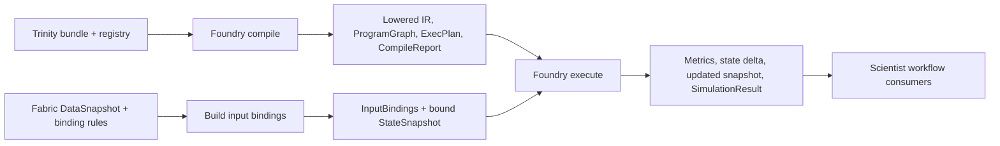

# Causal Engine

Related reference: [Foundry compile and execute](../reference/foundry/compile-execute.md),
[Foundry agent simulation](../reference/foundry/agent-sim.md), [Scientist workflows](../reference/scientist/workflows.md),
[Scientist causal validity](../reference/scientist/causal-validity.md).

The [causal operating-system north star](../system-design-decisions/policy-design-causal-operating-system-north-star.md)
describes the system target. This page records runtime paths visible in the repository; a simulation
result does not by itself establish a grounded effect, publication authority, or a complete
post-deployment learning loop. The code inspection below is pinned to
[`bafca83bff9ff49eef1466bc491a8420b5cd1dbb`](https://github.com/DenisKopylov/polisyos/tree/bafca83bff9ff49eef1466bc491a8420b5cd1dbb).
Evidence level: implementation and linked test sources were inspected at this pin; this docs-only
refresh did not run those tests.

## Foundry compile and execute

Foundry's public `compile()` accepts a Trinity bundle and resolves its registry, links and lowers
the bundle, builds a `ProgramGraph` and `ExecPlan`, and persists the compile artifacts and report
in CAS. `build_input_bindings()` binds a Fabric `DataSnapshot` and registry slots into a
`FoundryInputBindings` artifact and `StateSnapshot`. `execute()` consumes that binding, plan, and
registry; it runs the program graph and persists metrics, a state delta, the updated snapshot, and a
`SimulationResult` with provenance edges.

Scientist provides the workflow bridge: `CompileFoundryNode` stores the compile refs in
`ExperimentState`; `RunSimulationNode` requires the `ExecPlan` and input-bindings refs, calls
Foundry, and stores the `SimulationResult` ref and a simulation proof bridge. The basic bridge
case covered by its behavior test is `SCENARIO`; status composition can also produce `BOUNDED` or
`BLOCKED`, and the current bridge validator rejects `IDENTIFIED` without an admitted
producer/verifier. These bridge classifications do not establish an observed effect. Metric
validation, uncertainty, welfare, and decision-packet nodes can consume simulation outputs, while
causal readiness, grounding, and promotion remain separate decisions.

This is a model-conditioned execution result. It records what the compiled program produced from
the bound state and execution inputs. It is not an observed post-deployment effect. One compiled
program may contain several mechanisms, but the `compile()`/`execute()` pair does not itself create
the full individual, pairwise, and joint run set or certify cross-intervention effects.

## Design-level individual, pairwise, and joint simulation

The explicit design-composition path lives in `runtime.quality`, not in the Foundry public
compile/execute facade. Its `WorldModelRecord` is a versioned, content-hashed envelope for
jurisdiction, population, domain, time, resolution, source substrates, Foundry bindings, and a
`SimulationModelRef` naming the model spec, registry, mechanism/GCM/NCM/program refs, assumptions,
fidelity, and calibration state. `JointSimulationHorizonController` requires a resolved record,
validates each intervention atom's world and target-slot bindings, resolves Foundry inputs from the
record, and then checks engine semantics and coupling before dispatch. It requests trajectories for
each atom alone, each pair, and the all-atom joint scope, then derives interaction terms.
`JointSimulationPort` connects this controller to the generation cycle and persists the resulting
`JointSimulationResult` for downstream consumers. This binds a declared simulation world; it does
not by itself validate that world against an observed population.

These trajectories describe model predictions. The NCM behavior test uses a real registered
engine and verifies the individual/pairwise/joint runs, interaction term, and content-bound receipt;
the same result carries blockers `simulation_only_k_sim_not_world_evidence` and
`simulation_effect_basis_not_established`. A successful simulation is therefore not silently
promoted to empirical effect evidence. The controller may also refuse unsupported engine/coupling
combinations instead of emitting trajectories.

## Synthetic worlds are benchmark substrates

`polisyos.foundry.agent_sim.world` owns synthetic DGPs used to produce benchmark samples, known
truth, and evaluation metrics. For example, its cross-sectional template generates potential
outcomes `y0` and `y1`; the causal truth builder computes the synthetic ATE from `y1 - y0`. The
seed-world test checks supported families and required truth targets. That truth is an oracle for
the generated world and can score a method's prediction. It is not evidence that a policy changed
an observed population.

This package is also distinct from the runtime `WorldModelRecord` consumed by N5. The synthetic
world's `artifact()` method returns a versioned lineage record with content hashes and
`synthetic-world://` locators; those locators are not Foundry CAS artifact refs. Candidate scenario
records make their epistemic limit explicit: a declared synthetic SCM is marked
`candidate_only_not_empirically_grounded` and `calibrated=False` in
[the candidate-record producer](https://github.com/DenisKopylov/polisyos/blob/bafca83bff9ff49eef1466bc491a8420b5cd1dbb/policy-engine/src/polisyos/runtime/quality/world_model_record.py#L211-L222), which is also documented as hypothetical and non-authoritative in
[the candidate-simulation contract](https://github.com/DenisKopylov/polisyos/blob/bafca83bff9ff49eef1466bc491a8420b5cd1dbb/policy-engine/src/polisyos/runtime/quality/candidate_simulation.py#L1-L6).

## When an effect claim is grounded

The effect-claim promotion owner checks the intervention binding and grounding relation, including
the sign, outcome, effect path, and estimand axes. Missing or ungrounded relations block the claim
with `effect_claim_ungrounded`; an exact or certified-specialization relation can satisfy the
obligation within its declared scope. Neither a successful Foundry execution, an N5 trajectory, nor
agreement with synthetic truth substitutes for that producer-side evidence.

| Observed behavior | Code and test evidence at the pinned revision |
| --- | --- |
| Trinity compile artifacts persist and reach Scientist state; malformed Trinity fails closed. | [Compiler artifact persistence](https://github.com/DenisKopylov/polisyos/blob/bafca83bff9ff49eef1466bc491a8420b5cd1dbb/policy-engine/src/polisyos/foundry/compile/trinity_compiler.py#L208-L335), [artifact-contract tests](https://github.com/DenisKopylov/polisyos/blob/bafca83bff9ff49eef1466bc491a8420b5cd1dbb/policy-engine/tests/unit/foundry/compile/test_compile_artifact_contracts.py#L118-L166). |
| Bound input refs feed `execute()`; a basic proof-bridge case is `SCENARIO`, with status composition and an `IDENTIFIED` producer/verifier guard. | [Input binding producer](https://github.com/DenisKopylov/polisyos/blob/bafca83bff9ff49eef1466bc491a8420b5cd1dbb/policy-engine/src/polisyos/foundry/data_plane/bindings.py#L582-L714), [execution consumer test](https://github.com/DenisKopylov/polisyos/blob/bafca83bff9ff49eef1466bc491a8420b5cd1dbb/policy-engine/tests/unit/foundry/runtime/test_execute_input_bindings.py#L76-L115), [Scientist proof-bridge test](https://github.com/DenisKopylov/polisyos/blob/bafca83bff9ff49eef1466bc491a8420b5cd1dbb/policy-engine/tests/unit/scientist/nodes/builtins/simulate/test_run_simulation.py#L218-L267), [bridge status validator](https://github.com/DenisKopylov/polisyos/blob/bafca83bff9ff49eef1466bc491a8420b5cd1dbb/policy-engine/src/polisyos/ir/analytics/simulation_proof_bridge.py#L170-L183), [status composition](https://github.com/DenisKopylov/polisyos/blob/bafca83bff9ff49eef1466bc491a8420b5cd1dbb/policy-engine/src/polisyos/ir/analytics/simulation_proof_bridge.py#L865-L889). |
| A content-hashed world record binds the model and Foundry inputs; N5 rejects pending world refs and tests atom-to-slot binding. | [World-record contract](https://github.com/DenisKopylov/polisyos/blob/bafca83bff9ff49eef1466bc491a8420b5cd1dbb/policy-engine/src/polisyos/pdc/_impl/world_model_record.py#L252-L282), [simulation-model contract](https://github.com/DenisKopylov/polisyos/blob/bafca83bff9ff49eef1466bc491a8420b5cd1dbb/policy-engine/src/polisyos/pdc/_impl/world_model_record.py#L87-L102), [record-to-input and atom binding](https://github.com/DenisKopylov/polisyos/blob/bafca83bff9ff49eef1466bc491a8420b5cd1dbb/policy-engine/src/polisyos/runtime/quality/world_model_record.py#L827-L855), [atom-binding test](https://github.com/DenisKopylov/polisyos/blob/bafca83bff9ff49eef1466bc491a8420b5cd1dbb/policy-engine/tests/unit/runtime/quality/test_world_model_record.py#L1358-L1391), [N5 pending-ref rejection test](https://github.com/DenisKopylov/polisyos/blob/bafca83bff9ff49eef1466bc491a8420b5cd1dbb/policy-engine/tests/unit/runtime/quality/test_joint_simulation_horizon.py#L1962-L1967). |
| N5 runs individual, pairwise, and joint scopes and persists a typed result. | [N5 controller](https://github.com/DenisKopylov/polisyos/blob/bafca83bff9ff49eef1466bc491a8420b5cd1dbb/policy-engine/src/polisyos/runtime/quality/joint_simulation_horizon.py#L1425-L1455), [generation-cycle producer](https://github.com/DenisKopylov/polisyos/blob/bafca83bff9ff49eef1466bc491a8420b5cd1dbb/policy-engine/src/polisyos/runtime/quality/generation_cycle.py#L3655-L3715), [real-NCM semantic test](https://github.com/DenisKopylov/polisyos/blob/bafca83bff9ff49eef1466bc491a8420b5cd1dbb/policy-engine/tests/unit/runtime/quality/test_joint_simulation_horizon.py#L613-L665). |
| Synthetic-world truth is generated from its DGP and exposed for evaluation. | [Cross-sectional template](https://github.com/DenisKopylov/polisyos/blob/bafca83bff9ff49eef1466bc491a8420b5cd1dbb/policy-engine/src/polisyos/foundry/agent_sim/world/templates/cross_sectional.py#L40-L137), [causal truth builder](https://github.com/DenisKopylov/polisyos/blob/bafca83bff9ff49eef1466bc491a8420b5cd1dbb/policy-engine/src/polisyos/foundry/agent_sim/world/targets/causal.py#L10-L44), [seed-world tests](https://github.com/DenisKopylov/polisyos/blob/bafca83bff9ff49eef1466bc491a8420b5cd1dbb/policy-engine/tests/unit/foundry/agent_sim/world/test_seed_worlds.py#L59-L80). |
| Promotion rejects an ungrounded effect claim. | [Promotion predicate](https://github.com/DenisKopylov/polisyos/blob/bafca83bff9ff49eef1466bc491a8420b5cd1dbb/policy-engine/src/polisyos/runtime/quality/promotion_sequence.py#L1621-L1672), [negative test](https://github.com/DenisKopylov/polisyos/blob/bafca83bff9ff49eef1466bc491a8420b5cd1dbb/policy-engine/tests/unit/runtime/quality/test_promotion_sequence.py#L4519-L4524). |
