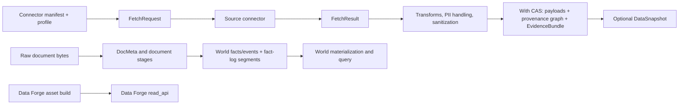

# Data Fabric

Related reference: [Fabric index](../reference/fabric/index.md), [connectors](../reference/fabric/connectors.md), [data plane](../reference/fabric/data-plane.md), [lineage](../reference/fabric/lineage.md), [time travel](../reference/fabric/time-travel.md).

`polisyos.fabric` is PolicyOS's runtime package for connector-backed acquisition,
retrieval custody, document and claim processing, CAS evidence, provenance helpers,
and world-store reads and writes. These are related capabilities with explicit
artifacts between them; they do not form one automatic path from every source
response to a world fact or policy decision.

This explanation describes source behavior inspected at commit
`c35222b3dcf103338175cf300c5fe9487e6416f3`. The named test files were inspected
but not run in this documentation pass; no live provider, deployment, or
end-to-end production workflow was observed. The [Fabric reference index](../reference/fabric/index.md)
maps each artifact to its producer, consumer, and evidence boundary.

## Fabric and Data Forge

| Responsibility | Owner and boundary |
| --- | --- |
| Runtime source access and world-store operations | Fabric owns connector protocols and profiles, fetch orchestration, its evidence and lineage artifacts, document/claim pipelines, and the world-store API. |
| Prepared asset builds and publication | Data Forge owns offline, asset-centric acquisition, normalization, and publication. Fabric is intended to consume selected assets through `polisyos.data_forge.read_api`; the retrieval service has an observed direct import from a catalog batch module, documented below. |

`architecture/packages/boundaries.toml` declares that Fabric may use the Data
Forge read API and forbids `data_forge.kernel` or `data_forge.domains`;
`architecture/imports/policy.toml` allows the broader `data_forge` root. The
Data Forge README describes its runtime-safe entrypoint as
`polisyos.data_forge.read_api`. These are intended boundaries; the Fabric
reference records an observed catalog-domain import exception and domain batch
execution exports through `read_api`, so they should not be read as proof of a
fully enforced narrow runtime matrix.

`read_api` is also not uniformly read-only by export semantics:
`src/polisyos/data_forge/read_api/legal.py` exposes `run_batch_pipeline`, and
`src/polisyos/data_forge/read_api/academic.py` exposes `run_edge_synthesize`.
The import boundary names the intended package surface; these selected exports
retain batch execution behavior.

## The concrete paths

Connector-backed acquisition starts with a `ConnectorManifestSpec` containing
`DatasetFetchSpec` entries. A profile and execution policy configure the source
connector; each request produces a typed `FetchResult` with a payload, schema
and version fields, fetch time, optional source-update time, and declared
quality metadata. Fabric applies the configured transform and sanitization
stages, routes rejected records to quarantine where applicable, and can persist
payloads, a provenance graph, and an `EvidenceBundle` in CAS. The data-plane
orchestrator can then create a `DataSnapshot` that references the evidence
bundle and a primary data artifact.

The document path is a separate producer: raw bytes become `DocMeta`, then
normalization, structure, and chunk artifacts; those stages append document
facts and events to world fact-log segments for later materialization. Claim
extraction consumes an explicit normalized/chunked `DocMeta` artifact and writes
its own claim artifacts and world segment. No generic connector-result-to-claim
or connector-result-to-world-fact bridge is established here. A connector
`EvidenceBundleRef` or `DataSnapshotRef` is not itself a world fact.

`run_orchestrated_ingestion` uses the first source artifact in the evidence
bundle as `DataSnapshot.data_ref`. This CAS `DataSnapshot` is distinct from a
retained world snapshot, which is created from materialized world state for
world-query time travel. Its `fabric.quality_report` records the
ingestion source, dataset count, and evidence notes; this wrapper does not
compute a full content-quality assessment. Use the quality modules and their
own contracts for those checks.

## Keep declaration, custody, and workflow proof separate

| Question | Evidence available in this repository | Boundary of that evidence |
| --- | --- | --- |
| Which adapter and contract are declared? | Connector classes expose a `connector_id`; SourceContract v2 records have a separate `contract_id` and connector reference. `tools/quality/validation/fabric_source_contracts.py::build_conformance_reports` pairs generated contracts with connector classes. `validate_source_conformance_v2` compares the contract's declared connector ID with the metadata's qualified ID and, when set, checks that the class ID is represented. `tests/unit/fabric/connectors/test_source_contract_v2.py` exercises a selected passing pair; `tests/repo_quality/tools/test_fabric_source_contracts.py` expects zero conformance errors for the generated set. Both test files were inspected, not run. | This is bounded declaration-level identity evidence. It does not establish native or stable facade resolution, provider readiness, or the family-level mapping; the [generated inventory](../reference/fabric/best-in-class-inventory.md) row remains `partial`. |
| Was a result returned and persisted? | With CAS enabled, ingestion stores payload artifacts, a `ProvenanceCoreGraph`, and an `EvidenceBundle`; orchestration may add a `DataSnapshot` referring to the bundle and its first source artifact. | Persistence binds bytes and recorded relationships. The snapshot is not a world fact, a merged dataset, or proof of a downstream read. |
| Did a producer reach a consumer? | Document and claim stages have their own artifact, fact/event, and materialization paths; catalog-bound retrieval has a bounded measurement-root consumer. | Coexisting APIs do not connect arbitrary connector results to document/claim or world consumers. The generic connector-result-to-world bridge is `bridge_missing`. |
| Is lineage captured across producers? | Connector ingestion can persist fetch provenance and merge transform lineage when an applicable transform pipeline supplies a tracker. | The downstream materialization, claim, world-fact, and query-result tracker methods have no inspected production call sites. Automatic cross-producer lineage is `bridge_missing`, with `semantic_test_missing` for an end-to-end test. |
| Is an upstream source operational or authoritative? | Fixture-backed unit tests, declared profiles/contracts, local quality checks, and current-fetch comparison provide bounded implementation evidence. | They do not show deployed provider reachability, historical transport occurrence, independent source truth, or a production-ready policy workflow. Those claims remain `not_established`. |

`production_visible` describes the source-platform's declared contracts and
conformance evidence; it is not a deployment health signal. Quality must also
be read by origin: connector-supplied quality and freshness values are source
assertions; `DataQualityValidator` computes checks over the data it receives;
and the orchestration wrapper's `fabric.quality_report` contains only source,
dataset-count, and evidence-note metadata. These layers can support review, but
none turns custody or a contract label into source authority.

## Provenance, time, and trust

Fabric stores references and provenance at several boundaries. Connector
ingestion can persist a `ProvenanceCoreGraph` and link it from an
`EvidenceBundle`. Document and claim persistence records typed CAS inputs, while
world fact emission accepts provenance, evidence references, and valid time.
`FabricLineageTracker` can represent source-field, transform, materialization,
claim, fact, and query-result relationships. A lineage helper or persisted ref
proves only the relationships it actually records; it does not prove that all
producer and consumer paths share one complete graph.

Keep time roles separate. `FetchResult.fetched_at` is the connector fetch time;
`source_updated_at` is a separate optional source-update value. `DocMeta` carries
`retrieved_at`. World queries accept both `as_of_valid_time` and
`as_of_tx_time`. A fetch timestamp does not supply either world-query time.

CAS custody and validation do not make source content scientifically true. A
`FabricFetchReceipt` is explicitly scoped to catalog selection and custody of the
returned result. `resolve_persisted_fetch` reloads the payload, rebinds the plan
to the catalog, and compares it with a current connector replay; its contract
says this does not establish the historical transport occurrence or scientific
truth. Connector-supplied quality, version, and update fields remain typed
source results, not independent measurements.

## When to use this model

Use the [Fabric reference](../reference/fabric/index.md) to find the producer,
artifact, and consumer for a specific path. Use the
[Data Forge consolidation boundary](../reference/fabric/index.md#fabric-and-data-forge)
when the input is a prepared asset rather than a runtime connector fetch. Treat
each workflow's returned artifact refs and admissibility checks as explicit
bindings; do not infer a generic source-to-world or source-to-policy bridge from
the fact that both endpoints exist.

When source behavior changes, update the reference that owns the changed
boundary: connector declarations and contract evidence in
[connectors](../reference/fabric/connectors.md) or
[source platform](../reference/fabric/source-platform.md); CAS outputs and
orchestration in [data plane](../reference/fabric/data-plane.md); world-time
semantics in [time travel](../reference/fabric/time-travel.md); and lineage
production call sites in [lineage](../reference/fabric/lineage.md). A claim
that a bridge is closed needs a consumer test that starts from a producer's
persisted artifact and demonstrates the downstream effect; tracker helper tests
or request-dispatch tests with a patched producer do not establish that chain.
