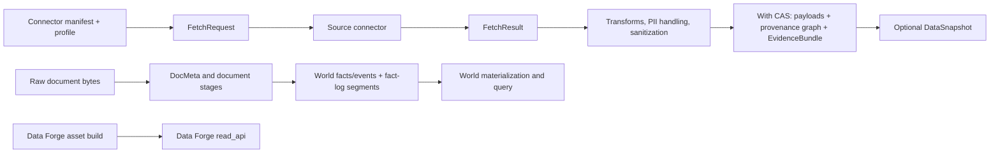

# Data Fabric

Related reference: [Fabric index](../reference/fabric/index.md), [connectors](../reference/fabric/connectors.md), [data plane](../reference/fabric/data-plane.md), [lineage](../reference/fabric/lineage.md), [time travel](../reference/fabric/time-travel.md).

`polisyos.fabric` is PolicyOS's runtime package for connector-backed acquisition,
retrieval custody, document and claim processing, CAS evidence, provenance helpers,
and world-store reads and writes. These are related capabilities with explicit
artifacts between them; they do not form one automatic path from every source
response to a world fact or policy decision.

## Fabric and Data Forge

| Responsibility | Owner and boundary |
| --- | --- |
| Runtime source access and world-store operations | Fabric owns connector protocols and profiles, fetch orchestration, its evidence and lineage artifacts, document/claim pipelines, and the world-store API. |
| Prepared asset builds and publication | Data Forge owns offline, asset-centric acquisition, normalization, and publication. Fabric is intended to consume selected assets through `polisyos.data_forge.read_api`; the retrieval service has an observed direct import from a catalog batch module, documented below. |

`architecture/packages/boundaries.toml` declares that Fabric may use the Data
Forge read API and forbids `data_forge.kernel` or `data_forge.domains`;
`architecture/imports/policy.toml` allows the broader `data_forge` root. The
Data Forge README describes its runtime-safe entrypoint as
`polisyos.data_forge.read_api`. These are intended boundaries; the Fabric
reference records an observed catalog-domain import exception and domain batch
execution exports through `read_api`, so they should not be read as proof of a
fully enforced narrow runtime matrix.

## The concrete paths

Connector-backed acquisition starts with a `ConnectorManifestSpec` containing
`DatasetFetchSpec` entries. A profile and execution policy configure the source
connector; each request produces a typed `FetchResult` with a payload, schema
and version fields, fetch time, optional source-update time, and declared
quality metadata. Fabric applies the configured transform and sanitization
stages, routes rejected records to quarantine where applicable, and can persist
payloads, a provenance graph, and an `EvidenceBundle` in CAS. The data-plane
orchestrator can then create a `DataSnapshot` that references the evidence
bundle and a primary data artifact.

The document path is a separate producer: raw bytes become `DocMeta`, then
normalization, structure, and chunk artifacts; those stages append document
facts and events to world fact-log segments for later materialization. The claim
path likewise persists claim artifacts and writes its own world segment. A
connector `EvidenceBundleRef` or `DataSnapshotRef` is not itself a world fact.

`run_orchestrated_ingestion` uses the first source artifact in the evidence
bundle as `DataSnapshot.data_ref`. Its `fabric.quality_report` records the
ingestion source, dataset count, and evidence notes; this wrapper does not
compute a full content-quality assessment. Use the quality modules and their
own contracts for those checks.

## Provenance, time, and trust

Fabric stores references and provenance at several boundaries. Connector
ingestion can persist a `ProvenanceCoreGraph` and link it from an
`EvidenceBundle`. Document and claim persistence records typed CAS inputs, while
world fact emission accepts provenance, evidence references, and valid time.
`FabricLineageTracker` can represent source-field, transform, materialization,
claim, fact, and query-result relationships. A lineage helper or persisted ref
proves only the relationships it actually records; it does not prove that all
producer and consumer paths share one complete graph.

Keep time roles separate. `FetchResult.fetched_at` is the connector fetch time;
`source_updated_at` is a separate optional source-update value. `DocMeta` carries
`retrieved_at`. World queries accept both `as_of_valid_time` and
`as_of_tx_time`. A fetch timestamp does not supply either world-query time.

CAS custody and validation do not make source content scientifically true. A
`FabricFetchReceipt` is explicitly scoped to catalog selection and custody of the
returned result. `resolve_persisted_fetch` reloads the payload, rebinds the plan
to the catalog, and compares it with a current connector replay; its contract
says this does not establish the historical transport occurrence or scientific
truth. Connector-supplied quality, version, and update fields remain typed
source results, not independent measurements.

## When to use this model

Use the [Fabric reference](../reference/fabric/index.md) to find the producer,
artifact, and consumer for a specific path. Use the
[Data Forge consolidation boundary](../reference/fabric/index.md#fabric-and-data-forge)
when the input is a prepared asset rather than a runtime connector fetch. Treat
each workflow's returned artifact refs and admissibility checks as explicit
bindings; do not infer a generic source-to-world or source-to-policy bridge from
the fact that both endpoints exist.
