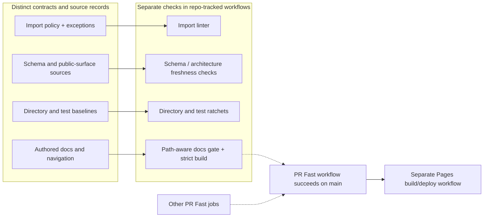

# Freeze Policy

**Owner:** `@platform-owners`

**Source of truth:** `architecture/imports/policy.toml`,
`architecture/imports/exceptions.toml`, `architecture/public_surface/contract.toml`,
`architecture/generated_artifacts.toml`, `tools/devx/architecture/guardrails.py`,
`tools/quality/lint/lint_imports.py`, `tools/quality/validation/check_docs_gate.py`,
`tools/quality/validation/directory_health.py`,
`tools/quality/testing/report_test_ratchets.py`, and the repository-root
workflows named below.

**Source snapshot reviewed:** `bafca83bff9ff49eef1466bc491a8420b5cd1dbb` (2026-10-14).

**Evidence caveat:** these files were inspected at the source snapshot; this
documentation update did not run their validators. No live GitHub
branch-protection or Pages settings were inspected. A tracked validator
establishes only the predicate it checks; it does not prove the north-star
architecture or every capability is implemented.

Related references: [quality gates](../reference/quality-gates.md),
[ratchet policy](../reference/ratchet-policy.md), and
[documentation inventory](../reference/documentation-inventory.md).

Related decisions: [ADR-0004](../adr/0004-architecture-boundaries-import-gate.md),
[ADR-0053](../adr/0053-architecture-freeze-contracts.md),
[ADR-0061](../adr/0061-import-gate-ci-contract.md), and
[ADR-0096](../adr/0096-canonical-product-root-and-workspace-boundary.md).

“Freeze” is shorthand for several distinct, repo-tracked constraints, not one
global state that makes the architecture immutable. ADR-0053 and ADR-0061 are
marked **Proposed**; their normative intent is not itself enforcement evidence.
The current source snapshot contains these separate checks:

| Surface | Tracked rule and check | What the check does not establish |
| --- | --- | --- |
| Import direction | `architecture/imports/policy.toml` and its exception registry are consumed by `tools/quality/lint/lint_imports.py`; the repository-root `.github/workflows/abi.yml` runs the linter. | An allowed edge is not a runtime call graph, nor evidence that a producer's artifact is consumed or admitted. |
| Schema and public/generated contracts | The root ABI workflow checks schema snapshots with `tools/quality/diagnostics/gen_schema.py --check`; `polisyos-tools architecture guardrails check` validates registered public-surface and generated-artifact contracts. | Snapshot and inventory consistency does not prove domain semantics, policy admissibility, or that every listed capability is wired. |
| Docs drift and site build | The root ABI workflow runs the path-aware `check_docs_gate.py` and strict MkDocs build. The gate dispatches evidence checks based on changed paths; the build checks navigability/rendering. | A clean docs gate or build is not a semantic review of every claim and is not a service test. |
| CI ratchets | The repository-root `.github/workflows/ci.yml` runs the directory-health and test-topology ratchets with `--fail-on-regression`. | These ratchet selected measures and baselines; they are not a global architecture freeze or evidence of production readiness. |
| Docs publication | `.github/workflows/docs-pages.yml` rebuilds with strict MkDocs and uploads a Pages artifact after its configured successful-main workflow condition, or on manual dispatch, then invokes the deployment job. | The workflow definition is not evidence that a particular run succeeded or that live repository settings match the checked-in files. |

The source-of-truth workflows are under repository-root
`.github/workflows/`. Product-local
`policy-engine/ops/ci/templates/workflows/` files are reusable templates, not
the workflow files GitHub executes directly for this repository.

## How the controls relate

These controls make selected repository promises reviewable and repeatable. They
do not join into a universal runtime governance flow: a schema or import check
cannot establish a policy claim, and a successful documentation publication
cannot turn a candidate into authority. This distinction matches the failure
register's **P37** (what predicate a gate consumes) and **P38** (whether the
implementation checks the property or a proxy). For current gates and exact
invocations, use the [quality-gates reference](../reference/quality-gates.md)
and the [failure and repair register](../reference/policy-design-case-failure-patterns.md).
