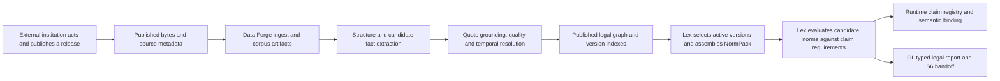

# Lex Pipeline

Related reference: [Lex index](../reference/lex/index.md), [NormPack](../reference/lex/normpack.md), and [Data Forge legal batch](../reference/lex/batch-pipeline.md).
Related boundary: [PolicyOS identity and custody](../system-design-decisions/policyos-identity-and-custody-boundary.md).

- Freshness: 2026-10-14
- Owner: `@data-forge-owners` for offline legal corpus preparation; `@lex-owners` for runtime Lex and its claim-scoped legal assessment.
- Source pin: `bafca83bff9ff49eef1466bc491a8420b5cd1dbb`
- Source of truth: `src/polisyos/data_forge/domains/legal/corpus/**`, `src/polisyos/data_forge/domains/legal/batch/**`, `src/polisyos/lex/**`, `src/polisyos/legal_requirement/_impl/compiler.py`, `src/polisyos/core/contracts/epoch.py`, `src/polisyos/runtime/quality/semantic_epoch.py`, `src/polisyos/runtime/quality/producer_pipeline.py`, and `src/polisyos/runtime/quality/proving_ground/legal_mandate_search.py`; tests listed in [Code-inspected evidence](#code-inspected-evidence).
- Evidence level: implementation and named tests were inspected at the source pin; tests were inspected, not run for this documentation refresh. Their fixtures establish only the paths they exercise; they do not prove completeness of an institution's legal corpus, legal truth, or live issuer authentication.

Lex provides version-aware legal artifacts and claim-scoped legal checks for policy workflows. Offline corpus extraction and graph publication belong to Data Forge. Neither component enacts, promulgates, or authenticates a law on behalf of an external institution. PolicyOS integrates those institutions' releases as evidence, then owns the bounded claims and public projections it issues from that evidence.

## From candidate text to a scoped claim reaction

The stages have distinct authority:

| Stage | What the code produces | What the result establishes |
| --- | --- | --- |
| Corpus ingestion | Raw document artifact, document identity and Lex metadata such as publisher, retrieval time, jurisdiction, `published_at`, and effective dates | Custody of bytes and supplied metadata along the ingest path. The inspected path does not verify an external issuer's signature or prove the source is the complete official corpus. |
| Extraction and grounding | Structural provisions, SPO candidates, quote spans, quality markers, and graph rows | Whether candidate text can be grounded to the processed document and passes the configured quality checks. `grounded_fact` or `normative_fact` is not issuer authentication or legal competence. LLM-produced material remains candidate evidence. |
| Version selection and NormPack | A date-scoped `NormPack`, persisted CAS artifact, world facts, and an `ASSEMBLE_NORM_PACK` event | Which indexed document versions and canonical claims the local assembly path selected for a jurisdiction and legal `as_of` date. It preserves selected input references and algorithm/policy versions; it does not make the source act official. |
| Claim-level legal assessment | `LegalAuthorityRecord` rows, claim anchors, competence-window splits, issue codes, and an aggregate report status | How supplied norms match a particular claim's required authority type, jurisdiction policy, actor, instrument, hierarchy, effective window, and conflict/supersession conditions under the current Lex rule. It is PolicyOS's scoped assessment, not a legal act or external issuer attestation. |
| Amendment-window receipt | `LegalAmendmentWindowDenominatorReceipt` plus a content-addressed snapshot of the local `lex_amendments` owner rows | The complete local amendment-table denominator and its per-row temporal/scope assessments for the query's valid-effect date and knowledge/admission cutoffs. It does not establish that the table contains every relevant act published by an institution. |
| GL mandate handoff | A `Layer3GLMandateAuthorityRecord` that carries Lex record and source refs | A compatibility handoff that requires S6 evaluation. Its `compatibility_only` disposition and empty `s6_evaluation_ref` are explicit; it is not an evaluated legal mandate or a legitimacy verdict. |

The legal authority adapter accepts candidate norm mappings and requirement specs. It checks that `norm_version_ref` and `source_provenance_ref` are present, but a nonempty reference is not resolved there to source bytes, an independent verifier, or issuer credentials. It explicitly returns LLM-labeled candidates as `context_only`; labels and field shape supplied by a caller do not independently establish provenance. A Lex grade such as `admissible` therefore means the record passed this implementation's claim-scoped checks over the inputs it received. It must not be described as verified by the external legal institution.

The amendment-window receipt is stronger and narrower than a report assembled from field presence: `LexEpochBoundaryOwnerAdapter` reloads the complete local snapshot, checks its content address, recomputes the receipt denominator, and reconciles each assessment against those owner bytes before persisting the receipt. This is consumer-side reconciliation against the DTO's assertions, not an independent witness of the Lex data owner's completeness or the institution's source set. Missing owner tables, invalid temporal windows, unresolved scope, or unresolved cutoffs remain typed failures. The receipt's `independently_reconciled` class is bounded to that local owner snapshot.

## Time and replay

Legal effect time and evidence-ingestion time answer different questions. `effective_from` and `effective_to` bound when a provision or amendment applies. A NormPack request's `as_of` is the inclusive legal-time cut used to select an active version. `published_at` can break a tie between otherwise effective versions; a publication date alone does not make a version effective. `retrieved_at` records document retrieval, while fact-log `tx_time` orders recorded facts and artifact pointers. The active-version resolver does not substitute transaction or retrieval time for a missing legal effective window. At the pinned source, however, a malformed nonempty `effective_to` parses to `None` and the current candidate predicate treats it as open-ended. This is an unresolved validation gap, not evidence that the legal window is actually open; the cited versioning tests do not cover malformed end dates.

The amendment receipt preserves three separate coordinates: its valid-effect date, visibility knowledge cutoff, and purpose/admission cutoff. A retroactive amendment can have the same owner snapshot at two knowledge cuts but different dispositions and denominator hashes. The receipt consumer refuses unresolved cutoffs and does not replace a missing legal effect date with the transaction timestamp.

The local NormPack path places jurisdiction, `as_of`, domain, selection/conflict/trust policy IDs, selected document-version IDs, canonical claim IDs, and extraction/conflict algorithm versions into the stable pack identity and metadata. Its CAS manifest carries the provision index, claim-set, conflict-resolution, and trust-assessment inputs; the assemble event records the selected world refs. The test suite checks repeat assembly with the same local inputs and records an assemble event. Static provider output is also supported, but that branch does not carry the same local selected-source lineage, so the local replay statement should not be generalized to every provider. The claim-level authority report uses `lex-legal-authority:v1`; changing rule or input evidence changes the basis of the assessment and requires a new evaluation.

## Admission and custody boundary

`run_requirement_spec_producer_pipeline()` invokes the Lex requirement adapter and places its result in the `lex` compiled interface, then translates report outcomes into producer handshakes. That bridge tracks liveness and binding state; the producer-pipeline authority boundary explicitly excludes legal authority and producer-domain truth. The report mapping is returned by the adapter; that function itself does not persist a separate legal-authority artifact or event.

For policy claims, `build_runtime_claim_registry()` carries legal-authority record references forward. `build_semantic_binding_ledger()` consumes the Lex records and fails when a claim that requires legal authority has no claim-level record. GL composes legal requirement bindings, candidate norms, Lex assessment, and downstream gates; a selected norm without its claim-level record is rejected. The generated mandate record stays `compatibility_only` until a separate S6 evaluation is supplied. None of these consumers turns a source reference or successful DTO validation into proof of the institution's signature.

The custody boundary puts the validity window, rule/version basis, and stale or reissue consequences of PolicyOS's own signed recommendation on PolicyOS. The institution owns its lawmaking or administrative act. PolicyOS integrates that act through typed evidence and claim reactions; it does not take custody of the institution's authority by copying the act into a NormPack. The source paths described here do not demonstrate a complete external-source invalidation-to-reissue cascade.

## Unresolved integration

At this source pin, external issuer authenticity is `not_established` on the inspected legal ingest-to-admission path. The integration still needs an institutionally grounded receipt or equivalent that resolves the named source to bytes, content-binds the relevant release, verifies issuer provenance, and feeds invalidation/reissue into current legal claims. Accordingly, an issuer-verification step is `verification_missing` in this path. Local quote grounding, effective-date selection, a CAS hash, a typed legal record, or an `admissible` grade cannot fill that gap by shape or adjacency.

The inspected code leaves source-set completeness `not_established`: the local amendment denominator is complete over the table it reads, while upstream completeness of that table is not independently reconciled here. GL authority facets include document-metadata derivations and governed-config values for actor, instrument, implementation/fiscal authority, hierarchy, fallback, and some conflict defaults; those values must retain their stated source class and must not be narrated as issuer-verified facts.

## Code-inspected evidence

All source and test links below are pinned to `bafca83bff9ff49eef1466bc491a8420b5cd1dbb`.

- Data Forge ownership and public Lex boundary: [`src/polisyos/lex/README.md`](https://github.com/DenisKopylov/polisyos/blob/bafca83bff9ff49eef1466bc491a8420b5cd1dbb/policy-engine/src/polisyos/lex/README.md), [`src/polisyos/data_forge/domains/legal/corpus/README.md`](https://github.com/DenisKopylov/polisyos/blob/bafca83bff9ff49eef1466bc491a8420b5cd1dbb/policy-engine/src/polisyos/data_forge/domains/legal/corpus/README.md), and [`src/polisyos/data_forge/domains/legal/batch/README.md`](https://github.com/DenisKopylov/polisyos/blob/bafca83bff9ff49eef1466bc491a8420b5cd1dbb/policy-engine/src/polisyos/data_forge/domains/legal/batch/README.md).
- Ingest, effective-version selection, and NormPack assembly: [`corpus/ingest.py`](https://github.com/DenisKopylov/polisyos/blob/bafca83bff9ff49eef1466bc491a8420b5cd1dbb/policy-engine/src/polisyos/data_forge/domains/legal/corpus/ingest.py), [`corpus/versioning.py`](https://github.com/DenisKopylov/polisyos/blob/bafca83bff9ff49eef1466bc491a8420b5cd1dbb/policy-engine/src/polisyos/data_forge/domains/legal/corpus/versioning.py), [`normpack/select_sources.py`](https://github.com/DenisKopylov/polisyos/blob/bafca83bff9ff49eef1466bc491a8420b5cd1dbb/policy-engine/src/polisyos/lex/normpack/select_sources.py), and [`normpack/assemble_pack.py`](https://github.com/DenisKopylov/polisyos/blob/bafca83bff9ff49eef1466bc491a8420b5cd1dbb/policy-engine/src/polisyos/lex/normpack/assemble_pack.py).
- Grounding and temporal admission tests: [`batch/postprocess.py`](https://github.com/DenisKopylov/polisyos/blob/bafca83bff9ff49eef1466bc491a8420b5cd1dbb/policy-engine/src/polisyos/data_forge/domains/legal/batch/postprocess.py), [`batch/publish.py`](https://github.com/DenisKopylov/polisyos/blob/bafca83bff9ff49eef1466bc491a8420b5cd1dbb/policy-engine/src/polisyos/data_forge/domains/legal/batch/publish.py), [`test_postprocess_grounding.py`](https://github.com/DenisKopylov/polisyos/blob/bafca83bff9ff49eef1466bc491a8420b5cd1dbb/policy-engine/tests/unit/data_forge/legal_batch/test_postprocess_grounding.py), [`test_lex_corpus.py`](https://github.com/DenisKopylov/polisyos/blob/bafca83bff9ff49eef1466bc491a8420b5cd1dbb/policy-engine/tests/unit/fabric/test_lex_corpus.py), and [`test_normpack.py`](https://github.com/DenisKopylov/polisyos/blob/bafca83bff9ff49eef1466bc491a8420b5cd1dbb/policy-engine/tests/unit/fabric/test_normpack.py).
- Claim-level authority producer and runtime consumer: [`normpack/legal_authority.py`](https://github.com/DenisKopylov/polisyos/blob/bafca83bff9ff49eef1466bc491a8420b5cd1dbb/policy-engine/src/polisyos/lex/normpack/legal_authority.py), [`test_legal_authority_adapter.py`](https://github.com/DenisKopylov/polisyos/blob/bafca83bff9ff49eef1466bc491a8420b5cd1dbb/policy-engine/tests/unit/lex/test_legal_authority_adapter.py), [`test_lex_legal_authority_surface.py`](https://github.com/DenisKopylov/polisyos/blob/bafca83bff9ff49eef1466bc491a8420b5cd1dbb/policy-engine/tests/unit/runtime/quality/test_lex_legal_authority_surface.py), and [`semantic_binding.py`](https://github.com/DenisKopylov/polisyos/blob/bafca83bff9ff49eef1466bc491a8420b5cd1dbb/policy-engine/src/polisyos/runtime/quality/semantic_binding.py).
- Legal amendment receipt and verifier: [`knowledge/store.py`](https://github.com/DenisKopylov/polisyos/blob/bafca83bff9ff49eef1466bc491a8420b5cd1dbb/policy-engine/src/polisyos/lex/knowledge/store.py), [`semantic_epoch.py`](https://github.com/DenisKopylov/polisyos/blob/bafca83bff9ff49eef1466bc491a8420b5cd1dbb/policy-engine/src/polisyos/runtime/quality/semantic_epoch.py), [`epoch.py`](https://github.com/DenisKopylov/polisyos/blob/bafca83bff9ff49eef1466bc491a8420b5cd1dbb/policy-engine/src/polisyos/core/contracts/epoch.py), and [`test_knowledge_store_filters.py`](https://github.com/DenisKopylov/polisyos/blob/bafca83bff9ff49eef1466bc491a8420b5cd1dbb/policy-engine/tests/unit/lex/test_knowledge_store_filters.py).
- Requirement compilation, producer bridge, and GL mandate handoff: [`legal_requirement/_impl/compiler.py`](https://github.com/DenisKopylov/polisyos/blob/bafca83bff9ff49eef1466bc491a8420b5cd1dbb/policy-engine/src/polisyos/legal_requirement/_impl/compiler.py), [`test_legal_authority_requirement_adapter.py`](https://github.com/DenisKopylov/polisyos/blob/bafca83bff9ff49eef1466bc491a8420b5cd1dbb/policy-engine/tests/unit/lex/test_legal_authority_requirement_adapter.py), [`producer_pipeline.py`](https://github.com/DenisKopylov/polisyos/blob/bafca83bff9ff49eef1466bc491a8420b5cd1dbb/policy-engine/src/polisyos/runtime/quality/producer_pipeline.py), [`test_producer_pipeline.py`](https://github.com/DenisKopylov/polisyos/blob/bafca83bff9ff49eef1466bc491a8420b5cd1dbb/policy-engine/tests/unit/runtime/quality/test_producer_pipeline.py), [`legal_mandate_search.py`](https://github.com/DenisKopylov/polisyos/blob/bafca83bff9ff49eef1466bc491a8420b5cd1dbb/policy-engine/src/polisyos/runtime/quality/proving_ground/legal_mandate_search.py), and [`test_proving_ground_legal_mandate_search.py`](https://github.com/DenisKopylov/polisyos/blob/bafca83bff9ff49eef1466bc491a8420b5cd1dbb/policy-engine/tests/unit/runtime/quality/test_proving_ground_legal_mandate_search.py).
