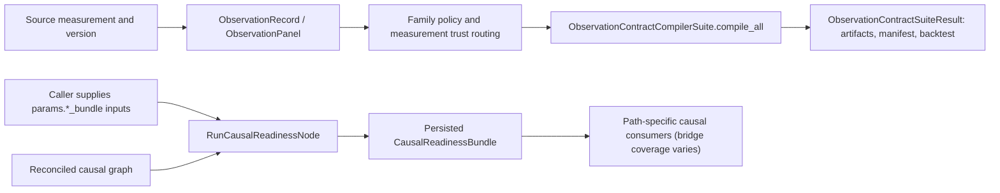

# Observation Contracts

Related: [IR observation reference](../reference/ir/observation.md), [causal validity](../reference/scientist/causal-validity.md), [PolicyOS identity and custody boundary](../system-design-decisions/policyos-identity-and-custody-boundary.md), [Stage-0 custody kernel](../system-design-decisions/stage0-custody-kernel-ratification.md), and the [causal operating-system north star](../system-design-decisions/policy-design-causal-operating-system-north-star.md).

Evidence basis: implementation and semantic-test paths below were inspected at repository pin `bafca83bff9ff49eef1466bc491a8420b5cd1dbb`. The implemented observation contracts describe evidence intake and causal-readiness routing. The post-deployment confirmatory/exploratory learning loop described in the north star is a target, not an established runtime capability at this pin.

## Purpose and boundary

Observation contracts state what a measurement describes, its provenance and scope, and which analysis modes may consume it. They prevent downstream components from guessing trust or identification assumptions from raw values. They do not turn an observation into an institutional act, a causal effect, a mandate, or a public claim.

This boundary follows `S0-K03`, `S0-K05`, `S0-K06`, and `S0-K12`: classify one authority plane at a time; observation and transport do not mint authority; scope must close before authority use; matching bytes do not prove admission. A source’s declaration is evidence to resolve and admit for a named purpose, not a substitute for the PolicyOS owner’s verification.

## Implemented intake and readiness path

The compiler suite and readiness node are distinct stages at this pin. `compile_all()` returns an
`ObservationContractSuiteResult` containing compiled artifacts, a manifest, and backtest material;
it does not return the `CausalReadinessBundle` consumed by `RunCausalReadinessNode`. The node instead
reads caller-supplied `params.*_bundle` payloads plus the reconciled graph and constructs/persists
its own readiness bundle. No SuiteResult-to-node bridge is demonstrated by the inspected source
and tests, so that edge is `bridge_missing`; the diagram keeps the paths separate rather than
implying that compiler output is automatically the readiness-node input (`P01`, `P02`).

`ObservationRecord` in `src/polisyos/ir/observation/contracts.py` carries a schema version, observation family and time grain, period, entity scope, metric and value, coverage, bias and censoring flags, trust weight, source ID and version, regime and schema-regime IDs, identification mode, confidence tier, and optional proxy source. `ObservationPanel` requires records to share family and time grain so a compiler can align them. These types preserve measurement context; they do not themselves establish source truth.

`MeasurementRegistry` in `src/polisyos/ir/observation/measurement.py` maps the source confidence and coverage metadata to a local measurement trust tier. A proxy becomes `derived_proxy`; an `exploratory` source-confidence tier becomes `weak_anchor`; `core` data is `authoritative_high_coverage` only when it meets the family coverage threshold and has no measurement-bias flag, otherwise it is `authoritative_partial_coverage`. Other records map to `administrative_noisy`. Those names are measurement-routing tiers, not the publication-authority band.

`IdentificationModeRouter` in `src/polisyos/ir/observation/measurement.py` selects a family’s primary or fallback identification mode. Low coverage, censoring, measurement bias, or a shock triggers a configured fallback when available. For example, a family may fall back to `bounds_only`; this preserves a bounded candidate result instead of silently claiming point identification. An incompatible explicit mode is reported rather than silently normalized. Compilers then build the typed readiness contracts, and the Scientist `RunCausalReadinessNode` in `src/polisyos/scientist/nodes/builtins/causal/run_causal_readiness.py` persists a `CausalReadinessBundle` and its leaf references for downstream use.

These constraints take effect only when the records are routed, compiled, persisted, and consumed. A `bounds_only` value or `exploratory` confidence label sitting on an `ObservationRecord` is descriptive input; by itself it does not prevent an unsafe effect from reaching a consumer. The readiness artifact and the downstream gate must be present and actually used. The current counterfactual gate’s explicit skip behavior makes this boundary observable (`P01`, `P02`, `P10`, `P32`).

## Consumer behavior and its limit

The counterfactual identification gate in `src/polisyos/scientist/nodes/builtins/causal/counterfactual_identification_gate.py` consumes the persisted bundle when one is referenced. It blocks when the bundle is unreadable or a selected query fails identification checks. It also has explicit skip behavior: if the bundle reference is absent, it records `status=skipped` and lets the DAG continue; if filtering leaves no counterfactual results, it also skips. The gate’s property is to ensure that every caller-declared required query is present and identified before simulation. Its implementation filters bundle entries to required IDs, then checks only the filtered entries; it never compares the matched IDs back to the full required set. Thus, with required IDs `{a, b}`, a bundle containing only identified `a` returns `status=pass` while omitting `b`; a bundle omitting both returns `status=skipped`. A missing bundle reference also returns `skipped`. These are bounded consumer-side divergences (`P38`): the code measures reference/result presence and the identified state of matches, not completeness of the declared required-query set. No semantic test for missing references or missing required IDs was found (`semantic_test_missing`); existing tests exercise identified and non-identified queries that are present.

There is a separate bridge gap in hierarchical policy search. `evaluate_counterfactual_gate` returns a `CounterfactualGateDecision` with `blocked` and `summary`; `src/polisyos/scientist/nodes/builtins/planning/run_hierarchical_policy_search.py` treats that return as a `NodeOutcome` and reads `.state` and `.status`. The live return has neither attribute, so the node-local callback raises `AttributeError` before calling the simulation node, and the search node's own catch set omits that exception. In normal workflow orchestration, `execute_with_retry_sync` in `src/polisyos/scientist/orchestration/engine/retry.py` recognizes `AttributeError` as a runtime error and exposes the exhausted zero-retry case as a generic failed node outcome (`node.retry_exhausted`), rather than the intended typed Stage B `counterfactual_gate_blocked` refusal. The workflow therefore fails before simulation; this is not an uncaught DAG-level exception. The test in `tests/unit/scientist/nodes/builtins/planning/test_run_hierarchical_policy_search.py` mocks the helper with a NodeOutcome-shaped value, so it does not verify the live return contract or the workflow's failure classification. The standalone gate node wraps the decision correctly, but the hierarchical-search bridge is `bridge_missing` and its end-to-end semantic check is `semantic_test_missing` (`P02`). This is a candidate-search/simulation-path integration failure, not evidence of a publication-authority bypass; publication readiness remains a separate claim-level admission boundary.

`RunCausalReadinessNode` returns `skip` when no readiness inputs are provided and does not produce a new bundle; when no prior bundle reference is present, the standalone gate follows its absent-reference skip path. Other claim-level admission rules are separate. For example, the Claim readiness owner requires evidence for high-stakes claim types before publishability. A skipped causal-readiness gate does not establish that a high-stakes claim has adequate evidence or authority; `ok` is not a publishability status.

The test evidence is semantic within each exercised boundary: `tests/unit/ir/observation/test_contracts.py` checks proxy source requirements, finite values, and homogeneous panels; `tests/unit/ir/observation/test_measurement.py` checks trust-tier mapping and fallback routing; `tests/unit/scientist/nodes/builtins/causal/test_run_causal_readiness.py::test_run_causal_readiness_node_persists_bundle_and_leaf_refs` checks persisted producer output. `tests/unit/scientist/nodes/builtins/causal/test_counterfactual_identification_gate.py` exercises present identified and non-identified queries but not the missing-reference or missing-required-ID cases. `tests/unit/scientist/nodes/builtins/planning/test_run_hierarchical_policy_search.py` mocks the gate helper’s return value rather than asserting compatibility with its live `CounterfactualGateDecision` return. These tests establish the paths they exercise, not semantic truth of an underlying causal graph or outcome.

## Exploratory measurements are not the exploratory learning contour

`SourceConfidenceTier.EXPLORATORY` is a source-side confidence classification that maps to `weak_anchor`. It is not the post-deployment exploratory contour in the north star. The target confirmatory contour uses pre-registered, powered, counterfactual-backed observations of predicted variables and updates policy-effect beliefs only after clean attribution. The target exploratory contour searches for unexpected changes under false-discovery control; each anomaly remains a candidate until the confirmatory process grounds it.

At this pin, DDM has delayed-label model-performance monitors, drift detectors, and an `OnlineFDRController` component in `src/polisyos/ddm/calibration/multiple_testing.py`. For example, `monitor_realized_binary_performance` in `src/polisyos/ddm/detectors/realized_performance_monitor.py` emits a model metric event after labels arrive, and `tests/unit/ddm/test_delayed_label_replay.py::test_realized_performance_event_reports_label_delay_and_budget` exercises that producer. `tests/unit/ddm/test_stationary_replay.py::test_stratified_bootstrap_and_multiple_testing_controls_are_available` exercises multiple-testing utilities. These are useful components, but they do not demonstrate a policy-specific causal effect update or an anomaly-to-confirmatory-to-world-model bridge.

The ratified identity document classifies the post-deployment learning loop as GY Phase 6 greenfield. The source and test paths cited here establish useful DDM and observation components, but do not demonstrate the policy-specific confirmatory update or a full exploratory-to-confirmatory-to-world-model chain. This bounded statement is about the cited PolicyOS runtime path; it is not an exhaustive absence claim for external systems or runtime configuration.

## Target contract versus observed capability

| Target or question | Observed state at the pin | Capability label / boundary |
| --- | --- | --- |
| Input measurements retain provenance, time, entity scope, coverage, bias, censoring, regime, source confidence, and identification mode. | Typed record and panel contracts, trust routing, compilers, persisted readiness bundles, and Scientist consumers exist with focused semantic tests. | Implemented for these bounded paths; no claim that record shape alone establishes measurement validity (`P10`, `P32`). |
| Every caller-declared required counterfactual query must be present and identified before simulation. | The standalone gate blocks unreadable bundles and non-identified matched queries, but skips for an absent reference or zero matches; with required `{a,b}` and only identified `a`, it passes the incomplete subset. Hierarchical search receives the helper’s incompatible return type and normal workflow execution surfaces a generic failed-node outcome before simulation. | `bridge_missing` for hierarchical-search integration; `semantic_test_missing` for missing-ref, partial/missing-ID, and live bridge cases; `P02` and `P38` identify the orchestration and property gaps. |
| Confirmatory updates should revise the policy-effect model from cleanly attributed outcomes. | The ratified identity marks this as greenfield; the cited source/test paths contain no demonstrated policy-specific effect-update chain. | `producer_missing` for the target policy-effect update. |
| Exploratory anomalies should remain candidate hypotheses until confirmatory admission, then grow the causal world model under FDR control. | DDM detector/FDR components exist, but the complete candidate-to-confirmatory bridge and world-model consumer were not demonstrated. | `bridge_missing` for anomaly-to-confirmatory orchestration; `consumer_missing` for a demonstrated world-model update reader; `semantic_test_missing` for the two-contour end-to-end behavior. |
| External institutions supply observations, mandates, or decisions. | PolicyOS can consume external records through typed and scoped contracts; it does not perform the institution’s act. | External acts remain `surface_out_of_scope` as PolicyOS functions; missing or contradictory partner evidence must remain a typed limitation or refusal under `S0-K04` and `S0-K06`. |

These labels apply to the target post-deployment learning capability, not to the existing observation intake or DDM components as a whole. The complete learning loop is `absent/unallocated` as a capability chain at this pin: the ratified identity calls it greenfield, and no admitted policy-effect update contract, producer, consumer, or appointed loop owner is evidenced. A useful subcomponent does not supply the missing producer-to-world-model path (`P01`, `P02`). Keep LLM-generated hypotheses at candidate authority until an independent producer establishes their substance (`P05`, `P15`).

## Evidence and limitations

Implementation references are code paths under `policy-engine/src/polisyos/`, named inline above. Observation and readiness tests prove contract validation, routing, persistence, and the gate behavior they exercise; they do not prove causal adequacy, external source authority, or deployment-time effect attribution (`P10`, `P29`, `P32`). The north-star two-contour loop is a design target, while the identity/custody boundary is ratified scope. Both are linked above so their authority is not conflated. The evidence pin is `bafca83bff9ff49eef1466bc491a8420b5cd1dbb`; no conclusion here relies on later uncommitted branch edits.
