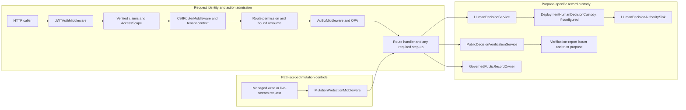

# Security Model

Owner: `@runtime-owners`

Source of truth: `src/polisyos/runtime/http/app.py`,
`src/polisyos/runtime/http/{deployment_security.py,execution_policy.py,jwt_auth_middleware.py,cell_router_middleware.py,authz_middleware.py,authorization.py,mutation_policy.py,access_audit.py,services/human_decisions.py,services/public_decision_verification.py}`, `src/polisyos/core/security/identity.py`, and `src/polisyos/core/artifacts/signing.py`.

Source snapshot reviewed: `bafca83bff9ff49eef1466bc491a8420b5cd1dbb` (2026-10-14).

Evidence caveat: source and test locations were inspected at this snapshot; this page refresh did not run those tests. No deployed identity provider, OPA service, signing key, database, or Runtime configuration was inspected. This page describes code composition, not deployment readiness or certification.

Related references: [auth and tenant model](../reference/api/auth-tenant-model.md), [API error semantics](../reference/api/error-semantics.md), [security and compliance operations](../reference/security-compliance.md), and [current Runtime request lifecycle](../reference/runtime/current-request-lifecycle.md).

Related decisions: [ADR-0097](../adr/0097-runtime-rate-limiting-and-idempotency.md), [ADR-0101](../adr/0101-runtime-audit-trail-model.md), and [ADR-0102](../adr/0102-key-rotation-lifecycle-and-trust-store-policy.md).

Related authority boundary: [identity and custody decision](../system-design-decisions/policyos-identity-and-custody-boundary.md)
and [Stage-0 custody ratification](../system-design-decisions/stage0-custody-kernel-ratification.md).

---

## Security roles are separate

PolicyOS's security code separates four decisions: who the caller is, which
API action that caller may perform, which resources that action is bound to,
and which deployment-owned signer or publisher may custody a durable record.
Authentication or route permission does not establish that a policy conclusion
is admissible. A signature authenticates bytes under a configured identity and
purpose; it does not grant broader policy or publication authority. This
follows the identity decision's §1 signature rule and Stage-0 **S0-K05**,
**S0-K07**, and **S0-K12**: transport, projection, and content equality do not
create authority.

The diagram groups the current owners by responsibility. The mutation-control branch applies only to paths recognized by its middleware, while the custody branches are separate service compositions.

## Request identity and authorization

When the full security chain is enabled, `create_runtime_api_app()` composes `JWTAuthMiddleware`, `CellRouterMiddleware`, and `AuthzMiddleware` in that order. The app's order guard treats a different order as a startup error. The JWT middleware asks the configured identity provider to validate a bearer token and projects verified claims into request state and an `AccessScope`.

`DeploymentIdentityProvider` is built from a strict deployment document. It constrains the OIDC/JWKS issuer, audience, algorithm set, active and revoked key IDs, and cache lifetime. The underlying `SPIFFEIdentityProvider` validates the token's signature and required claims, requires `tenant_id`, maps supported Keycloak-style role claims, checks an optional cell binding, and checks the code-recognized MFA claims for configured privileged roles. These checks identify a caller; they do not authorize a route or authenticate every external service in a deployment.

`CellRouterMiddleware` resolves the authenticated tenant through its configured cell registry and installs tenant context for downstream code. A conflicting `X-Tenant-ID` or a token cell that differs from the resolved cell is rejected. In the full chain the header cannot override authenticated tenant claims. `AccessScope` is request identity context, not evidence that a caller owns a policy claim or may sign one.

Route modules declare action permissions and resource-binding contracts through `authorization.py`. `AuthzMiddleware` consumes the route requirement, binds the resource, and evaluates an OPA input that includes the effective identity, action, and resource. Unsafe routes are checked against the route-authorization contract at app construction and startup. High-stakes actions can add a context-bound, replay-checked step-up dependency; base JWT MFA and route step-up are distinct checks.

The authorization middleware also has a service-delegation path. It validates a signed delegated context, expected service audience, peer SPIFFE identity, and configured trusted issuers. A separate deployment-managed service-principal path binds exact grants to issuer, audience, subject, tenant, and cell. Both paths are separate from a user's bearer token; the presence of a SPIFFE-related type or header alone does not authenticate a service.

OPA and security-dependency failures fail closed in the enforcing path. In supported non-production profiles, configured OPA shadow mode may let a policy denial continue with a shadow-deny response marker; the production profile rejects shadow mode. Do not describe a shadow decision as an enforced denial.

## Mutation controls and audit records

`MutationProtectionMiddleware` is installed by the app factory, but it does not process every HTTP mutation. Its current path predicate manages control-plane POSTs, run-bound predictive-calibration POSTs, and designated live-stream GETs. For managed requests it applies the in-process rate limiter and appends a mutation audit record. Generic idempotency replay applies only where the route does not own the operation intent: the natural-language run and predictive-calibration routes use their typed operation stores instead. Other unsafe routes still rely on their route-authorization contracts and any route-specific controls; they do not inherit generic idempotency merely because the middleware is installed.

The current generic mutation services are local to the Runtime CAS root: rate windows are process memory, idempotency records are local files, and `RuntimeMutationAuditTrail` appends to `runtime/audit/mutations.jsonl`. This is a useful bounded control path, not a distributed limiter or a guarantee of centralized, immutable audit retention.

Runtime authorization and data-access audit are separate writers in `access_audit.py`; the Runtime container stores them under `runtime/audit/access.jsonl`. Authorization decisions use a dedicated sealed append path. The mutation middleware writes a different file. `core.security.audit_sink` and `audit_verifier` implement a separate hash-chained audit facility; their existence does not show that every Runtime authorization or mutation record is routed through that chain. Each writer's failure behavior is also caller-specific: some denial paths attempt audit emission without making audit success a prerequisite for the refusal.

## Signing, custody, and public records

General CAS signing lives in `core.artifacts.signing`. It provides cryptographic operations and trust checks for artifacts, but an artifact signature by itself does not establish the signer's appointment, the artifact's purpose, or authority over a policy claim.

Human-decision custody has a narrower owner. The deployment bundle may contain `human_decision_custody`; that section is optional. When it is absent or invalid, the Runtime container creates a typed unavailable custody result and the human-decision service refuses operations that require it. When configured, `HumanDecisionService` combines the deployment-bound signer, verifier, trust policy, and `HumanDecisionAuthoritySink`; the create route separately requires its action permission and the `HUMAN_DECISION` step-up class. This is a purpose-specific record path, not a general Runtime signing facility.

Public verification reports use another owner, `PublicDecisionVerificationService`, with an issuer key and trust policy scoped to the verification-report purpose. Its `verification_report_only` record authenticates a retained report and document; it does not issue a policy decision or confer publication authority. A governed public policy record is a separate path delegated to `GovernedPublicRecordOwner`. The report signer, human-decision custodian, Runtime caller, and governed-record owner must not be conflated.

## Composition is not deployment readiness

The execution-profile resolver defaults to `dev` when `POLISYOS_EXECUTION_PROFILE` is unset. The `governed` and `production` profiles mark the full security chain as required; the code does not apply that requirement uniformly to every non-development profile. Development fixture identity is opt-in and forbidden outside `dev`. Without the full chain, `FailClosedAccessScopeMiddleware` still rejects non-public requests that lack an access scope; this reduced configuration is not equivalent to verified OIDC plus tenant routing plus OPA authorization.

For a required non-development security chain, bootstrap requires the factory-attested `RuntimeDeploymentSecurity` composition rather than arbitrary direct collaborator injection. Production also forbids authz shadow mode and requires a configured deployment-provenance step-up verifier. These are source-level bootstrap conditions. They do not establish that a running environment has the expected issuer, key set, OPA policy, cell registry, signing material, persistent stores, or operational audit retention.

Even a successfully composed security bundle does not imply that human-decision custody is available, because its deployment configuration is optional. A signed record path is available only when its own trust, signer, verifier, purpose, and sink are configured and its readback checks succeed. Repository code and fixture-backed tests cannot establish those deployment facts.

## Evidence locations

The following test sources exercise representative composition and refusal paths. Their presence is not a test-run receipt for this page or source snapshot.

- Request authorization and tenant binding: `tests/unit/runtime/http/test_runtime_api_authz.py::test_runtime_api_authz_deny_blocks_endpoint`, `::test_runtime_api_denies_cross_tenant_run_access`, and `::test_high_stakes_mutating_operation_without_step_up_is_denied`.
- Profile and provider composition: `tests/unit/runtime/http/test_runtime_deployment_security.py::test_non_development_bootstrap_requires_exact_deployment_security_bundle`, `::test_deployment_identity_provider_rejects_algorithm_outside_declared_set`, and `tests/unit/runtime/http/test_runtime_step_up_authz.py::test_production_profile_requires_configured_step_up_verifier`.
- Human-decision custody: `tests/unit/runtime/http/test_runtime_deployment_security.py::test_human_decision_custody_is_typed_unavailable_when_unconfigured` and `::test_human_decision_custody_signs_and_strictly_verifies_exact_cas`.
- Mutation limits: `tests/unit/runtime/http/test_runtime_api_write_path_hardening.py::test_control_run_launch_replays_idempotent_post`, `::test_control_run_launch_rate_limits_per_tenant`, and `::test_control_mutations_append_audit_trail`.
- Verification-report purpose: `tests/unit/runtime/http/test_public_decision_verification.py::test_issued_record_authenticates_exact_document_without_decision_authority` and `::test_missing_key_or_issuer_purpose_trust_never_authenticates`.

For endpoint error shapes and operations, see the [API error reference](../reference/api/error-semantics.md), [security and compliance operations](../reference/security-compliance.md), [key-rotation runbook](../runbooks/key-rotation.md), and [CAS or OPA outage runbook](../runbooks/cas-opa-outage.md). Those references describe their own contracts and evidence; this page does not claim a live security or compliance posture.
