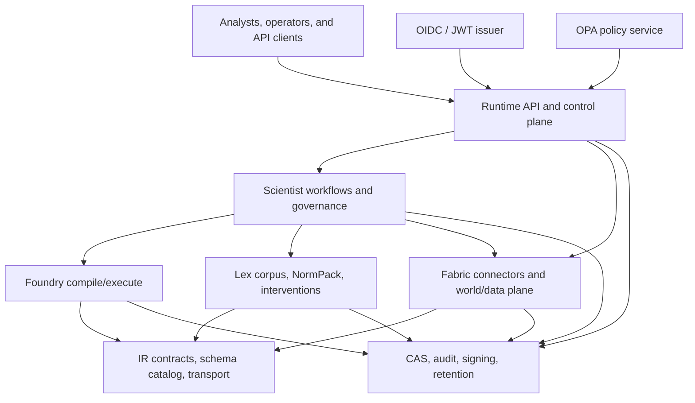

# PolicyOS Documentation

PolicyOS builds a causal operating system for policy. Its ratified identity is
the **epistemic custodian of policy justification**: it owns everything it signs
while their signatures publicly stand, and consumes other institutions' acts as
typed evidence. The [identity and custody boundary](system-design-decisions/policyos-identity-and-custody-boundary.md)
defines that responsibility. The [north star](system-design-decisions/policy-design-causal-operating-system-north-star.md)
explains the wider causal world-model direction; a design target is not a claim
that every runtime bridge is complete.

The implementation maps in this handbook were inspected at source commit
`bafca83bff9ff49eef1466bc491a8420b5cd1dbb` on 2026-10-14. E02 integration was
still underway at that snapshot. Read the
[E02 documentation snapshot](reference/e02-documentation-snapshot.md) for its
scope and later revalidation needs. Source inspection and cited test coverage
are distinct from freshly executed tests or deployment evidence.

## System Context

## Start Here

- [Architecture](explanation/architecture.md) explains responsibilities and the
  boundary between the current implementation and the design target.
- [End-to-end data flow](explanation/end-to-end-data-flow.md) follows one concrete
  producer/artifact/consumer path and its limits.
- [Contributor start here](reference/contributor-start-here.md) routes code,
  contract, documentation and operational changes to their owners.
- [Tutorials](tutorials/index.md) for the first working flows.
- [How-to guides](how-to/index.md) for operational tasks.
- [Reference](reference/index.md) for API, schema, and subsystem contracts.
- [Explanation](explanation/index.md) for architecture, security, governance,
  and data-flow rationale.

- [Runbooks](runbooks/index.md) for incident response and rollback.

## Architecture Packages

| Package                 | Main page                                                                                          | Default evidence                                                                                                                                            |
| ----------------------- | -------------------------------------------------------------------------------------------------- | ----------------------------------------------------------------------------------------------------------------------------------------------------------- |
| System context          | [Architecture](explanation/architecture.md)                                                        | [Platform acceptance audit](reference/operations/platform-acceptance-audit.md), [platform diagrams](reference/operations/platform-architecture-diagrams.md) |
| Contract architecture   | [Trinity](explanation/trinity.md), [IR design](explanation/ir-design.md)                           | [TRINITY contract](contracts/TRINITY.md), [IR schema catalog](reference/ir/schema-catalog.md)                                                               |
| Runtime and security    | [Security model](explanation/security-model.md)                                                    | [Auth and tenant model](reference/api/auth-tenant-model.md), [security compliance](reference/security-compliance.md)                                        |
| Data architecture       | [Data fabric](explanation/data-fabric.md)                                                          | [Fabric reference](reference/fabric/index.md), [lineage](reference/fabric/lineage.md)                                                                       |
| Scientific architecture | [Causal engine](explanation/causal-engine.md), [Governance model](explanation/governance-model.md) | [Foundry reference](reference/foundry/index.md), [Scientist reference](reference/scientist/index.md)                                                        |
| Legal architecture      | [Lex pipeline](explanation/lex-pipeline.md)                                                        | [Lex reference](reference/lex/index.md), [NormPack contract](contracts/E2_9_LEX_NORMPACK_ASSEMBLY_V1_0.md)                                                  |
| Observation contracts   | [Observation contracts](explanation/observation-contracts.md)                                      | [IR observation reference](reference/ir/observation.md)                                                                                                     |
| Freeze and ratchets     | [Freeze policy](explanation/freeze-policy.md)                                                      | [Quality gates](reference/quality-gates.md), [ratchet policy](reference/ratchet-policy.md)                                                                  |

## Operational Anchors

- [Ownership](reference/ownership.md) routes reviews and escalations.
- [Generated artifacts](reference/generated-artifacts.md) describes the durable
  artifact families used by the runtime, Scientist, Foundry, and Fabric.

- [Repository topology](reference/repository-topology.md) is the public map for
  where product files, docs, tests, tools, ops material, data, and runtime state
  belong.

- [Operations reference](reference/operations/index.md) ties diagrams, SLOs,
  retention, and closeout evidence together.

- [Documentation inventory](reference/documentation-inventory.md) tracks the
  bounded documentation census and the historical D0-D5 ledger.
- [Documentation verification](reference/documentation-verification.md) explains
  what the documentation checks actually establish.

## Current source maps

| Question | Start with |
| --- | --- |
| How does an input become a persisted result and a public projection? | [Data flow](explanation/end-to-end-data-flow.md), [runtime request lifecycle](reference/runtime/current-request-lifecycle.md) |
| Which owner acquires or materializes data? | [Fabric](reference/fabric/index.md), [Data Forge data paths](reference/data-forge/current-data-paths.md) |
| Which workflow produces and consumes policy evidence? | [Scientist current workflows](reference/scientist/current-workflows.md), [governance](explanation/governance-model.md) |
| What does compilation or simulation establish? | [Foundry](reference/foundry/index.md), [IR design](explanation/ir-design.md) |
| Where do legal evidence and authority separate? | [Lex pipeline](explanation/lex-pipeline.md) |
| What reaches a dashboard or other client? | [Frontend surface map][frontend-map] |

## Decisions, work in progress and history

The [system-design decision index](https://github.com/DenisKopylov/polisyos/blob/bafca83bff9ff49eef1466bc491a8420b5cd1dbb/policy-engine/docs/system-design-decisions/README.md) routes
ratifications and proposals; the [ADR index](adr/index.md) preserves each
record's declared status. Acceptance of a decision is separate from
implementation evidence. Active and accepted execution plans live in
`docs/plans/`; completed and superseded plans belong in `docs/plans/archive/`.
Reviewed historical evidence belongs in `docs/archive/`. Those repository-only
trees are separate from this published handbook.

[frontend-map]: reference/frontend/current-surface-map.md
