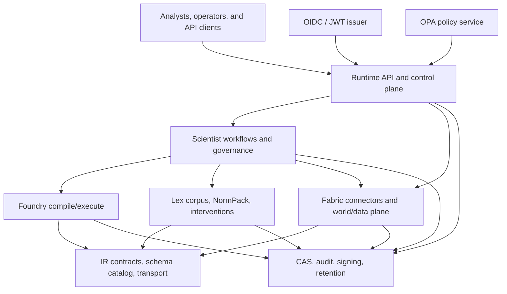

---
search:
  boost: 1.2
---

# PolicyOS Documentation

PolicyOS is designed as a causal operating system for public policy and the
**epistemic custodian of policy justification**. Its [identity and custody
boundary](system-design-decisions/policyos-identity-and-custody-boundary.md)
defines what it owns and signs; the [north star](system-design-decisions/policy-design-causal-operating-system-north-star.md)
describes the wider design direction.

This handbook is a source-inspected map, not an end-to-end acceptance record.
The implementation maps were inspected at source commit
`bafca83bff9ff49eef1466bc491a8420b5cd1dbb` on 2026-10-14, while E02 integration
was still underway. The [E02 documentation snapshot](reference/e02-documentation-snapshot.md)
records the comparison scope and which selected maps need re-review. A source
path or cited test identifies evidence to inspect; it does not mean that a test
was freshly run or that a deployed system was observed.

The system is not functional end to end. The maps below describe bounded,
inspected paths and identify missing bridges. Tutorials are blueprints or
bounded smoke examples, not demonstrations of a complete policy-analysis,
justification, or publication chain.

## Choose a route

| If you need to… | Start here |
| --- | --- |
| Follow one inspected request from input to readback | [End-to-end data flow](explanation/end-to-end-data-flow.md) |
| Change a component or its documentation | [Contributor Start Here](reference/contributor-start-here.md) |
| Check a change | [Documentation checks](reference/documentation-verification.md) or the [contributor task map](reference/contributor-start-here.md) |
| Investigate a failure | [Debug a failed run](how-to/debug-failed-run.md) or [incident runbooks](runbooks/index.md) |
| Perform another operational task | [How-to guides](how-to/index.md) |
| Look up an API, schema, or subsystem contract | [Reference](reference/index.md) |
| Understand the system boundary, design, and tradeoffs | [Architecture](explanation/architecture.md) or [explanations by topic](explanation/index.md) |
| Read a bounded smoke example or draft workflow | [Tutorials](tutorials/index.md); these do not establish end-to-end behavior |

## System context

This diagram shows responsibility and dependency directions. It does not
establish that the full runtime chain is implemented.

## Inspected implementation paths

These links route to inspected maps and subsystem references. The
[E02 documentation snapshot](reference/e02-documentation-snapshot.md) records
the selected maps that need re-review; follow each child page's evidence notes
for its own scope.

| Question | Start with |
| --- | --- |
| How does an input become a persisted result and a public projection? | [Data flow](explanation/end-to-end-data-flow.md), [runtime request lifecycle](reference/runtime/current-request-lifecycle.md) |
| Which owner acquires or materializes data? | [Fabric](reference/fabric/index.md), [Data Forge data paths](reference/data-forge/current-data-paths.md) |
| Which workflow produces and consumes policy evidence? | [Scientist current workflows](reference/scientist/current-workflows.md), [governance](explanation/governance-model.md) |
| What does compilation or simulation establish? | [Foundry](reference/foundry/index.md), [IR design](explanation/ir-design.md) |
| Where do legal evidence and authority separate? | [Lex pipeline](explanation/lex-pipeline.md) |
| What reaches a dashboard or other client? | [Frontend surface map][frontend-map] |

## Maintain the documentation

Use the [contributor task map](reference/contributor-start-here.md) and
[verification contract](reference/documentation-verification.md) together:
select the affected owners, review changed claims, and run the checks for that
surface. An edit date or unchanged source bytes alone does not establish
semantic accuracy. [Ownership](reference/ownership.md) routes reviews;
[generated artifacts](reference/generated-artifacts.md) and
[repository topology](reference/repository-topology.md) identify canonical
locations. The [documentation inventory](reference/documentation-inventory.md)
tracks the bounded census.

## Decisions, work in progress and history

The [system-design decision index](system-design-decisions/README.md) routes
ratifications and proposals; the [ADR index](adr/index.md) preserves each
record's declared status. Acceptance of a decision is separate from
implementation evidence. Active and accepted plans live in `docs/plans/`;
completed and superseded plans live in `docs/plans/archive/`. Reviewed
historical evidence belongs in `docs/archive/`. These repository-only trees
are separate from the published handbook.

[frontend-map]: reference/frontend/current-surface-map.md

For plain-language terms and search prompts, use the [reader vocabulary](reference/reader-vocabulary.md).
The [language policy](reference/documentation-language.md) defines canonical English
and the source-preservation and translation boundaries.
