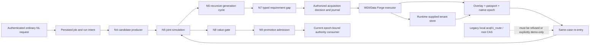

# E02-R2 P Corridor Closure Map

> **For the follow-up implementation lane:** use this map with `PARTIAL_TRIAGE.md`, the cited
> R-class maps, and the current owner code. It is a sequencing/design aid; it does not change a
> finding status or authorize an epoch, receipt, or register transition.

**Goal:** identify, from the complete 118-row partial-finding set, the engineering findings whose
real caller paths enter promotion, acquisition, persisted evidence/custody, or epoch/replay flows;
name their witnesses, owners, and relationship to R1-R14.

**Architecture:** preserve one owner per function. The generation-cycle path carries a candidate
through N4-N9, while only a separately authorized acquisition action can grow the world through
the Data Forge overlay, passport, native epoch, and same-case re-entry. Persisted evidence and
checkpoints must resolve through their existing readers with identity, tenant, version, and time
bindings intact. Similar vocabulary does not create a shared owner or let one finding close another.

**Tech stack:** Python runtime and test owners; typed Pydantic artifacts; tenant-bound artifact
store; Data Forge acquisition overlay and native semantic-epoch qualification; existing HTTP and
Scientist/Fabric consumers.

**Spec:** E02-R2 assignment §§3.1-3.3 and 7.4-7.5; `partial_triage.json` and `PARTIAL_TRIAGE.md`.

## Global constraints

- Run the complete P41 four-base baseline before any product/test repair; do not edit a pinned tree
  while its tests are running.
- Candidate computation may carry a declared unknown. Protected actions, publication, custody
  facts, and authority-producing epochs stay fail-closed.
- Data enters the world only through the runtime-supplied store, Data Forge overlay admission,
  passport, and native epoch qualification; do not make a second world-growth writer.
- A persisted artifact is useful only through its production reader and exact identity/version
  binding; file presence, a status marker, or a package-acceptance count is not a witness.
- Preserve the production-data symlink and read-only boundary. Derived data belongs in job scratch.
- This map is not a plan task: it does not implement GY, DS12, DS13, or DS15 and does not edit the
  debt register or plans.

## Review focus

- An ordinary authenticated NL candidate with no owner substrate context still reaches the existing
  candidate producer and carries a typed unknown.
- A protected request with missing, stale, or foreign intent/EvalSafety evidence cannot downgrade
  into ordinary candidate work.
- A revised cycle keeps the stable design-problem subject separate from the active basis at N7
  re-entry and in persisted receipts.
- WDI live acquisition with no exact growth-bridge selection cannot write evidence through a
  root-rebuilt store or then mint an authoritative WMR.
- Duplicate, corrupted, stale, or historically valid artifacts retain distinct typed outcomes at
  the actual consumer.

## Complete census and inclusion rule

This was a read-only source/design pass at `codex/e02-r2-partial-triage` commit
`a1369b6549420d9e38d16918113fa7a005ee8afa`. The current triage JSON contains **118 unique finding
IDs: 76 engineering (`a`), 16 principal (`b`), and 26 typed blockers (`c`)**. A complete walk of
all 118 rows selected **33 of the 76 engineering rows** below. The other 43 engineering rows are
listed after the tables, so the selected subset is auditable rather than a keyword sample.

The inclusion predicate was applied after reading every `a` row and its current source/owner trace:

1. **Direct frontier relation:** an exact production caller or source operation touches the
   generation-cycle, N7, N13b, acquisition, promotion, or named GY/Atlas surface corridor; or
2. **Adjacent custody/evidence relation:** a persisted identity, tenant binding, source cursor,
   history slice, checkpoint, evidence reference, or candidate-transfer artifact is consumed by a
   real runtime/Scientist/Fabric owner and its card requires a behavioral re-open/replay witness.

The second band is intentionally not called a GY/Atlas crosswalk. Where a path to GY-PR1, DS12,
DS13, or DS15 is not established, the map says so and leaves the row with its existing owner. General
similarity such as “both mention a ledger,” “both use epochs,” or “both involve artifacts” is not an
inclusion edge.

The complete enumeration used for the denominator is reproducible with this small script; its
manual `CORRIDOR_IDS` set is the reviewed output of the source walk, while the script verifies it
against the full current JSON rather than an extracted excerpt:

```python
import json
from pathlib import Path

path = Path("policy-engine/docs/plans/active/agent-packages/PolicyOS_E02R2/partial_triage.json")
rows = json.loads(path.read_text())["rows"]
assert len(rows) == 118
ids = [row["finding_id"] for row in rows]
assert len(set(ids)) == 118
engineering = {row["finding_id"] for row in rows if row["bucket"] == "a"}
CORRIDOR_IDS = {
    "B01", "B02", "B03", "B12", "LA-046", "B15", "B164", "B13", "B16", "B33",
    "B74", "B75", "B76", "B79", "B86", "LA-024", "LA-025", "LA-050", "LA-051",
    "B125", "B126", "B127", "B128", "B129", "B130", "B131", "B132", "B135",
    "B136", "B137", "B166", "B199", "B200",
}
assert CORRIDOR_IDS <= engineering
print("all=118; engineering=76; corridor=33; other engineering=43")
print("corridor:", ", ".join(sorted(CORRIDOR_IDS)))
print("other engineering:", ", ".join(sorted(engineering - CORRIDOR_IDS)))
```

**The script was read against the complete 118-row JSON; no tests, server, production database, or
native/numerical job was run for this map.** The counts do not upgrade package or finding status.

The complete complement of the 33 selected rows inside the 76 engineering rows is **43 IDs**:

```text
B14, B17, B18, B20, B22, B37, B40, B47, B52, B93, B138, B140, B141, B145, B147,
B167, B168, B172, B173, B174, B175, B182, B185, B195, B211, B212, B213,
LA-003, LA-015, LA-020, LA-022, LA-028, LA-029, LA-033, LA-038, LA-039, LA-040,
LA-044, LA-047, LA-048, LA-052, LA-056, LA-057
```

These stay in the full partial triage but lack an exact traced edge to the four corridors under this
map's predicate. The complement includes general DataComposer correctness (B138/B140/B141/B145),
calibration/backtesting/model-estimator behavior (B167/B168/B172-B175/B182/B185/B195/B211-B213),
and independent migrations, facades, and service lifecycles. This exclusion means “no direct owner
edge established here,” not “no dependency exists.” B37 is explicitly not epistemic custody: its
row is FileBudgetLedger snapshot atomicity; the DUR-01 policy-justification-ledger lifecycle is a
different owner obligation.

## Runtime path map



The two dashed/solid seams matter: a candidate may proceed with declared unknown substrate scope;
world growth requires the canonical admission chain. An N7 route record, a candidate artifact, or
an `acq01_route` payload alone is not an admitted world update.

## Direct frontier and R-class intersections

| Finding | Existing R class / owning function | Production caller and file handoff | Behavioral witness required; remaining capability label | R-fix relationship |
| --- | --- | --- | --- | --- |
| **B01** | **R1/R5**; Runtime HTTP composition and generation-cycle owner | Authenticated NL `process_nl_job` → `run_lifecycle` → existing N4 producer. | Served ordinary input with no Python-created `CycleSubstrateContext` reaches the producer; typed unknown is read back by the caller. Foreign candidate/model, unresolved data, and protected mode still refuse. **`bridge_missing`** until the server-owned candidate path is composed. | The R1/R5 shared run-intent/context bridge can close this row only if its positive served candidate witness and protected negative cover the B01 discriminator. |
| **B02** | **R1/R5**, with an R13 same-file lease boundary | HTTP → recursive dispatch → leaf N6 → N4/N5/N8; the actual call chain is mapped in `R1_TRUSTED_BAND_MAP.md`. | Carry one resolved identity through recursion; mutate DesignProblem, WMR, or catalog version and observe refusal at the consumer. Keep absent sources absent. **`bridge_missing`** plus the exact binding semantic witness. | R1/R5 must carry the context and typed unknown; R13 separately owns N7 re-entry identity and its source-store lease. Neither closes the other's binding. |
| **B03** | **R1/R5**; N5 joint request assembly | Same HTTP/recursion path; `GenerationCycleController` invokes the existing N5 owner. | Actual candidate + atoms + WMR + outcomes + horizon + budget form a serializable request; ordinary request reaches N5; one changed material binding refuses; unknown parameters remain typed gaps. **`bridge_missing`**. | R1/R5 can own the same request route; count B03 only with its own behavioral N5 witness, not from candidate-front-door passage. |
| **B15** | **R1/R5 adjacent**, CYC-05 recursion owner | HTTP recursion owner → recursive generation-cycle controller. | Two distinct children and parent edges reach recursion; forced budget stop retains obtained output and marks incompleteness; one-child control remains usable. **`semantic_test_missing`**. | R1/R5 supplies the same admitted route and context, but the bounded-recursion criterion needs its own witness; it is not implied by fixing R1/R5. |
| **B12** | **R13**, ACQ-01 / N7 store and legacy-route class | Served WDI: `AcquisitionActionService.handle_job` → `WorldBankWDIAcquisitionExecutionPort` → `AcquisitionWorldGrowthBridge.admit/resume`; in-cycle N7: `GenerationCycleController.run` → `_run_n7_acquisition_if_requested` → `_rebuild_n7_acq01_route_context`. | Production-scope local `acq01_route` cannot rebuild a WMR or rebind an atom; selected WDI uses the exact runtime store, passport and native epoch, then re-enters the same tenant/case. Positive served witness plus negative local-route probe. **`producer_missing`** for a production ACQ-01 route; WDI chain separately needs **`verification_missing`**. | R13 can close the root-store/legacy-authority regression and preserve the existing WDI route. It cannot invent the absent ACQ-01 producer or claim positive ACQ-01 world growth. Keep those as distinct residuals. |
| **LA-046** | **Independent DataRequirementCompiler finding**; R13 has a shared `generation_cycle.py` lease, not this finding's semantic defect | `GenerationCycleController._run_n7_acquisition_if_requested` → `_n7_data_requirement_specs` → `DataRequirementCompiler.compile` → closed-loop consumer. | Pair opaque scenario IDs and negative housing/rent wording; explicit named pilot profile remains UA/2022-02-01, generic national/annual remains unresolved; run the real compiler through N7 fallback into the existing consumer. **`semantic_test_missing`**. | Sequence after R13 because of the shared file. It touches GY-N7's compile-all-gaps operation. The corrected crosswalk removes its former N13b/DS15 edge: this row does **not** close or advance B12. |
| **B164** | **Independent FUN-03**, not GY-PR1 | `run_policy_blueprint_runtime` assembles the Scientist funnel and invokes `Level6PromotionStage`; owner stage then invokes its effect-capable runner. | `no_promotion`, `reduced_judge`, and `auto_cap` each prevent effect-capable execution; change ticket/authority after preparation and prove commit rechecks; preserving allowed callback runs once. **`verification_missing`**. | No R-class closure. Although the class name says promotion, this is a different promotion owner from GY-N9 and does not close GY-PR1 or DS12/DS13. |

### Direct relationship ruling

The corrected owner-scope crosswalk establishes B02→GY-N4/N6, B01/B02→GY-N6,
B02/B03→GY-N5, B02→GY-N8, B15→GY-N6, LA-046→GY-N7, and B12 conflicts with GY-N13b and Atlas
DS15. These are **touches/conflicts**, not closure signals. LA-046's ACQ-01 package inheritance was
an incorrect relation and is removed. B12's local route conflicts with the canonical
N13b/DS15 overlay-passport-epoch chain. B164's generic word “promotion” is not a GY-PR1 edge.

## Adjacent artifact, data, and tenant-custody paths

These rows matter to input integrity, replay, or candidate generation, but the reviewed source path
does not establish a direct GY-PR1/DS12/DS13/DS15 relation. Treat them as separate owner follow-ups;
do not inflate the frontier crosswalk from file-name or vocabulary overlap.

| Finding | Existing owner / production caller | Required behavioral witness | Remaining capability label; R-fix relationship |
| --- | --- | --- | --- |
| **B13** | Foundry `AsyncChainExecutor`; the unit owner is `tests/unit/remediation/test_res_03.py`. A served result-reader caller is not established by this map. | A simulation node completes, a later independent stage fails, and the ordinary user-facing reader still retrieves the successful artifact with scope, failure stage, and basis/retraction semantics. Removing only the retained ref while keeping markers makes the served read fail. | **`semantic_test_missing`** until the user-facing consumer is named and witnessed. No R1 or GY-PR1 closure; same-file appearance in `generation_cycle.py` is not a caller edge. |
| **B16** | EMP scope/profile L1 loader owner; current card names the loader, but a served caller is not established by the source census in this map. | Scoped rows survive sort/LIMIT/aggregation; task measurement semantics and identity reach the consumed rows; mixed units do not average without a declared rule; sparse rows remain incomplete; supported-profile control. | **`semantic_test_missing`**; independent EMP-01 owner. The actual caller must be named before a mechanism is added. |
| **B33** | EMP/CAS graph-bridge owner; served consumer not established here. | Two causal models with same variable labels/marginals but different edges cannot receive the same transport certificate from a name-only template; absent structural evidence stays unresolved. | **`semantic_test_missing`**; independent EMP-01 owner. Does not become world-growth admission just because the bridge refers to a CAS graph. |
| **B74** | Foundry `CheckpointingChainExecutor` / `ChainCheckpoint`, consumed by resumed chain execution (`tests/unit/remediation/test_res_04.py`). | Warm replay equals cold execution for the same request; each scientific input/seed/snapshot/binding/version change invalidates; timeout alone may reuse; invalid completed prefix is rejected and surfaced to consumer. | **`semantic_test_missing`**; independent RES-04. No R2 linkage established: this is a separate checkpoint owner and is not the generation-cycle strangle receipt. |
| **B75** | Same checkpointed chain producer/reader. | Resume preserves distinct prior node outputs, seed, runtime, and version; missing legacy history becomes a typed limitation; final state remains usable by the served consumer. | **`semantic_test_missing`**; independent RES-04, no current R-class closure. |
| **B76** | `CheckpointingChainExecutor` sidecar manifest and `ChainCheckpoint` loader. | Structural path plus generation distinguish `['a_b']` from `['a','b']`; loaded content hash, shape, dtype, and path binding agree; failed new save leaves previous manifest/artifact readable. | **`semantic_test_missing`**; independent RES-04. Keep sidecar-specific CAS identity distinct from R9 multi-view blob semantics until a consumer demonstrates overlap. |
| **B79** | Served `POST /data/ingest` → `RunLifecycleService.run_data_ingestion` → Fabric `run_batch_incremental`/`modes.py` → connector request. | Admitted persisted cursor reaches the real connector as `incremental_since`, advances only after source progress; unverified legacy cursor sends no hint and cannot advance. Remove cursor injection but keep markers and the positive must fail. | **`verification_missing`**. Wait until R13 freezes because the request path must retain the runtime-supplied store. R13 is a prerequisite, not B79's served witness. |
| **B86** | Fabric streaming sanitizer and declared-source-schema owner, through the real ingestion consumer. | Same rows at multiple technical batch sizes have identical membership; malformed required field/type/non-finite metric refuses; absent optional field is allowed without erasing schema. | **`semantic_test_missing`**; independent ING-03. No R13 closure unless the actual WDI caller is the measured consumer. |
| **LA-024** | Scholar seed-fetch and search-fetch callers → common raw transport/admission owner. | Through both callers preserve bytes/final URL/headers/redirect history; allowed URL succeeds; blocked initial/redirect targets, loop, timeout, oversize, MIME/license/hash cases behave distinctly. | **`bridge_missing` + `verification_missing`** for shared transport. DNS/SSRF admission remains a separate `not_established` property. R7's no-health-probe repair protects its governed WDI journal; it does not close Scholar redirect/DNS checks. |
| **LA-025** | Existing catalog-snapshot CAS resolver and acquisition reader. | A retained v1 ref returns those exact bytes without network access; same-URL v2 remains distinct; missing/denied blob yields typed gap or explicit new-lineage refresh; consumer preserves source identity. | **`semantic_test_missing`**; independent SCL-03 producer-handshake gap. Catalog snapshot lookup is not N13b overlay admission. |
| **LA-050** | `ManifestRegistry`/DatasetManifest identity owner, used by the operational migration CLI and DatasetManifest validator. | Legacy/current aliases alone and together (equal/conflicting), unknown/missing fields, supported versions, JSON/YAML/default target, input isolation, and error type all retain historical-profile handling; parse success is not admission. | **`verification_missing`**; independent MIG-04. Does not get closed by R3 historical promotion serializer work. |
| **LA-051** | S10 calibration consumer and an as-yet-to-be-identified compatible calibration producer. | First census producer and exact consumer; same path binds observed numerator/denominator, rule/report version, scope, and times from producer to consumer. If no compatible producer exists, preserve `predictive_only`/`bridge_pending`. | **`bridge_missing`** until the producer-consumer pair is named. This is not R2 historical replay and not authority to claim empirical outcome updating. |
| **B125** | Scientist strategy state serializer and Python RNG owner; consumed by the existing search strategy restore path. | Persist/restore the actually used Python RNG and prove next candidate equals uninterrupted run; malformed state returns typed failure, never reseeds silently; wrapper RNG stays in the same lease. | **`semantic_test_missing`**; separate search replay. No R8 lease closure without proof that this is the same guarded production store/fence. |
| **B126** | Scientist Sobol sampler stream and checkpoint/restore owner. | Same logical indices requested as one batch/chunks before/after restore yield identical points; persisted identity includes seed, space, backend/version, cursor; sequence does not restart per chunk. | **`artifact_missing` + `semantic_test_missing`** if the checkpoint does not persist the full sampler identity; verify at its actual search consumer. No shared GY epoch is claimed. |
| **B127** | Scientist optimization effective-action canonicalizer/deduplicator before pending/selection. | Integer/categorical-equivalent normalized inputs deduplicate before selection; distinct continuous actions and explicitly requested replicate IDs remain separate. | **`semantic_test_missing`**; independent OPT-02. No R9 artifact-manifest closure unless a real shared-store collision is measured. |
| **B128** | Transfer score snapshot writer, restore owner, and the actual served transfer consumer. | Compatible snapshot round-trip retains every selected row and ArtifactRef; schema mismatch/unknown candidate gives typed refusal, not empty map; consumer sees the same references. | **`semantic_test_missing`**; separate TRN-01 handoff. Candidate-support data is not itself promotion evidence. |
| **B129** | Transfer-index discovery → history reader. | Carry the verified ArtifactRef/version without second ANN; >1,000 distractors and changes to `top_k` do not change addressability; corrupt/unavailable refs never substitute similar history and remain distinct statuses. | **`bridge_missing` + `semantic_test_missing`**; separate TRN-02, no R2 historical-run replay linkage established. |
| **B130** | Scientist transfer candidate ranker → warm-start selector. | Two candidates reverse rank between minimize/maximize after declared score normalization; bounded transfer selects the right one in both modes and carries the exact selection basis to the consumer. | **`semantic_test_missing`**; separate TRN-01. An objective-direction error in candidate support does not prove promotion authority is involved. |
| **B131** | Transfer score compatibility resolver → task-bound warm-start consumer. | A same task/metric/parameters/context can transfer; mutate each bound field while keeping the similarity label and require refusal at the consumer. | **`semantic_test_missing`**; separate TRN-01. This is content/task identity, not the GY epoch identity contract. |
| **B132** | Backward warm-start benchmark producer → source-run lineage reader. | Transfer the original benchmark and source-run refs with purpose; missing lineage is typed gap; a copied score is never relabeled independent evidence; read it back through warm start. | **`artifact_missing` + `semantic_test_missing`** until source lineage reaches consumer. Separate TRN-01. |
| **B135** | Transfer task-family/domain resolver → execution-owner boundary. | Nested `task_family`/`domain` survive object and mapping inputs; explicit authorized override works, absent-only fallback works; transfer never changes execution-owner tenant authority. | **`semantic_test_missing`**; separate TRN-03. Tenant-specific hints do not establish world tenant custody. |
| **B136** | `LessonQuery` local/transferred hint consumer. | Keep `source_run_id`, `source`, and `min_confidence`; a 0.2 hint cannot satisfy 0.8/LOCAL; a genuinely allowed transferred hint still returns without unnecessary materialization. | **`semantic_test_missing`**; separate TRN-03. No candidate authority is granted by returned hints. |
| **B137** | Lesson access accounting and trust-evidence owner across cold/warm/restarted reads. | Lookup/access metadata cannot restore confidence or local trust; only a new verification event creates a new trust version; consumer continues rejecting old low-confidence card. | **`semantic_test_missing`**; separate TRN-03. Do not confuse access time with evidence epoch. |
| **B166** | Scientist `BacktestOrchestrator` → `OutcomeMasker` → historical-slice reader/request. | Materialize/address exact immutable allowed slice and send its identity into the Scientist request; cutoff `[1,2,900,901]` at 2 and absent `intervention_step` stay excluded; unknown slice basis is a typed limitation; verified pre-cut slice is control. | **`bridge_missing` + `semantic_test_missing`** for slice identity to request. This is a history/time-boundary follow-up, not the GY-O1 deployed updater. |
| **B199** | Existing Foundry uncertainty interval identity/aggregation owner; downstream decision consumer must be named. | Same interval ref twice stays the same evidence/type/level; genuinely distinct refs stay distinct; incompatible credible/confidence intervals refuse absent an owner conversion; consumer preserves the distinction. | **`semantic_test_missing`**; independent UQS-01. A possible effective-independence input to promotion is only a hypothesis until the N9 consumer edge is traced. |
| **B200** | Existing uncertainty evidence-independence aggregator; downstream decision consumer must be named. | Duplicate effect under one evidence ref does not increase effective n/rank; adding independent refs changes supported contribution; unique denominator and independence basis reach consumer. | **`semantic_test_missing`**; independent UQS-01. Do not count this as GY-PR1 evidence admission absent an exact producer-to-N9 route. |

## What can land with R work, and what stays separate

| R/finding sequence | Partial rows it can close or unblock | Boundary that remains |
| --- | --- | --- |
| **R1/R5 shared run-intent and candidate/authority bridge** | B01; B02; B03, if each positive and negative is demonstrated through the served caller. It also supplies the context in which B15's recursion witness can run. | B15 still requires the bounded-child/budget semantic test. This does not close GY-PR1, produce an owner substrate context for protected authority, or establish a positive S8 chain. |
| **R13 root-store and N7 route strangle** | B12's local-route refusal/non-authoritative marking and exact supplied-store custody. It is an explicit prerequisite to B79's served ingestion witness. | B12 retains `producer_missing` until an actual production ACQ-01 producer exists; current WDI route is not that producer. R13's subject/basis re-entry witness still must pass. B79 needs its own cursor-positive/negative served result. |
| **LA-046 after R13's `generation_cycle.py` lease** | LA-046 can reuse the same existing N7 caller and shared file ownership. | Its inference/profile and real compiler-to-consumer witness are distinct; file touch or B12 closure does not close LA-046. |
| **R2/R3/R4 history and verifier repairs** | No listed P row is closed merely by serializer/strangle/checker fixes. B74-76, B125-129 and B166 have their own historical identity contracts and consumers. | Re-run their specific tests only if the source write set intersects them; do not infer broad history/custody closure from R2/R3. |
| **R7/R8/R9/R10 transport, lease, CAS, signature repairs** | LA-024 has a narrow shared network-admission adjacency to R7; some separate evidence consumers may use CAS/signatures. | R7 doesn't prove Scholar SSRF/DNS; R8 doesn't establish checkpoint/lesson tenant fencing; R9/R10 don't close refs until the corresponding typed view/ID path is exercised by the named consumer. |

## Recommended implementation order after the current P41 freeze

1. Finish and freeze the four-base baseline before source or test edits.
2. Land/replay **R1/R5** at their shared file leases, then close B01-B03 only from the served
   ordinary-candidate and protected-negative witnesses. Keep S8 authority conditioned on its own
   owner context.
3. Land **R13** with two disjoint probes: (a) local N7 route cannot mint/rebind an authoritative
   world in production scope; (b) exact WDI bridge uses the runtime-supplied tenant store through
   passport, native epoch, and same-case re-entry. Include the no-bridge/no-selection fallback
   branch in the full store census.
4. After R13 releases `generation_cycle.py`, run **LA-046**'s real compiler-to-N7 consumer witness;
   do not inherit ACQ-01's `producer_missing` status or label.
5. Run the **B79** served cursor pair and removal probe after the R13 storage route is frozen; run
   B86 in the same Fabric owner only if the four-base path and runtime caller are admitted.
6. Schedule the remaining independent rows by their consumers: promotion callback (B164), source
   transport/cache (LA-024/025), dataset manifest migration (LA-050), checkpoint/history (B74-76,
   B125/126/166), search transfer (B127-132/B135-137), and uncertainty/calibration (B199/200,
   LA-051). These are not extra GY/Atlas plan tasks.

At each second same-class finding, use P40: expand the shared mechanism or declare the bounded
residual and run its falsifier. Do not continue filing instance patches under one row.

## New-class candidate and bounded falsifier

The root acquisition-flow audit reports one **unconfirmed** DS15 movement-window candidate:
`AcquisitionMovementService.project_row` asks for a 1,000-event append prefix and can return
`invalid_source` at exactly 1,000 before searching a later matching movement receipt. This is not
an R13 storage class and is not an E02 merge regression by current evidence. It stays a candidate,
not a finding or closure claim.

**Falsifier before opening a new class:** on a read-only source census, establish whether
`ControlPlaneStore.list_diagnostic_events` can contain the target receipt after the first 1,000
events for one production run, then exercise the real board consumer with an exact 1,000-row prefix
and a matching 1,001st event. If the full-source query proves the receipt is included despite the
bounded prefix or the behavior is unreachable under the caller's retention contract, the candidate
is falsified. If reachable and the board still refuses an otherwise valid per-row movement, record
it as a distinct DS15 movement-denominator class with a behavioral test; do not patch it in this P
map or claim E02 caused it without P41 attribution. [Root audit:
`/Users/deniskopylov/.codex/scratch/e02-r2-acquisition-flow-seam-audit-20260924.md@sha256:fa24d840cd4c6fb485230f435a3787b195c79ee979b0536e1e9eb03819b3ee9a`]

## Pattern pass and unresolved evidence

- **P27/P28:** extend canonical owners; fence the reachable local N7 predecessor in the same change.
- **P29/P32:** exercise the artifact/authority consumer; ref presence, marker strings, path existence,
  and caller-declared booleans do not establish content or custody.
- **P31:** close store and status properties across all sibling consumers, including the no-bridge
  WDI branch and re-entry, not only the exact-selected fixture.
- **P35:** the 33/76/43 counts come from the complete JSON walk, not a keyword search. The list is
  fixed above and fully balances the `a` denominator.
- **P37/P38:** route/config and artifact identity must be recomputed/reconciled; name the divergent
  no-bridge route, same-subject/new-basis re-entry, or historical artifact whose current path is
  missing while its immutable record remains valid.
- **P41:** every live witness is still `UNRUN` here; only the four-base broker may assign a red to
  E02, main, Phase 0, or environment.

**Not measured by this map:** any behavioral test or removal probe; source-history replays; a
production caller for the EMP, served B13, LA-051 calibration, or UQS downstream decision edges;
positive ACQ-01 production growth; real-catalog WDI admission; tenant isolation of the no-bridge
fallback; DS15 movement-prefix reachability. Keep these as `UNRUN`/`not_established` until their
owners supply the named witness.

## Source anchors

Tracked sources read for this design, identified by Git blob so the exact basis is recoverable:

- `policy-engine/docs/plans/active/agent-packages/PolicyOS_E02R2/partial_triage.json@git-blob:611c6cbef221876def624b8c6170010e0eadecf1`
- `policy-engine/docs/plans/active/agent-packages/PolicyOS_E02R2/PARTIAL_TRIAGE.md@git-blob:41620fca52a503b902bd249998f5828b5c32060f`
- `policy-engine/docs/plans/active/agent-packages/PolicyOS_E02R2/R1_TRUSTED_BAND_MAP.md@git-blob:5a5ef522881db46de7c8cc6523d38f5a009ad8e3`
- `policy-engine/docs/plans/active/agent-packages/PolicyOS_E02R2/R13_ROUTE_MAP.md@git-blob:9432132bbe9ed328e2823743ad06a31abd5e0f7a`
- `policy-engine/docs/plans/active/agent-packages/PolicyOS_E02R2/R4_CONTRACT_MAP.md@git-blob:df794504a3a822fdc68cc7518e35828e2b482a9a`
- `policy-engine/docs/plans/active/agent-packages/PolicyOS_E02R2/R14_RATCHET_MAP.md@git-blob:c13460e67ebf13ba36faf077fb38a7c38fce5631`
- `policy-engine/docs/plans/active/layer3-slices/GY-engine-subordination.md@git-blob:9d510e2ee43fd017028542f180008cd2c2aacb37`
- `policy-engine/docs/plans/active/POLICYOS_ATLAS_SURFACE_IMPLEMENTATION_MASTER_PLAN.md@git-blob:21002cfb2805f718ef7e906e8df1c4ecb30c015d`
- `policy-engine/docs/plans/active/atlas-slices/DS15-acquisition-routes.md@git-blob:ccc4a7bd817f43b8053e88a86f9ec0cc4ccc7c42`
- `policy-engine/docs/reference/policy-design-case-failure-patterns.md@git-blob:7f4cc9ab9541a44c26e4648a2c08326e53743492`
- `policy-engine/src/polisyos/runtime/quality/generation_cycle.py@git-blob:65d830f71dccd9c3b1e943e5e132678f7221ed8a`
- `policy-engine/src/polisyos/runtime/quality/acquisition_world_growth.py@git-blob:e5caf4ccb42af91418472269bb052b8cf4db71fc`
- `policy-engine/src/polisyos/runtime/http/services/acquisition_surface_execution.py@git-blob:74bfe81aa16b00561c7650032593bd2be722d67e`
- `policy-engine/src/polisyos/runtime/http/services/acquisition_action_service.py@git-blob:86864be6912c0b6bf8e5312a8231095a1ecf0ee3`
- `policy-engine/src/polisyos/runtime/http/services/control/run_lifecycle.py@git-blob:a3827ed1677df17f09827d479db7510ffdb70e6e`
- `policy-engine/src/polisyos/fabric/data_plane/modes.py@git-blob:7932cd8b5884239b8bbcc7567076edc5797845b0`
- `policy-engine/src/polisyos/scientist/nodes/builtins/decide/run_policy_blueprint_runtime.py@git-blob:0b6832cd6ee46e09a10f3bbdc8972bcbaad22f81`
- `policy-engine/src/polisyos/scientist/methods/search/funnel/level6_promotion.py@git-blob:b77bfbf37c36ee88a562b1323d4eb80e292f7aa0`
- `policy-engine/src/polisyos/foundry/methods/backends/async_chain_executor.py@git-blob:848f9ed69191d3d349db3e09cd742157d6098df4`
- `policy-engine/src/polisyos/foundry/methods/backends/checkpointing.py@git-blob:0273c3e10ccff5e3388002f30fda98fd30dbd1cc`
- Finding-card corpus: `policy-engine/docs/plans/active/agent-packages/PolicyOS_E02_Combined_Agent_Package/source/B_r19_original.md@sha256:9c98584cbfa72996b058abf127f6c689f919a3421cdd563a82c84a7324ab39b5` and `.../source/LA_r09_original.md@sha256:2e13d05d40ab162dba6f1ed495865037bc08fc359a987e7a42c4d445a9b8d727`.

The row-level criteria and current residual labels are from the triage snapshot above. The source
maps add caller/lease detail; the GY and Atlas references above establish plan relations only. The
audit hypothesis cited in the new-class section is separate, scratch-held, and explicitly UNRUN.
