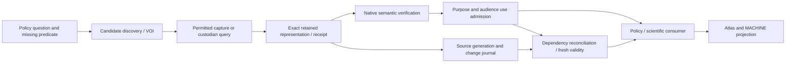

# Integration boundaries and canonical writers

**Goal:** one growing causal and justificatory system, with reusable acquisition and custody infrastructure. The program composes existing owners; it does not create a parallel foundation platform beside PolicyOS.

`R9` in this program means revision 9 of `external-foundations/research-receipt-r9.json`. `INT-R9` is the separate first-promotion research protocol. Files named `R9_PUBLICATION_*` belong to that publication history; they do not prove acquisition/lifecycle R9 acceptance. Keep these identities in every handoff.

## Runtime path

Every claimed workflow handoff has a content-bound identity or lawful receipt and an actual consumer. This does not require persisting prohibited raw payload or every in-process intermediate. Query-only/ephemeral paths retain only permitted minimized evidence; missing replayable bytes remain an explicit replay limitation. Persisting a hash is not permission to retain raw content, nor proof that an unavailable body can be replayed. Discovery cannot promote; CAS cannot grant rights; authentication cannot establish scientific support; Atlas cannot calculate authority. Preseed and runtime capture share the same lifecycle. Reuse resolves exact retained bytes and obtains a new use decision where the purpose, audience, rule or rights change. Unavailable bytes are not an empty dataset.

## Allocation that prevents duplicate implementation

| Boundary | Canonical mechanism writer | Other workstreams' actual obligation |
|---|---|---|
| Candidate/source resolution | CAP-01; existing Fabric/catalog and Runtime acquisition owners | CNT supplies substantive source definitions; UI projects resolution. Neither builds a registry. |
| Network/body capture, exact representation, 304/range/page semantics | CAP-02; Fabric + selected Runtime producer | LIF-03 owns only cursor/frontier commit fencing. CAP consumes that interface; no second cursor store. |
| Semantic assertion → assessment → use relation | LIF-01; native evidence/legal/scientific owner | CAP-03 wires acquisition/library use to that owner; CNT supplies task evidence; GY consumes the admitted relation. |
| Source enrollment, generation, replay and publication cut | LIF-02; Claim Ledger / Decision Validity / publisher owners | CAP-04 emits source-specific events and verifies the acquisition consumer; it does not implement another cascade. |
| Rights-sensitive materialization, copy inventory and restore | LIF-05; existing security/rights/storage owners | CAP-06 wires restricted acquisition; OPS owns deployment/backup topology. Permission facts remain external where applicable. |
| Durable intent, attempts, provider effects and reconciliation | LIF-04; existing ControlPlaneStore/worker | OPS supplies supervised runner composition and operability; CAP-06 supplies provider-specific receipt semantics. One queue/lease/intent owner. |
| Resource admission and reserve | LIF-06; accepted existing permit/quota owners | OPS measures commissioned profiles; all workers request resource tickets. E02 compute permits are reused within their established scope, not mistaken for byte/RSS caps. |
| Derived data, cache and learned influence | LIF-07; Core lineage + actual semantic consumer | GY O1/O2/O3 own learning semantics; CNT owns evidence/selection inputs; no generic causal meaning inferred from lineage. |
| Legal text, applicability and actual institutional act | CAP-05 plus existing Lex relation owner | CNT-04 supplies authentic content/relations; UI shows authorized projections. Signing, court action and legal effect are not fabricated by ingestion. |
| Public/API/generated family | Assigned UI owner for each change to canonical DTO/OpenAPI/client family | Mechanism owners supply fields and representative usage; root serializes generation batches. Never hand-merge generated output. |
| World-model update | GY O1/O3 native owners, after their source gates | LIF provides durable dependency/history machinery; UI DS21 renders cause classes. O2 is separately candidate exploratory work. |

These are **program allocation rules**, not a claim that every named class exists in the future E02 tree. P0 rebinds the exact paths. One task may span several owners when its invariant requires it; reserve those write sets explicitly rather than splitting an atomic mechanism to fit a path quota.

## Interface dossiers, not a universal DTO

Before parallel consumers begin, the assigned writer records the smallest native interface they need. For each dossier, include exact owner/path/symbol, existing schema/rule/version, producing condition, persisted result, consumer relation, refusal/limitation meanings, temporal roles, migration and a distinguishing negative. Values below describe obligations; they are not new enum names or mandatory universal fields.

| Dossier | Required deciding property | Migration / adversarial discriminator |
|---|---|---|
| I01 selected source/intent | Exact selector, source/profile and original candidate basis survive to the real producer | Ambiguous/stale/fake candidate cannot become an admitted fetch. Preserve absence vs null/malformed under native DTO rules. |
| I02 representation/frontier | Receipt-before-frontier; conditional expected head/attempt; body/profile/continuation complete for selected protocol | 304 without retained body, stale A after B, sparse offsets and reset/ABA refuse or remain partial. Old cursor is not automatically upgraded. |
| I03 relation/use | Resolved content and verifier provenance establish the exact proposition, purpose and consumer | Same refs with wrong population/polarity/unit/jurisdiction fail. Historic numeric or reference-only record stays limited. |
| I04 enrollment/currentness | Replay between selected source cut and enrollment; publication participates in owner fence or carries an explicit bounded cutoff | Event-before-enrollment, scheduler down, lagging reverse index and permission race do not produce stale green. |
| I05 copy/right | Every governed writer is enrolled and checks the applicable right at effect/commit | Restore cannot resurrect revoked use; unlink is not physical erasure; delivered bytes cannot be recalled by a status change. |
| I06 external duty | Intent, attempt, external effect and local completion remain distinct | Lost reply after external accept is reconciled; cancel/lease expiry is not proof of worker termination or remote cancellation. |
| I07 capacity | Account for actual RSS/native buffers/spill/fan-in and provider principal; preserve custody reserve | A marker/lease is not enforced memory. Nested parent waits and simultaneous completion cannot deadlock/exhaust reserve. |
| I08 dependency/learning | Bind actual semantic/model/selection/right parents, preserving unknown influence and shared cohorts | More reports from the same cohort do not add independence; adaptive exposure cannot silently become confirmation. |
| I09 public projection | Native authority dimensions, audience filtering and limitations survive API/client/browser/MACHINE | Authentic report is not admissible policy; hidden byte/diff/order/timing surfaces cannot reveal a forbidden fact. |
| I10 operational profile | Effective configuration, actual workers/stores/auth and recovery match the selected deployment | A configured backend or external mode is not live readiness; unsupported topology remains unclaimed. |

## Research decisions versus engineering choices

AD-E02-01–06 and the Fabric N818 decision are already selected architecture inputs; accepted E02 implementation is reused, not reconsidered by default. Native codecs, retry composition, strict DTO presence and wiring defects remain engineering under those owners.

New normative, causal or institutional claims need real supporting inputs or a substantive research decision. A missing rule is not filled by a default. Conversely, engineering choices such as additive owner fields, transaction versus prepare/reconcile in a known persistence boundary, or a measured bounded eager path do not require a new constitutional approval when they preserve the existing meaning.

C03 remains an optional unratified SDD clarification. No task in this plan depends on adopting it. If implementation discovers a genuine contradiction with a binding SDD, return a narrowly scoped proposal to G/human approval, continue unrelated work, and keep the current contract until resolved.

## Compatibility, migration and cutover

Use expand → compatible read/write → semantic validation → dependent consumer migration → retirement. Preserve immutable history and original source time. Do not backfill rights, legal authority, independence, completeness or currentness from a URL, signature, digest or default. Directional reader/writer compatibility is measured by actual needed semantics; unknown optional facets may remain inert, but unsupported required semantics refuse the affected use.

Cutover derives its compatibility classes from the complete affected retained schema/rule versions, supported readers/writers, required semantic facets and selected backends. Cover every distinct supported old→new/new→old direction and each unsupported required-semantics refusal that is claimed; equivalent classes may share a witness only with an explicit equivalence argument. One old/new/incompatible example is a minimum diagnostic, not a sufficient universal acceptance set. Preserve unknown/absent/null/malformed distinctions where native contracts distinguish them. Exercise real producer and fresh consumer; the old route must be demonstrably retired where the plan claims strangling. Rollback preserves newer revocations and correction history. Reversion of application/configuration is operational recovery, not a decision that old authority has become valid again.

## Scope of verification

The shared invariants above are reviewed once at their owner, then each distinct consumer proves that it actually uses them. This avoids both duplicate frameworks and trusting an unwired contract. Final composed replay covers the actual accepted source/input/backend profile after all blocking reviews. Product execution remains UNRUN while this document is being prepared.

## R14 native owner delta

[DES allocation](../workstreams/07-productive-policy-design.md) and [explicit cards](../solutions/13-productive-design.md) extend existing N4/N6, Scientist search/memory, Lex/NormPack and document renderer. CAP-05 owns relation proof; CNT-04 remains case data/config; DES-05 owns generic interpretation composition. DES-06/07 share one document owner; DES-09 supplies shared invocation context while CAP/LIF/OPS retain rights/resources. No duplicate optimizer, scheduler, legal store, memory service or budget ledger. Historical G6 PUBLIC raw-text prohibition and UI-02 data-only practice remain binding.
