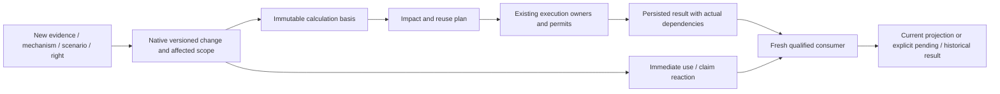

# R16: композиция вычислений и повторное исполнение при изменении оснований

23 октября 2026. Проект реализации после фактической приёмки E02. Исследованный source: `4633fc44df0aedeb3f9989b7a68036349cca2969`; ограниченное статическое чтение, runtime **UNRUN**. Развивает [R15](../research/heterogeneous-model-execution.md), не заменяет исходные GY/Atlas/R9/debt обязательства и не меняет system-design-decisions.

## 1. Выбранный инженерный путь

PolicyOS должен исполнять **версионированную композицию** моделей, методов, преобразований и проверок, а затем объяснять, что требуется пересчитать при изменении её оснований. Это расширение существующих Foundry compile/execute, Scientist search, native method registries, CAS/lineage, epoch/currentness и ControlWorker. Не новый универсальный scheduler, цифровой двойник или второй authority engine.

Разделены четыре отношения, уже имеющие собственных владельцев: execution dependency; происхождение и влияние artifacts; causal/scientific justification; допустимость конкретного использования/публичной подписи. Связи между ними content-bound; одинаковая форма графа не делает их взаимозаменяемыми. Цикл вычисления не доказывает циклическую причинность, а отсутствие execution cycle не доказывает independence.

Предпочтение: (1) native DAG для поддержанных последовательностей; (2) existing fixed-point owner для явно выбранного algebraic coupling; (3) temporal/event adapters для выбранных clocks; (4) incremental reuse только при доказанном predicate. Консервативный clean recompute затронутого scope — обязательный корректный fallback, не поражение free-grow. Не требуется с первого дня инкрементальная версия каждого метода.

## 2. Что именно изменилось

Ниже семантические случаи, а не закрытый product enum. Native profile может комбинировать несколько изменений; неизвестный required effect не получает default «не влияет».

| Изменение | Правильное действие | Запрещённая подмена |
|---|---|---|
| Новые наблюдения, correction/retraction, изменённая выборка | Новый input cut; обновить затронутый estimator/measurement/learning путь; сохранить selection/dependence history | Повторный учёт того же события через другой источник; замена исторического knowledge cutoff |
| Альтернативный механизм политики | Новый structural candidate/program; проверить изменённые targets/ports/обязательства, перекомпилировать затронутый closure | Изменить только parameters старого графа, если изменилась причинная операция |
| Сценарий внешнего фактора | Явная hypothetical branch с forcing/assumption identity и областью применимости | Сделать допущение наблюдаемым фактом, probability или обновлением operative world |
| Новый scientific model/method/backend | Новый executable/profile/guarantee binding; requalification и вычисления по нужному scope | Method ABI, SemVer или совпавший baseline output как доказательство эквивалентности |
| Право, issuer, rule, applicability, currentness | Сразу пересмотреть affected use/claim; численный payload может остаться прежним при отдельном допустимом reuse | Ожидать нового simulation перед снятием устаревшего допуска; green от равенства чисел |
| Другая цель/ценностное основание/аудитория | Переоценить допустимый consumer и сравнение; вычислительные outputs reuse лишь в соответствующей области | Скрытая перенастройка общественных весов, reuse private result в новом public purpose |

Conditioning on observed X, `do(X=x)`, замена structural mechanism и assumed exogenous forcing — разные операции. Scenario X=x не получает автоматически semantics `do`; наблюдение policy announcement не равно фактическому исполнению. Candidate work с declared unknown допустим; actual permission и authority не создаются дизайном.

## 3. Native execution basis и устойчивые границы

Один run связывает необходимые native artifacts: selected program/structure, method/backend executable identities, verified mappings, source/model/rule versions, scenario/initial state, observation и decision cutoffs, numerical/inference profile, resources и relevant use admission. Это отношения между existing artifacts, **не единый мегадокумент с обязательными пустыми полями**.

Computational result identity и current-use decision различны. Content-addressed result может быть прежним, но новым consumer требуется новая проверка purpose/audience/rights/currentness. Численное равенство не прекращает распространение изменения authority или justification. Старый публичный claim остаётся в истории вместе с реакцией своего владельца. Historical custody не обещает бессрочный доступ к запрещённым bytes: lawful retention/deletion rules сохраняются. Если исходные данные или result больше нельзя хранить/читать, owner сохраняет разрешённый факт прежнего решения и deletion/unavailability reaction; exact historical replay становится unavailable, а не подделывается.

До исполнения owner разрешает обязательные facets фактического метода и композиции; после исполнения сверяет actual observed inputs/effects с разрешённой границей. Capability declaration adapter-а — предложение, пока native verifier не подтвердил выбранную property. Unknown required facet ограничивает dependent guarantee; optional facet можно игнорировать лишь если это разрешает его owning contract. Нет whitelist социальных доменов или всех сегодняшних типов моделей. Requiredness вычисляет native composition verifier по content-bound versioned contracts выбранных producer, consumer, adapter и заявленной numerical/scientific guarantee, а не по списку, который adapter прислал сам. Adapter не может снять consumer requirement пометкой optional; противоречие или неизвестная obligation ограничивает зависимое утверждение. Конкретные native refs/versions и verifier owner фиксируются при accepted-source rebind; новая central facet enum не вводится.

## 4. Последовательности и разные циклы

| Форма исполнения | Native решение | Семантическая граница |
|---|---|---|
| Rule calculation → transform → estimator → simulation → evaluation | Typed ProgramGraph/ExecPlan, explicit producer-slot mappings; независимые nodes могут параллелиться | Method output сохраняет собственный target, unit/support и guarantee; прогноз не превращается в observation |
| Same-time algebraic SCC | Compiler выделяет поддержанный coupling block, внешний execution graph остаётся acyclic; existing fixed-point owner | SCC — вычислительная группа, не causal admissibility certificate; hidden lag запрещён |
| Lagged state transition / event / multi-rate | Native temporal adapter с declared clocks, update/event ordering и observation availability | Solver iteration, model time, event/knowledge time и wall clock различаются |
| Optimization/inference/calibration loop | Native method/search owner; frozen problem + recorded trial/profile; nested resource tickets | Convergence optimizer-а не гарантирует causal validity, global optimum или model adequacy |
| Search → counterexample → acquisition/study → revised candidate | DES-04/DES-12 + existing control/learning owners; каждый новый basis создаёт versioned continuation | Самоподтверждение simulation outputs не является независимым эмпирическим evidence |

Каждый loop имеет свой termination/completeness claim, budget и допустимые side effects. Нельзя flatten research rounds, numerical iterations и physical steps в один counter. Unsupported SCC не сортируется по node ID; unsupported event synchronization не заменяется случайным порядком worker completion. GYD-30 остаётся владельцем joint result, DES-11 — trajectory adapter, DES-03 — search.

На цикле нужно различать convergence conditional on a frozen sample path и expected-response equilibrium. Warm start после изменения assumptions — только начальное предположение, если selected method допускает его; не готовый result и не право выбирать старый equilibrium. Structural state migration требует verified owner mapping; иначе restart/replay. Multiple equilibria и path dependence сохраняются в выводе. После solve проверяется **actual materialized final result**, а не только сохранённый solver flag. На текущем source feedback callback вызывает весь ExecPlan; выделенный на схеме SCC не ограничивает actual invocation. Preferred extension строит owner-native bound subplan/map closure: upstream acquisition/prefix выполняется до solve и становится frozen boundary input; iterations и final residual исполняют допустимый block; downstream effects/materialization идут после принятого block result. Если callback всё ещё исполняет весь plan, purity/reset/effect/resource denominator включает именно весь actual closure; он допускается лишь при safe repeatability каждого relevant member, иначе profile ограничен/отклонён. Общий invariant проверяет actual call trace, не declared SCC list.

## 5. Согласованный срез и реакция на изменения

Выбранный source cut — набор exact owner-native versions/coordinates, а не один wall-clock timestamp. Внешние источники не образуют общей транзакции автоматически. Если model требует согласованного release или одновременной популяции, selected relation должен подтвердить это; иначе результат условен/ограничен. Независимым inputs не навязывается фиктивная глобальная синхронность.

Capture события и их correction/history сохраняются до coalescing. LIF-02 немедленно отражает invalidation/unknown currentness у affected claims; дорогое recompute может быть отложено existing duty owner. Нельзя debounce-ом стереть revocation, промежуточное protected use или обязательную публичную реакцию. При burst обновлений разрешено объединить redundant вычисления к выбранному более позднему cut, сохранив все значимые события и obligation outcomes.

Readiness frontiers/watermarks относятся к конкретному каналу и progress guarantee. Они не доказывают, что во внешнем мире больше не будет corrections. Late data создаёт новую revision; prior as-of view сохраняется. Lost events/enrollment race устраняются existing replay-between-cut-and-enrollment protocol, а не предположением «мы подписались достаточно рано».

## 6. Selective recomputation без скрытого stale reuse

Предпочтительный алгоритм внутри существующих owners:

1. Resolve changed native identities и affected active uses/selected branch. Заморозить новый basis; origin change и план исполнения сохраняются раздельно.
2. Сопоставить **potential dependencies** (ports, selectors, directory/catalog membership, absence queries, config, model code, rules) с **actual dependencies** предыдущего исполнения. Один старый executed DAG не покрывает ещё не посещённую ветку или появление нового источника.
3. Подтвердить полноту relevant dependency closure. Если adapter читает вне tracked resolver или не может описать dependence, не разрешать fine-grained exact cache hit: recompute conservatively в явно выбранном scope или ограничить claim.
4. Рассчитать invalidation через native lineage/currentness и выбрать demanded outputs. Узлы unaffected остаются reusable; SCC по умолчанию единица numerical invalidation, пока owning incremental algorithm не докажет более мелкую корректность. Stateful temporal chain повторяется от последнего совместимого checkpoint не позже первого affected transition; последующие affected states нельзя оставить только потому, что late observation имеет старую дату.
5. Для каждого выбранного node проверить executable/input/profile/state/randomness/support identity. Exact reuse, numerical warm start, incremental sufficient-statistic update и historical replay — разные операции с разными гарантиями. Delta update разрешён только supported method, с correction/retraction/selection semantics; иначе clean refit.
6. Если recomputed output совпал, pruning downstream допустим только для **эквивалентного consumer input по полному required semantics**, не по одному scalar/hash value. Численно неизменный support/authority/provenance change всё равно достигает relevant consumers. Approximate equality не универсальна: ошибка может накопиться или пересечь downstream threshold; требуется bound/profile либо recompute.
7. Persist result и actual dependency receipt, сверить с planned closure, получить fresh-use qualification. Terminal publication/selection сверяется с intended candidate revision и актуальным applicable owner fence; stale worker может оставить допустимый historical artifact, но не заменить current head.

Evidence content DAG — не достаточное основание statistical independence. Повторный запуск на тех же observations не новый эксперимент; два articles/aggregates могут зависеть от одной выборки. При отсутствии надежной event/likelihood-factor identity повторная assimilation не считается независимой; сохраняется unresolved dependence или выполняется reconstruction из разрешённого исходного набора.

## 7. Retry, resume и новая научная задача

Transport retry сохраняет logical operation intent и использует LIF-04 reconciliation. Новый live response, другой scenario или changed program — новое scientific input/calculation identity, даже если UI просит «повторить». Durable workflow history replay воспроизводит orchestration decisions; оно не является numerical replay и не повторяет автоматически external effect.

Отдельные native records связывают logical request, attempts, selected basis, running/completed result и branch current head. Cancel request не доказывает termination. Новый claimant/epoch не освобождает permit старого процесса до reconciliation; новый run не может считать старый reserved capacity свободным. Устаревший completion проверяется на terminal commit и fresh consumer. Публичная актуальность по-прежнему решается LIF-02, а не этим compute controller.

Периодические обновления должны иметь fairness/deadline policy и bounded coalescing по existing resource owner. Стратегии finish-pinned-run-and-requalify и cancel/restart выбираются по стоимости, новизне и обещанному currentness, не по универсальному debounce timeout. При непрерывных обновлениях система должна выдавать честный as-of/conditional result или pending-currentness, а не бесконечно обещать «сейчас пересчитаем».

## 8. Рост и производительность

Free-grow означает: новая conforming модель/метод/источник подключается через owning registry/profile/adapter и native artifact reader, без central family switch; новый semantic primitive требует ограниченного owning extension, а не лживого label. Проверка добавляет unseen adapter и новую динамическую dependency, затем меняет её content; ни central search edit, ни stale result не допустимы.

Переиспользуются immutable chunks/views и разрешённые bounded checkpoints; вычисления demand-driven, исходы и dependencies не копируются целиком на каждом ребре. Отдельно измеряются read bytes, resident memory, solver states, lineage/index maintenance, external requests и stored outputs. Изменение small chunk может всё равно требовать глобального estimator — объём delta не доказывает sublinear algorithm.

Resource admission охватывает весь nested denominator: scenarios, replicates, Jacobian probes, multistart, surrogate verification, retries, restore/refit, final materialization и CAS writes. Parallelism разрешён независимым nodes/branches и independent oracles; Jacobi/Gauss–Seidel, asynchronous stale iterates и shared RNG имеют разные semantics. Нет отдельного quota owner у каждого nested model.

External calls по возможности завершаются до numerical loop и становятся frozen inputs. Remote pure evaluation требует exact request/result/effect accounting каждого evaluation. Изменившийся input — новый расход, а идемпотентность не бесплатность. Institutional acts не входят в solver loop. Tenant/purpose isolation действует и для cache existence/timing, lineage и scenario labels.

## 9. Границы выбора и реализации

Эти решения конкретизируют existing ownership и honesty rules. Новый SDD нужен только при фактическом изменении общих authority/time/identity semantics или public promise за ратифицированной границей; здесь SDD не меняются. Numerical/method profiles выбираются по case; не требуется одновременная поддержка FMI, HELICS, probabilistic programming и каждого inference family.

Открытые внешние inputs — actual models/licenses, target/measurement/calibration/transport grounds, incumbent facts, laws, rights, institutional execution records. Их отсутствие не оправдывает отсутствующий внутренний bridge, но ограничивает dependent substantive claim. Полная цепь, stage-qualified delivery и falsifiers находятся в [implementation slices](../solutions/16-composed-execution-and-revisions.md) и [assurance](../assurance/10-composition-reexecution-quality.md).

Pattern pass: P01/P02/P03/P04/P05/P07/P08/P10/P13/P14/P17/P24/P25/P27/P29/P31/P32/P35/P37/P38/P40. Главные классы: одинаковые numbers при другом смысле; untracked/dynamic dependency; циклическая самоподдержка justification; stale completion/current head; cache/restore, обходящие native use admission. Runtime capability после этого документа остаётся not_established.
