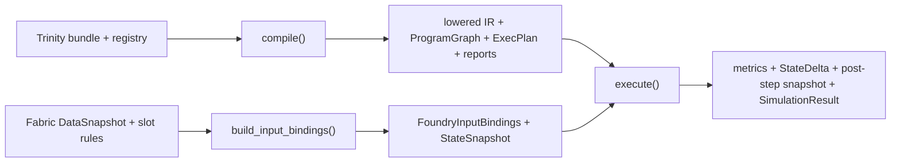

# Foundry Compile and Execute

Related explanation: [Causal Engine](../../explanation/causal-engine.md).

This page describes the current `polisyos.foundry.compile()`,
`build_input_bindings()`, and `polisyos.foundry.execute()` boundaries. A successful
execution records what the compiled program produced from its bound model state
and inputs. It is a model-conditioned simulation result, not an observed policy
effect or causal-validity decision.

Owner: @foundry-owners
Source of truth: `src/polisyos/foundry/compile/**`, `src/polisyos/foundry/data_plane/bindings.py`, `src/polisyos/foundry/execute/**`, `src/polisyos/scientist/nodes/builtins/compile/compile_foundry.py`, `src/polisyos/scientist/nodes/builtins/simulate/run_simulation.py`, and the linked tests.
Evidence level: implementation and linked test sources were inspected at the pinned revision; tests were not run for this docs-only update.

Historical freshness receipt: 2026-04-17 (an earlier documentation pass; not a
current verification receipt). Code inspection for this refresh is pinned to
[`bafca83bff9ff49eef1466bc491a8420b5cd1dbb`](https://github.com/DenisKopylov/polisyos/tree/bafca83bff9ff49eef1466bc491a8420b5cd1dbb).

## Runtime path

`compile()` accepts `policy_ref.kind == "ir.trinity_bundle"`. It resolves the
registry bundle, links and lowers the Trinity bundle, then persists lowered IR,
the `ProgramGraph`, `ExecPlan`, slot layout, TreasuryPlan, link report, and
`CompileReport` in CAS. Unsupported or malformed compilation returns a failed
`CompileResult` with a persisted failure report.

`build_input_bindings()` reads a Fabric `DataSnapshot` and registry slot
definitions. It validates explicit rules, or infers mappings from matching
payload paths when rules are omitted, then persists `FoundryInputBindings`, an
input-binding report, and the bound state snapshot consumed by `execute()`.
Unknown slots, duplicate binding IDs, or unavailable required values fail
binding.

`execute()` requires an `ExecPlanRef`, `FoundryInputBindingsRef`, and registry
bundle. It resolves the bound state snapshot. On success, it executes the
program graph, applies its state delta, and persists metrics, the state delta,
the post-step snapshot, and a `SimulationResult` with input/provenance edges.
Max-step, unsupported-mechanism, hard-constraint, or welfare-bound rejection
returns `ExecuteResult(ok=False)` before the post-step snapshot and
`SimulationResult` are persisted. Some failure results can retain intermediate
`derived_refs` emitted before validation; the rejected result has no
`simulation_result_ref`. A missing registry reference or unreadable input is an
invalid request and raises an error.



The downstream boundary is the persisted artifact refs, not in-memory objects.
The Foundry reference facade exposes the same compile/bind/execute sequence to
Scientist nodes. `CompileFoundryNode` stores the compile report and derived refs
in `ExperimentState`; `RunSimulationNode` requires the exec-plan and input-
binding refs, records the simulation outputs, and materializes proof-bridge
artifacts. The basic bridge case covered by its behavior test is `SCENARIO`;
other inputs can produce `BOUNDED` or `BLOCKED`. The current bridge validator
rejects `IDENTIFIED` certification without an admitted producer/verifier. None
of these projections turns a Foundry run into an observed effect. See [Causal
Engine](../../explanation/causal-engine.md) for the separate design-composition
simulator and effect-grounding boundary.

## Optional feedback and source capture

An optional fixed-point `FeedbackConfig` asks Foundry to iterate the compiled
program's model mapping and persist a `FeedbackResult`, iteration trace, and
convergence certificate; configured runs may also persist Jacobian diagnostics
and an equilibrium-multiplicity report. A multiplicity report characterizes
solutions under its declared start/search protocol. It does not turn a model
equilibrium into observed causal evidence.

When `return_selected_profile=True`, compile, binding, and single-step execute
can retain the exact selected CAS manifest profiles. Foundry then writes a
`FoundryExecutionInputBasis`; the `SimulationResult` reports
`execution_source_status="single_step_basis"`. A feedback result has no
composed single-step basis and reports `feedback_uncomposed`. This source capture
binds the selected inputs and effective execution request; it does not establish
the source's scientific meaning, causal refinement, currentness, or authority.
Downstream source-bound consumers may impose stricter acceptance rules than the
Foundry execution API.

The compile/execute facade does not itself compose a design-wide individual,
pairwise, and joint run set. That path is owned by
`polisyos.runtime.quality.joint_simulation_horizon`; its trajectories are also
model predictions and remain subject to separate grounding checks.

## Minimal flow

```python
from polisyos.foundry import compile, execute
from polisyos.foundry.data_plane.bindings import build_input_bindings

compiled = compile(store, compile_request)
if not compiled.ok:
    raise RuntimeError(compiled.notes)

bindings = build_input_bindings(
    store,
    data_snapshot_ref=data_snapshot_ref,
    registry_bundle_ref=registry_bundle_ref,
)

result = execute(
    store,
    execute_request.model_copy(
        update={
            "exec_plan_ref": compiled.exec_plan_ref,
            "input_bindings_ref": bindings.input_bindings_ref,
            "registry_bundle_ref": registry_bundle_ref,
        }
    ),
)
```

## Source and behavioral evidence

| Behavior described | Code and test evidence at the pinned revision |
| --- | --- |
| Trinity-only compile emits CAS artifacts or a persisted failure report. | [Public compile API](https://github.com/DenisKopylov/polisyos/blob/bafca83bff9ff49eef1466bc491a8420b5cd1dbb/policy-engine/src/polisyos/foundry/compile/api.py#L18-L64), [artifact persistence](https://github.com/DenisKopylov/polisyos/blob/bafca83bff9ff49eef1466bc491a8420b5cd1dbb/policy-engine/src/polisyos/foundry/compile/trinity_compiler.py#L208-L335), [artifact consumer and malformed-input tests](https://github.com/DenisKopylov/polisyos/blob/bafca83bff9ff49eef1466bc491a8420b5cd1dbb/policy-engine/tests/unit/foundry/compile/test_compile_artifact_contracts.py#L118-L166). |
| Snapshot and slot rules produce the binding artifacts consumed by execute. | [Binding producer](https://github.com/DenisKopylov/polisyos/blob/bafca83bff9ff49eef1466bc491a8420b5cd1dbb/policy-engine/src/polisyos/foundry/data_plane/bindings.py#L582-L775), [execute binding test](https://github.com/DenisKopylov/polisyos/blob/bafca83bff9ff49eef1466bc491a8420b5cd1dbb/policy-engine/tests/unit/foundry/runtime/test_execute_input_bindings.py#L76-L115), [required-ref test](https://github.com/DenisKopylov/polisyos/blob/bafca83bff9ff49eef1466bc491a8420b5cd1dbb/policy-engine/tests/unit/foundry/runtime/test_execute_requires_input_bindings_ref.py#L1-L20). |
| Execute writes result artifacts and returns failure for unsupported mechanisms or hard constraints. | [Execute API and result persistence](https://github.com/DenisKopylov/polisyos/blob/bafca83bff9ff49eef1466bc491a8420b5cd1dbb/policy-engine/src/polisyos/foundry/execute/api.py#L303-L357), [simulation execution path](https://github.com/DenisKopylov/polisyos/blob/bafca83bff9ff49eef1466bc491a8420b5cd1dbb/policy-engine/src/polisyos/foundry/execute/api.py#L422-L540), [quickstart behavior tests](https://github.com/DenisKopylov/polisyos/blob/bafca83bff9ff49eef1466bc491a8420b5cd1dbb/policy-engine/tests/unit/foundry/facade/test_quickstart.py#L40-L67). |
| Scientist passes refs into compile/execute and materializes a typed simulation proof bridge. | [Compile node](https://github.com/DenisKopylov/polisyos/blob/bafca83bff9ff49eef1466bc491a8420b5cd1dbb/policy-engine/src/polisyos/scientist/nodes/builtins/compile/compile_foundry.py#L102-L180), [simulation node bridge path](https://github.com/DenisKopylov/polisyos/blob/bafca83bff9ff49eef1466bc491a8420b5cd1dbb/policy-engine/src/polisyos/scientist/nodes/builtins/simulate/run_simulation.py#L402-L452), [basic `SCENARIO` bridge test](https://github.com/DenisKopylov/polisyos/blob/bafca83bff9ff49eef1466bc491a8420b5cd1dbb/policy-engine/tests/unit/scientist/nodes/builtins/simulate/test_run_simulation.py#L218-L267), [status composition and non-`IDENTIFIED` validator](https://github.com/DenisKopylov/polisyos/blob/bafca83bff9ff49eef1466bc491a8420b5cd1dbb/policy-engine/src/polisyos/ir/analytics/simulation_proof_bridge.py#L170-L183). |
| Fixed-point and multiplicity artifacts are opt-in; feedback execution remains uncomposed for selected-profile capture. | [Feedback result and report producers](https://github.com/DenisKopylov/polisyos/blob/bafca83bff9ff49eef1466bc491a8420b5cd1dbb/policy-engine/src/polisyos/foundry/execute/api.py#L710-L735), [feedback source status](https://github.com/DenisKopylov/polisyos/blob/bafca83bff9ff49eef1466bc491a8420b5cd1dbb/policy-engine/src/polisyos/foundry/execute/api.py#L968-L988), [facade quickstart tests](https://github.com/DenisKopylov/polisyos/blob/bafca83bff9ff49eef1466bc491a8420b5cd1dbb/policy-engine/tests/unit/foundry/facade/test_quickstart.py#L49-L67), [source-bound consumer tests](https://github.com/DenisKopylov/polisyos/blob/bafca83bff9ff49eef1466bc491a8420b5cd1dbb/policy-engine/tests/unit/scientist/methods/search/funnel/test_source_bound_risk_candidate.py#L721-L730). |
