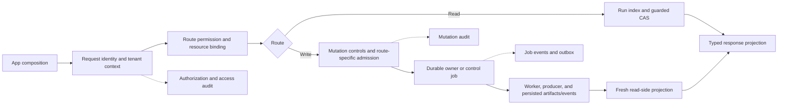

# Current Runtime Request Lifecycle

Owner: `@runtime-owners`
Source of truth: `repo:policy-engine/schemas/runtime_api_v1.openapi.json`, `repo:policy-engine/src/polisyos/runtime/http/app.py`, `repo:policy-engine/src/polisyos/runtime/http/dependencies.py`, `repo:policy-engine/src/polisyos/runtime/http/authorization.py`, `repo:policy-engine/src/polisyos/runtime/http/routes/control.py`, `repo:policy-engine/src/polisyos/runtime/http/routes/public_decisions.py`, `repo:policy-engine/src/polisyos/runtime/http/services/control_plane_store.py`, `repo:policy-engine/src/polisyos/runtime/http/services/control/run_lifecycle.py`, `repo:policy-engine/src/polisyos/runtime/http/services/control_worker.py`, `repo:policy-engine/src/polisyos/runtime/http/services/run_index.py`, `repo:policy-engine/src/polisyos/runtime/quality/candidate_firewall.py`, `repo:policy-engine/src/polisyos/runtime/quality/claim_registry.py`, `repo:policy-engine/src/polisyos/runtime/quality/authority.py`, and the linked tests
Source pin: `bafca83bff9ff49eef1466bc491a8420b5cd1dbb`
Validation status: Source and test-reference inspection only for this documentation update; the linked tests and HTTP runtime were not run.

This page traces the current HTTP path from app composition to response or
durable effect. It describes source-owned behavior; it is not an endpoint
inventory and it does not grant authority to a route, caller, or response DTO.
For schema-described operation shapes, start with the committed
`policy-engine/schemas/runtime_api_v1.openapi.json` snapshot and the
[REST API reference](../api/index.md). Route handlers remain the source for
admission and lifecycle behavior, including routes the snapshot does not
describe.

## Lifecycle at a glance

The routes are mounted by `create_runtime_api_app` in
`policy-engine/src/polisyos/runtime/http/app.py`. The app factory resolves a
deployment execution profile and constructs the app-scoped
`RuntimeServiceContainer` in `policy-engine/src/polisyos/runtime/http/container.py`,
installs exception and request telemetry handling, composes security and
mutation middleware, then mounts route modules. Startup rechecks mutation and
step-up contracts and starts container-owned services; shutdown stops them.

## Request identity and admission

In a deployment with the full security chain, the required middleware order is
JWT authentication, tenant-to-cell routing, then authorization. JWT
authentication validates the bearer token and writes verified claims plus an
`AccessScope` to request state. When `X-Tenant-ID` is present, it must agree
with the authenticated tenant. The cell router resolves the tenant to a cell
and installs the tenant context used by downstream stores. Authorization
evaluates a route's server-owned permission and its frozen resource binding;
unsafe routes cannot substitute a different resource after the binding is
created. The route dependency can also require a deployment-verified step-up
assertion for high-stakes actions. See
`policy-engine/src/polisyos/runtime/http/app.py`,
`policy-engine/src/polisyos/runtime/http/jwt_auth_middleware.py`,
`policy-engine/src/polisyos/runtime/http/cell_router_middleware.py`,
and `policy-engine/src/polisyos/runtime/http/authorization.py`.

At policy resolution, `security_required` is true for effective `governed` and
`production` profiles; `research` is also non-development but does not set this
profile-level requirement. The app factory rejects an incomplete chain when
the selected profile requires it. In the reduced
middleware configuration, `policy-engine/src/polisyos/runtime/http/fail_closed_middleware.py`
still rejects non-public requests without an authenticated access scope.
Development fixture identity is opt-in and forbidden outside the development
profile. Production requires a configured step-up verifier; any configured
step-up verifier outside development must have deployment provenance. A
missing identity, tenant/cell binding, resource binding, permission, or required
step-up proof stays a denial; OPA or security dependency failures do not become
an allow. The exact public-path allowlist and deployment checks live in the
middleware owners.

Route-level ownership checks are separate from role or route permission. A run
must carry tenant metadata matching the verified access scope. A missing run
tenant is denied as unscoped. Artifact reads resolve the owning tenant through
the run index; an artifact without a tenant-linked run is denied unless the
server explicitly enables `allow_unscoped_artifacts` (false by default).
Ownership refusals are recorded before returning the denial; failure to append
that refusal does not release the protected run or artifact. These checks are
in `policy-engine/src/polisyos/runtime/http/dependencies.py`.

## Read path: owner state to response projection

The app-scoped `policy-engine/src/polisyos/runtime/http/dependencies.py`
holds the guarded CAS stores and services for run indexing, timelines, debug,
lineage, artifacts, comparison, and other read surfaces. The run index rebuilds
from persisted Core run directories and caches the resulting snapshots for two
seconds by default. Each run read separately overlays the current
decision-validity projection and its `decision_validity_checked_at` time. The
cached summary is not the validity owner, and this check time is not the
producer time or the time its evidence was collected. See
`policy-engine/src/polisyos/runtime/http/services/run_index.py` and
`policy-engine/src/polisyos/scientist/validation/decision_validity.py`.

Read routes resolve the requested run or artifact, apply tenant ownership,
then construct their response DTO from the appropriate service. Artifact
surfaces use the CAS owner and, where a semantic profile is required, reopen
and validate the selected artifact profile against its bytes before projecting
it. Raw-byte negotiation and diagnostic/profile views have distinct limits;
an artifact preview or API response does not itself establish the truth or
authority of the producer that wrote it. See
`policy-engine/src/polisyos/runtime/http/routes/runs.py`,
`policy-engine/src/polisyos/runtime/http/routes/artifacts.py`,
and `policy-engine/src/polisyos/core/artifacts/canonical_profile.py`.

Many read routes append a data-access entry and emit matching telemetry through
`policy-engine/src/polisyos/runtime/http/dependencies.py`.
The route's DTO is a public projection of owner state. For example, the
public-decision verification endpoint verifies a retained issued record and
document; its signature authenticates those bytes for the declared purpose and
does not supply a policy decision or publication authority.

## Write path: mutation controls and route-owned admission

Managed mutations pass through `policy-engine/src/polisyos/runtime/http/mutation_policy.py`,
which applies tenant/route rate limits, supported idempotency replay, and
append-only mutation audit. Some operations have a stronger route-owned intent
owner and deliberately bypass the generic response cache; their typed intent,
actor scope, and durable owner state determine retry behavior. Route
authorization and business admission still run for those operations.

Natural-language run launch is a representative request-to-queue path:

1. `POST /api/v1/control/runs/nl` requires the server-derived route permission,
   the exact bound action proof, an authenticated actor/tenant/cell, and an
   `Idempotency-Key`. The route passes the captured request body and query bytes
   into the control service so the authorization receipt and immutable request
   intent bind the same request.
2. `ControlPlaneService.launch_nl_run` resolves the effective execution
   profile and creates a durable pre-admission attempt before provider
   preflight. The attempt is scoped to the authenticated actor, tenant, cell,
   request intent, and idempotency-key digest. Reusing the key with changed
   intent conflicts; a started or otherwise unresolved attempt is not treated
   as a fresh request.
3. Profiles that require provider settlement must establish the producer/run
   binding and record complete producer settlement references before the job
   can be admitted. A source-controlled preflight exit may record `no_call`;
   missing or unreadable settlement stays unavailable and blocks automatic
   retry cleanup. The ledger proves local settlement custody, not an external
   provider invoice or provider-side exactly-once execution.
4. On admission, `ControlPlaneStore.create_job` in
   `policy-engine/src/polisyos/runtime/http/services/control_plane_store.py`
   persists the job, creation event, and outbox row in one transaction and
   links the pre-admission attempt. The container-owned
   `policy-engine/src/polisyos/runtime/http/services/control_worker.py`
   leases the job, renews the lease while running, and invokes the control
   lifecycle owner.
5. The lifecycle resolves the execution intent and candidate context before
   dispatching the compiler/producer path. It persists progress and terminal
   job events through the control store; Core run outputs and CAS artifacts
   are then served through the read owners. `GET /api/v1/control/jobs/{job_id}`
   reads a status projection from that persisted owner.

For this route, `RunLaunchResponse.status="accepted"` means the job was
admitted and queued; it does not mean the worker finished, the run produced a
decision packet, or any claim passed a governance consumer. A preflight refusal
can persist a failed job and return `status="rejected"`. Reusing the same
idempotency key with the same bound intent returns the existing attempt; a
changed intent conflicts, and an unresolved attempt conflicts until its
history is inspected. The attempt lookup routes are
`GET /api/v1/control/admission-attempts/{attempt_id}` and
`GET /api/v1/control/admission-attempts/by-idempotency-key`. A timeout or lost
worker lease is not proof that no producer ran; reconcile the durable job and
attempt records before retrying. These results and recovery rules are owned by
`policy-engine/src/polisyos/runtime/http/services/control/run_lifecycle.py`
and `policy-engine/src/polisyos/runtime/http/services/control_plane_store.py`.

## Following a queued result to a consumer

Use the owner at each boundary rather than treating the launch response as the
result:

| Boundary | Runtime owner and durable/read surface | What the boundary establishes |
| --- | --- | --- |
| Request admission | `POST /api/v1/control/runs/nl`; route authorization, request-bound proof, actor/tenant/cell scope, immutable request intent, and idempotency key | Permission to attempt this scoped operation and, when returned as accepted, admission to a durable job. It does not establish execution completion or claim admissibility. |
| Pre-admission | `control_pre_admission_attempts` and its event history, written by `ControlPlaneStore` before execution admission | A recoverable attempt and observed settlement state. Provider-settlement preflight is required only for the configured profiles that require it. Missing scope, producer binding, or unreadable/incomplete settlement remains refusal or unresolved state; a local settlement record is not a provider invoice or provider-side exactly-once proof. |
| Job and worker | `ControlPlaneStore.create_job` writes the job, initial progress, creation event, outbox notification, and linked attempt in a transaction. `ControlWorker` leases and renews a specific job attempt. | Durable queue/lifecycle state. Store failure can stop progress; a stale or lost lease can reject fenced persistence while handler activity may still be in progress. Neither an accepted response nor an audit event substitutes for a terminal job state. |
| Producer output | `ControlPlaneService.launch_nl_run` in `policy-engine/src/polisyos/runtime/http/services/control/run_lifecycle.py` queues the selected execution intent; `ControlWorker` in `policy-engine/src/polisyos/runtime/http/services/control_worker.py` invokes the lifecycle and persists run outputs and CAS artifacts, while job progress/events record control state. | Producer output under its declared profile and provenance. Persistence alone does not promote candidate material to authority or prove causal adequacy. |
| Read projection | `GET /api/v1/control/jobs/{job_id}`, run routes, and artifact routes read through their respective owners; the run index overlays current validity on reads. | A projection of owner state at that read. Run and artifact routes apply their own tenant-ownership checks; job and attempt status use their distinct route and owner paths. Projection freshness, signature verification, or a successful status is not policy closure. |
| Claim or authority consumer | `policy-engine/src/polisyos/runtime/quality/claim_registry.py`, `policy-engine/src/polisyos/runtime/quality/authority.py`, and other consumers call `policy-engine/src/polisyos/runtime/quality/candidate_firewall.py` where candidate references enter protected slots. | Candidate refs need a runtime ledger entry, compatible admission state, admission lineage, validation refs, and an envelope permitting the requested purpose. Missing ledger, unknown or unverified candidates, state mismatch, and missing evidence produce issues or a refusal at the consuming gate. This is a consumer-side boundary, not proof that every claim has adequate causal evidence. |
| External projection | Artifact routes apply purpose-specific export checks; `policy-engine/src/polisyos/runtime/http/routes/public_decisions.py` invokes the report verifier or governed-record owner. | A bounded projection or verified retained record for its declared purpose. It does not establish all policy-authority dimensions or authorize later use by itself. |

These adjacent rows describe existing owners and consumers; they are not
evidence that every natural-language run traverses every boundary or produces
a claim that is admissible for publication. The API reference links the
generated schema to the manual route explanations:
[Runs API](../api/runs.md), [Artifact Inspection API](../api/artifacts.md), and
[Runtime API Reference](../api/index.md). Use the router and service owners
above for behavior the schema cannot prove.

The route and lifecycle owners are `policy-engine/src/polisyos/runtime/http/routes/control.py`,
`policy-engine/src/polisyos/runtime/http/services/control/run_lifecycle.py`,
`policy-engine/src/polisyos/runtime/http/services/control/job_nl_admission.py`,
`policy-engine/src/polisyos/runtime/http/services/control/job_nl_execution.py`,
and `policy-engine/src/polisyos/runtime/http/services/control_plane_store.py`.
This is one concrete write path; other routes use their own service and
admission contracts.

## Candidate state, authority, and custody

The execution profile and intent band constrain what a producer may do. A
candidate or simulation result remains a candidate even when it is persisted
and exposed through run or job projections. The
`policy-engine/src/polisyos/runtime/quality/candidate_firewall.py`
checks candidate references at consumers that would otherwise read them in
authority-bearing slots. Missing ledger evidence, an unknown candidate, or an
unverified candidate is a refusal; candidate text or a positive-looking status
does not become authority by appearing in a response.

Authority-bearing operations use purpose-specific owners and deployment
custody. High-stakes human-decision routes require route permission and
step-up; the service requires the configured signer, verifier, trust policy,
and durable custody sink before it can create and read back a signed record.
Public verification-report issuance has its own issuer key and declared trust
purpose. A governed public record is a separate path through a configured
governed-record owner; a prepared candidate is private review material, and an
issued record is returned only after that owner verifies its readback. The
verification-report signature alone is explicitly not decision authority.
See `policy-engine/src/polisyos/runtime/http/routes/human_decisions.py`,
`policy-engine/src/polisyos/runtime/http/services/human_decisions.py`,
`policy-engine/src/polisyos/runtime/http/routes/public_decisions.py`,
and `policy-engine/src/polisyos/runtime/http/services/public_decision_verification.py`.

For public verification, `POST /api/v1/runs/{run_id}/public-verification-record`
requires `PLATFORM_ADMIN` plus an `OWNED_EXISTING_PATH` binding for `run_id`,
then resolves the tenant-owned run and its declared decision-packet profile.
The caller selects an output class; it does not provide the public document,
signing key, or authority verdict.
The route checks the declared `Content-Length` header and rejects a nonzero
value; this check does not prove that the received body bytes are empty, and
missing-length or chunked-body behavior was not exercised for this review. The
report-only `pvr_` path signs and verifies the retained projection, but all
seven public-authority dimensions remain `not_established` and
`promoted_record` is null. The distinct governed `gpr_` path may establish
issuer issuance and projection faithfulness after owner verification; its other
five dimensions remain `not_established`. `GET /api/v1/public-decisions/verification`
verifies the issued locator; it is not a policy-admission or publication gate.
See the detailed dimension contract in
[Artifact Inspection API](../api/artifacts.md) and the wire DTOs in
`policy-engine/src/polisyos/runtime/http/services/public_decision_verification_contracts.py`
and `policy-engine/src/polisyos/scientist/governance/continuous/governed_public_record_contracts.py`.

These boundaries distinguish request admission from policy admissibility:
authorization permits a scoped API action; execution policy chooses an allowed
runtime lane; producer evidence and governance owners determine what a result
can support; custody controls whether a particular signed record can be
issued and maintained. A successful HTTP status or persisted artifact is not a
substitute for those later checks.

Fail-closed behavior binds the authority band: protected actions, published
claims, and custody facts cannot proceed on missing authority. Candidate-band
work can carry an unknown scope only where the owning path explicitly permits
it and preserves the unknown as a typed limitation; a missing value must not be
silently replaced with a concrete scope. This lifecycle map follows runtime
code paths, but it does not demonstrate a complete causal-policy capability or
show that any HTTP result is publishable.

## Audit and failure boundaries

The runtime has related but distinct durable records: authorization decisions,
read-access entries, mutation audit entries, control-job lifecycle events, and
outbox records. They have different writers and purposes. For example,
authorization audit events use the sealed writer in
`policy-engine/src/polisyos/runtime/http/access_audit.py`, while
read routes use the shared helper in `dependencies.py` and mutation requests
use `mutation_policy.py`. Do not infer producer evidence or publication
authority from an audit receipt.

Typical fail-closed edges include missing verified scope, a tenant mismatch or
unscoped owner, an absent route permission or required step-up proof, an OPA or
storage dependency failure, a profile/content mismatch, unresolved producer
settlement, an invalid custody signature, or missing issuer trust. The route
returns a typed refusal/error or leaves the durable operation unresolved; it
does not replace missing authority with a caller-provided label. Exact status
codes and error fields belong to the [API error reference](../api/error-semantics.md).

## Existing implementation evidence

These test files contain the relevant semantic probes. Their presence is not a
test-run receipt for this page or source pin.

- Authorization, binding, tenant, and refusal probes:
  `policy-engine/tests/unit/runtime/http/test_runtime_api_authz.py`
- Rate limits, idempotency, mutation audit, and dependency failures:
  `policy-engine/tests/unit/runtime/http/test_runtime_api_write_path_hardening.py`
- Control service and route composition:
  `policy-engine/tests/unit/runtime/http/test_control_service_di.py`
- Worker identity and lease custody:
  `policy-engine/tests/unit/runtime/http/test_control_worker_custody.py`
- Candidate firewall behavior:
  `policy-engine/tests/unit/runtime/quality/test_candidate_firewall.py`
- Human-decision custody:
  `policy-engine/tests/unit/runtime/http/test_human_decision_guarded_custody.py`
- Governed public-record HTTP issue, projection, and verification readback:
  `policy-engine/tests/unit/runtime/http/test_public_export.py::test_public_decision_projection_is_custody_bound`
- First governed public signature custody and verification readback:
  `policy-engine/tests/unit/runtime/http/test_public_export.py::test_first_governed_public_signature_is_custody_bound`
- Public verification report limits and tamper cases:
  `policy-engine/tests/unit/runtime/http/test_public_decision_verification.py`

This lifecycle was written from source and test inspection. No API server,
deployed security providers, external producer, or database concurrency test
was run for it. E02 remains unfinished at this source pin.

Recheck this page when app composition or profile security resolution changes;
when route permission/resource binding or tenant checks change; when job
admission, persistence, worker lease, or event/outbox behavior changes; or when
run validity, candidate-firewall, claim-registry, export, or public-record
consumers change. The generated contract is
`policy-engine/schemas/runtime_api_v1.openapi.json`; relevant behavioral probes
include `policy-engine/tests/unit/runtime/http/test_runtime_api_authz.py`,
`policy-engine/tests/unit/runtime/http/test_runtime_api_write_path_hardening.py::test_control_run_launch_replays_idempotent_post`,
`policy-engine/tests/unit/runtime/http/test_control_worker_custody.py`,
`policy-engine/tests/unit/runtime/quality/test_candidate_firewall.py`, and
`policy-engine/tests/unit/runtime/http/test_public_export.py::test_public_decision_projection_is_custody_bound`.
These sources and test references were inspected at the pinned revision; the
tests, schema generator, and HTTP path were not run for this edit.

- Last updated: 2026-10-14
