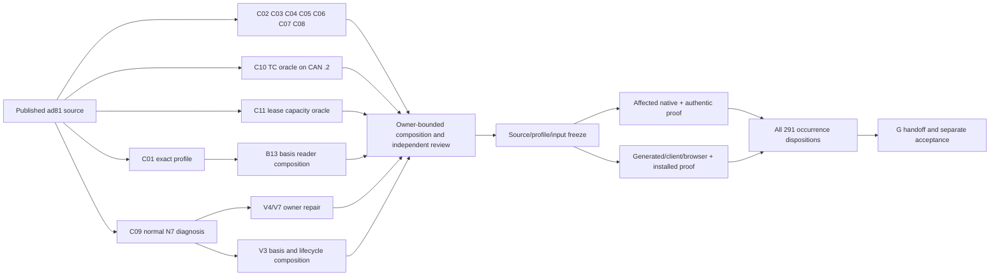

# E02 completion implementation plan

> **Historical record — not the current operating procedure.** Current E02 organization/status is [E02-WORK-PLAN.md](../../../../../../../E02-WORK-PLAN.md), with repository [AGENTS.md](../../../../../../../AGENTS.md) and the current [HANDOFF](../../../execution-prompts/HANDOFF.md). Dated permissions, staffing, RAW/patch-only authorship, receipt templates and append-only status instructions below are historical. Preserve original criteria, accepted decisions and each evidence record on its own source; do not execute superseded workflow rules or append new status here.

> For future agentic workers: use scoped execution with an independent reviewer. This checkpoint is planning only. Start implementation or cloud tasks only after the user continues the work. A cloud task receives its entire standalone prompt; local assistants receive one explicit read/write lease and do not delegate.

**Goal:** Finish the existing E02 queue against its original criteria, preserving all existing work and separating author evidence from G acceptance and formal closure.

**Architecture:** Reuse existing canonical owners and compose one producer-to-fresh-consumer chain per property. Cloud lanes own portable mechanisms and independent oracles; the local root composes overlap, supplies authentic local inputs and preserves evidence. Shared source, schemas, generated families and resources are serialized only at actual intersections.

**Stack:** Existing Python 3.14 / uv 0.9.21, Node 22 / corepack pnpm, Core/IR CAS, Fabric, Scientist, runtime HTTP and dashboard; supported native/optional backends remain explicit.

**Spec:** The user's 27 October continuation-planning request; [handover](../executor-handover-20261027/START-HERE.md); canonical [TASKS](../../../execution-prompts/unified-local-2026-10-09/TASKS.json), [HANDOFF](../../../execution-prompts/HANDOFF.md), selected [G decisions](../executor-handover-20261027/selected-decisions.json), and [G27 dispositions](../g-review-followup-20261027/dispositions.json). Earlier documents' numerical staffing and old source cuts do not override the current user constraints.

## Global constraints

- Keep the existing attached author checkout, environments, production link, untracked fixtures, ignored RAW/CAS/DB and append-only history. No reset, rebase, stash, cleanup, recovery overlay or main/G publication.
- No product edits, dependency installation or heavy product checks in this planning stage. Its only changes are this explicitly enumerated documentation packet.
- Preserve 26 canonical rows, 127 bundles, 282 IDs, 291 occurrences and 319 task–ID edges. Five IDs overlap Q0 and specialist routes; do not add the 212 Q0 occurrences to all 84 specialist-route occurrences. Specialist-only is 79. Do not reopen B198.
- Candidate computation is not authority. No synthetic law, issuer, permission, calibration, population truth or production currentness. Missing backend is not product FAIL; source review is not runtime PASS; 137/-9 is not an OOM diagnosis.
- Each mechanism has one writer with mandatory tests/importers/DTO/API/UI/schema/generated/config/lock/public/release companions. Mandatory companions are outside any mechanism path budget. Shared-file changes require a refreshed composed preimage, never a parallel hidden implementation.
- Do not send production data, credentials or private RAW/CAS/DB to cloud. A portable fixture can prove a software property and remains bounded by that property.
- Cloud resource planning assumes only the user's approximate **32 GB total disk**, subject to actual measurement. RAM is separate. No claim is made about 100 cloud machines or a working mid-run coordinator message channel.

## Review focus

1. A valid declared reference with wrong profile, erased payload discriminator, or malformed same-ID sibling must not be admitted by a cheap identity/shape proxy (C01/C06/C07).
2. Unknown owner/source/request relationships must remain declared unknown; earlier funnel work must not borrow a later HTE request, and protected gates must not turn green from consumer assertions (C07, T2).
3. New source admission and skipped evaluation must preserve source/history/cost/action while comparing the same effective plan actually executed; stale eligibility/frontier/race must disable retention (V3).
4. An old successful output must lose dependent validity after basis change while independent siblings/history survive; success markers with a removed result ref cannot authorize a fresh read (B13).
5. Product tests must execute the intended boundary. A/A fixture failure, absent planner report, backend/setup error or imported-but-unexecuted node is not evidence about the intended negative (C01/C02/C09, R1).

## Current position

[QUEUE.json](QUEUE.json) contains every original row and links to the exact criterion crosswalk. [analysis/criterion-routes.json](analysis/criterion-routes.json) retains every original occurrence and source span/hash; it also links Q0's individual source-only nextchecks. G27's Q0 oversight links are recorded separately from original finding assignments. The existing historical ledger is not a count of currently unimplemented criteria.

There are three concurrent kinds of remainder: internal source/bridge work (notably G27-01, R3, I3, V3, V5 and S1); incomplete semantic/native/installed proof (including I1/I4/V1/V2/R1 and generated consumers); and exact external facts (authority/currentness/calibration and other original criterion inputs). A local input limit does not block independent software work. Conversely, a portable result does not supply the missing external fact.

The committed WIP is seventeen source/test/tool paths at `8698293225576fc7a1ad8f6d2c1ca8834f04140c`; their current blobs match. Twelve saved patches belong to ten unapplied proposal groups. R3's latest retained execution is fourteen failures. V6's new matrix stopped on A/A before A/B; normal N7 stopped before planner report. S3 has a bounded author result after the older assessment, not G acceptance. R2's defining properties and configured B56 already have explicit G dispositions; their documentation corrections and the separate long-lease proof do not reopen them.

Two new planning findings require action: S1 r4's stop-note hashes differ from indexed/current bytes, so rebind/re-review current bytes; I4's diff has explanatory labels in its file headers and fails an ordinary applicability check. A header-only in-memory correction passes the check, but its encoder oracle still needs repair and review. See [source-proposals](analysis/source-proposals.md) for exact identities. Applicability is never semantic admission. The source audit also found twelve current Hatch force-includes against the older eleven-row installed manifest; final Q2/DX0 packaging admission must derive its asset denominator from the actual owner, not copy that old roster. Q0's34 F-family research nextchecks are generic freeze/rebind instructions; wave2 must derive executable oracles from each linked original scope/witness before declaring those units ready.

## Approach selection

The recommended approach is cloud owner slices plus a single local compositor and authentic proof lane. A local-only queue would keep portable work behind a resource-constrained Mac. Automatically applying all saved proposals would import known NO-GO and unreviewed candidates. Both approaches discard useful distinctions already established by the handover. The proposed split preserves those distinctions while moving independent engineering and oracle work to separately admitted cloud tasks.

## Dependency graph: four different gates

Research may start once its published source and necessary context are present. Editing additionally needs a stable contract and exclusive mechanism lease. Joint testing needs composed source, actual backend and isolated fixture/store/port. Final acceptance needs complete criteria, source/input/proof qualification and G's disposition. An edge at one gate is not an edge at all four.

| Edge | What it needs | Earliest gate affected | Consequence |
| --- | --- | --- | --- |
| G27-01 fixture → comparator repair | Proof: valid scoped A/A, intended A/B red | Editing target/semantic proof | Do not repair an unobserved proxy; C01 owns both phases. |
| G27-01 → B13 reader composition | Shared debug/test source | Composition/joint test | Research B13 now; apply reader deltas sequentially after C01. Neither closes the other. |
| I1 → I4 served replay | Selected material/currentness contract | Joint served proof | C02 checkpoint and C03 deterministic legacy work start independently. |
| R2 → I3 | Accepted cleanup contract/source | Implementation preservation/joint test | I3 can start on current source; no R2 rerun prerequisite just to begin. Replay affected cleanup after Fabric changes. |
| R3 → R4 lease work | Only actual container/lifecycle/executor overlap | Composition/joint test | R4 oracle may start now; C11's initial lease excludes R3 container/lifecycle. |
| V1 fixture → V2 positive | Input/root admission, not full V1 acceptance | Local fixture joint proof | Prepare both oracles now; first new-cost V1/V2 runs alone, then remeasure. |
| N7 diagnosis → V4/V7 fix | Observed real route and correct producer contract | Repair choice/joint proof | C09 starts now. Do not insert planner records or weaken grounding. |
| V4 ↔ V7 | Same owner/callers/test companions | Editing/composition | One writer, separate original outcome records. |
| N7 fix ↔ V3 | Actual generation-cycle source overlap | Editing/composition | V3 basis/store/history preparation starts now; serialize only generation-cycle application. |
| S1 → S3 | Exact request/source/subject/unit contract | Composed B31 proof | Preserve S3 bounded evidence; review/prep now, affected replay after join. |
| C07 owner → ordinary explicit POST | Source/composition: actual caller transport in C05-owned lifecycle | Editing/composed proof | C07 writes only uncertainty/projection/outbox owner and returns an unapplied transport proposal; root composes after C05. Owner/oracle work starts independently. |
| S1 → earlier funnel | Missing owned request at that phase | Implementation semantics | Explicit API binding is a valid bounded subproperty; full funnel needs a real later caller relation. |
| V5 ↔ S2 | Shared Search objective/units/uncertainty consumers if changed | Editing/composition | C06 and C07 have explicit disjoint scopes; S2 oracle prepares in parallel, later writer lease checks actual paths. |
| Q1 .3 ↔ TC .2 | Shared contracts/registry only where changed | Composition/generated proof | TC research/oracle on accepted .2 starts now. There is no blanket .3 prerequisite. |
| TC request + closure → TC composition | Stable selected-view contract and exact member resolver | Joint proof | Independent request and closure preparation converge before DTO/API rollout. |
| Upstream DTO/owner changes → Q2 generation | Frozen schema/registry/generator family | Regeneration/joint proof | Prepare clients/browser/validators early; one generator writer at freeze. |
| Q2 + DX0 → installed/native closeout | Exact build assets, backend/profile and output capacity | Joint proof/final acceptance | One package/scratch owner; portable Linux proofs can precede the full package wave. |
| I2 → R1 | No canonical source dependency established | Shared local resource only | Remove the old blanket wait; R1 child research and portable preparation start now. |
| Authentic inputs → authority/currentness claims | Actual bytes and verifier/issuer evidence | Claim-specific proof/acceptance | Keep these local and scope limits precisely; do not block independent cloud programming work. |
| All outputs → G | Full composition/dependency footprint and exact remote source | Acceptance | G owns transfer/integration; local author does not resume G or publish its refs. |

[analysis/dependencies.md](analysis/dependencies.md) is the more detailed typed edge analysis. A source-path conflict is resolved with one writer or disjoint test ownership, not with a global queue barrier.

## Critical paths and useful concurrency

No completion-date estimate is supported: post-repair served/native costs and remaining external input arrival are unmeasured. There are several join paths, not one universal linear lane:

- Source acceptance: C01 valid fixture → intended profile red → canonical repair → independent review → composed served read → G.
- Served generation: controlled V1/V2 root admission and C09 real route observation → one V4/V7/V3 generation owner → fresh persisted readers → affected DTO/clients/browser.
- Canonical/installed: C08 owner laws/budget and independently C10/TC .2 closure → composed owner contracts → Q2 canonical generation → wheel/rebuilt-sdist/archive/native consumers.
- Scientific and authority: S1 actual source/request join + V5 typed units + S2 real relation/law inputs + T2 actual authority/calibration → criterion-specific proofs. Their external limits may be the final closure tail even after portable code is ready.

At approved execution start, a useful front is **8 cloud author slices (C01–C08), 3 cloud oracle/diagnostic slices (C09–C11), and local admission/docs/oracle work**. Launch in two short batches if task monitoring or VM capacity warrants: first C01/C02/C03/C04/C06/C09/C10/C11, then C05/C07/C08 with complete leases and inputs. This staging is operational, not an invented source dependency. All eleven are independently assignable under their bounded written scope; C07's shared lifecycle transport application and ordinary-POST proof are explicitly later source/composition work after C05, not an independent first-wave completion claim; new shared companions stop only the affected writer. C11 begins as an oracle and may edit only its exclusive owner if it proves a defect.

Analysis can use roughly 12–20 useful direct helpers across criterion/owner/oracle/review preparation when there are distinct questions, up to the configured ceiling of 100. Editing parallelism is eight independent cloud mechanism leases, plus local documentation; root alone writes the canonical local tree/index/refs. Computation is governed per cloud VM by measured RAM/disk/backend and isolated state; there is no inherited two-job cloud limit. Locally start with at most two already measured jobs around 4 GiB combined RSS, one numerical thread each; first unmeasured V1/V2/native GP/VM runs alone. New measurements may change local admission. Intellectual helper count does not grant compute slots.

## Execution waves and readiness

### Wave 0 — this planning stage

- [x] Admit exact existing workspace and read handover/canonical sources.
- [x] Independently reconstruct source/WIP/proposal/evidence/criterion and environment boundaries.
- [ ] Save reviewed plan and standalone assignments as a normal documentation checkpoint, with branch readback. No product execution follows automatically.

### Wave 1 — approved independent front

- [ ] Launch standalone C01–C11 as listed in [LAUNCH.md](LAUNCH.md), using the already published `ad81` source and complete prompt text. Root records actual cloud task ID/environment/base/tree before relying on results.
- [ ] L01 corrects only R2 provenance and R4 arithmetic, after exact binding census; no unchanged numerical rerun.
- [ ] L02 admits the controlled-root falsifier and initial V1 positive when local resource/source freeze is satisfied; cloud can prepare portable V1/V2 oracles independently.
- [ ] L03 prepares R1 child startup/handshake; authentic replay waits on the measured 8 GiB reserve, not I2 completion. No cleanup is assumed to create it.
- [ ] In parallel prepare B13 invalidation, V3 shared prepared basis/store/history, S2 relation oracle, T2 U1–U5, I2 Linux/installed recipe, DX0 N1–N8 and criterion-specific Q0 tests. These are preparation lanes, not unreviewed competing writers.

### Wave 2 — owner composition and uncovered original criteria

- [ ] Admit each returned patch against its actual base/tree/preimages and complete companion set. Finish independent review; refresh a conflicting proposal under a new identity rather than blindly applying or rewriting history.
- [ ] Apply C01 before the B13 debug-reader bridge. Apply N7's demonstrated repair and V3's generation delta through one owner; V4/V7 keep separate receipts. Apply Fabric preserving R2. R3 owns shared container/lifecycle before any required R4 overlap. Root composes Core/IR/TC/DTO intersections once.
- [ ] Execute admitted V1 then V2 real paths; final native GP and actual Legal encoder use local assets only if their predicates need them. Portable Linux raw-filename proof may run in cloud and does not replace the actual local root census.
- [ ] Complete S1's real later caller/funnel, finite G528 path, S2's separate B190/B194/B197/B200/B157/LA-036 obligations, T2's distinct input predicates, Q1 state/Foundry/cache migration and Q0's individual nextchecks. S3 unchanged proofs are reused in their scope, then affected joins replayed.
- [ ] For LA-028/032/033, both LA-046 and both LA-051 occurrences, follow original span/bundle predicates in the crosswalk; a neighboring bridge or N7 route does not substitute for them.

Readiness for each wave-2 unit is its owner/input/interface and affected-preimage admission, not a requirement that every wave-1 task finish. [QUEUE.json](QUEUE.json) and each detailed report name the next property and minimal distinguishing result.

### Wave 3 — freeze and one expensive wave

- [ ] Freeze source first; complete all independent source reviews; batch blocking deltas. Cosmetic findings become declared debt rather than changing a frozen source unnecessarily.
- [ ] Freeze actual selected input refs/profiles/backend/clock/roots and full check denominators. Complete regenerated owner/DTO/OpenAPI/client/dashboard family with normal `--check` plus corrupt-field refusal. No lockfile or generated writes from multiple lanes.
- [ ] Run the affected local/authentic/native/installed proof wave with full deciding outputs and resource measurements. Use existing environments; packaging scratch/build asset consumers are one contended lease. Reserve full backend verification/CI parity for this boundary.
- [ ] Run source wheel, rebuilt-sdist wheel and required archive consumers with exact origins; all thirteen native SOTA rows and substantive expiry obligations are accounted for. Unavailable inputs/backends stay explicit, never PASS.

### Wave 4 — reconciliation and G

- [ ] Recompute the complete original denominator and one current disposition per occurrence: real property result/evidence or bounded limitation/external input/decision with performed attempts and next runnable action. Preserve shared routes and historical decisions.
- [ ] Publish only the author topic, normal append-only checkpoint and remote commit/tree readback, complete diff/import/config/build/public footprint and unreviewed ancestry. Separate implementation from receipt commits.
- [ ] Send the finished source-bound package for independent G review. G selects transfer/integration and repeats affected checks on its source. Formal E02 closure and later R9/GY/Atlas work remain outside author approval.

## Stop and escalation rules

A worker handles routine compatible engineering independently. If the actual base/tree differs, preserve and report identities; do not switch/reset. If a necessary input/backend/install/hook/channel fails, verify a bounded alternative, preserve useful tests/patches/outputs and name the smallest missing dependency. A source review can finish without local RAW by using the supplied facts and tracked patches; it cannot claim it reproduced that RAW. A real new semantic fork gets alternatives, affected original criterion, source/prototype/falsifier and a precise G decision request. The task must not wait indefinitely for a message channel that has not worked.

P40 applies to new review escapes: classify NEW class versus the same class deeper; on the second same-class finding widen the mechanism or declare a bounded residual and execute its falsifier. P41 attribution needs the exact slice base predating all work and zero intersection with the gate's complete input denominator; otherwise ownership is `not_established`.
