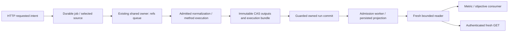

# E02: решения G для реализации, 20 октября 2026

**Три технических решения выбраны для реализации.** Это архитектурный пакет, не приёмка source и не adjudication findings: `source_acceptance=false`, `G_acceptance=false`, `closure_ids=[]`. Институциональные законы и полномочия этим пакетом не устанавливаются. D01–D08 connected plan сохраняются.

**Финальная редакция после самостоятельного критического прохода G:** начать с [окончательных решений и исправлений](06-final-decisions-and-solo-review.md). Этот проход выполнен без субагентов. AD01–03 ниже приведены в соответствие с финальным выбором; предыдущие helper GO относятся к предыдущей редакции, не к новым изменениям.

Исследован immutable snapshot `11ff2421e04223fc961dd5a520768fd75bafe1e2`, очередь `implementation-handoffs/LOCAL/decisions/20261020-g-architecture-decision-queue.md`. В ней результаты исполнения относятся к candidate `fe046fefbb06fc3dcaf259766f048a6defed58ea`, tree `c664005a5a930f91a7e05bc25e13c376dccdeabb`. Это разные роли commit: пакет вопросов и проверенный автором source. G checkout при подготовке документов: `93d6aa62a8d236667fdf322a5fc17962523b185e`, ветка `codex/e02-integration`. Более поздний engineering source требует delta reconciliation, а не притворного совпадения с этим срезом.

| Решение | Выбранная реализация | Что это позволяет утверждать |
|---|---|---|
| [AD-E02-01](01-method-output-metric-unit.md) | Compiled metric→node/slot binding, CAS execution bundle, fenced selection; exact unit adapter/typed law; persisted owner-verified projection | Откуда получена candidate metric, что вычислено и в какой единице. GET читает projection без model/law execution. Не identification/calibration/publishability |
| [AD-E02-02](02-shared-compute-admission.md) | Единственный process-wide SharedExecutor; serial folds; refs-only queue; prepare→dispatch→serialize/persist внутри worker, наружу refs | Bound worker slots для полного declared workload. Не жёсткий CPU/RAM предел; heavy callbacks и completed arrays не обходят admission |
| [AD-E02-03](03-observational-http-input.md) | Один strict `observational_input`; B основной envelope, A explicit compatibility; method/defaults pinned до enqueue, content admission под slot | Ordinary POST фиксирует selection, worker потребляет его, fresh GET показывает результат. Не подлинность observations |

**B56 не требует вложенного parallel fold execution или production-only witness.** Исходный B56 и уже выбранный D03 допускают полный объявленный локальный workload с serial folds. Нужны реальный общий owner, весь competing roster и измерения. Production inputs требуются для production-qualified утверждения, а ordinary HTTP является отдельным требованием AD03. Ни один из этих выводов ещё не закрывает B56.

Для исполнителя: [финальные решения](06-final-decisions-and-solo-review.md) → три подробных AD → [порядок реализации и acceptance](04-implementation-and-verification.md). [Исследование и red team](05-research-and-red-team.md) объясняют выбор и отвергнутые альтернативы. Новый вопрос G нужен только при конкретном несовместимом counterexample либо реальной внешней authority, которую нельзя заменить engineering решением.

Текущая evidence не повышена этим выбором: AD01 actual RAW prototype — **4 FAIL из 4** на codec defect, положительного composed receipt нет; AD02 — **52 PASS / 3 FAIL / 1 intentional SKIP**, с сохранённой ограниченностью internal route; ordinary observational HTTP positive AD03 — **UNRUN**. Решения определяют, как устранить gaps, а не объявляют их уже устранёнными.

CAS хранит bytes и selected views; owned run record устанавливает, какая попытка действительно принята. Ни hash, ни producer label сами по себе этого не доказывают. Полная identity CAS view — `(artifact_id, kind, media_type, manifest_profile_sha256)`. Одинаковый payload с другим manifest profile — другая выбранная view; payload ID может остаться тем же. Новые edges не переписывают историческую view.

Общая граница: candidate с объявленными unknown может вычисляться при допустимом доступе и resource policy. Unknown нельзя превращать в authority-grade premise. Научная достаточность, внешний закон, custody, permission, source currentness и unit representation — разные свойства. HTTP tenant из authenticated server context, а не из payload; candidate mode не отменяет privacy.

`paged K_ref` сейчас **не выбран**. Сначала streaming существующих readers, parity/removal/source-replacement и companions; затем измерение retained immutable map/copy floor. Старый abort на 3 GiB и нынешний OOM не устанавливают их причину. Условный следующий выбор описан в delivery plan, без изменения текущей representation.

Предыдущая подготовка: 16 прямых исследовательских ролей, включая source, primary-source research и red-team разрезы; без дочерних агентов. Финальный проход: G самостоятельно проверил source, критические interleavings и resource boundaries, исправил найденные неточности и упростил wire selection. Новых helper reviews нет. По ограничению пользователя не запускались тесты, product imports, builds, модели, installers или нагрузочные процессы. Допущены только документы. Acceptance-проверки в пакете — **план будущего исполнения, не новые PASS**.

[Review dispositions](review-disposition.md) фиксируют исторические bounded GO и последующий самостоятельный review. Машинный `document-receipt.json` описывает readback файлов; он не runtime verification receipt. В исследовательском раунде commit/push и hooks не выполнялись. По отдельному запросу пользователя пакет собран для передачи исполнителю одним docs-only commit; runtime acceptance от этого не меняется.

Pattern pass: P01/P02 — замкнуть producer→artifact→bridge→consumer; P04/P05 — candidate/authority и partial outcomes; P07/P08 — версии и роли времени; P10 — смысл metric; P14/P29/P32 — сила evidence и настоящая проверка; P27/P31 — один owner; P37/P38 — измеряемый predicate; P40 — исправление класса. Пока реализация не проверена, новые цепочки сохраняют `artifact_missing`/`bridge_missing`/`consumer_missing`/`verification_missing`/`surface_missing`/`semantic_test_missing` в соответствующей границе. Исторический B198 не переоткрывается.
