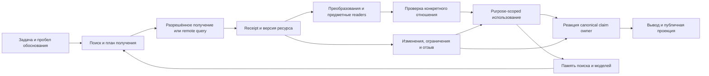

# Жизненный цикл внешних оснований и рост PolicyOS

Исследовательское архитектурное предложение, 2026-10-21. Документ развивает атлас; он **не ратифицирует новый runtime contract**, не принимает код E02 и не закрывает findings. Предложения для `system-design-decisions` здесь не применяются. Повторный критический разбор и уточнённые implementation protocols находятся в пунктах 5–7 ниже; одно необязательное уточнение C03 подготовлено отдельно на согласование. Проверки ниже — будущие условия реализации, а не выполненные тесты.

**Рекомендуемое устройство: связанный жизненный цикл поверх существующих владельцев, с устойчивыми границами между ними.** DataForge получает и подготавливает ресурсы; предметные владельцы сохраняют их смысл; Scientist строит и сравнивает обоснования; custody поддерживает честность уже сделанных утверждений. Новый источник должен чаще требовать новой записи или адаптера, чем новой ветки в orchestration. Новый способ устанавливать истинность, применимость или полномочие, напротив, нельзя вводить только настройкой.

## 1. Что именно должно расти свободно

Рост идёт по нескольким независимым направлениям: число источников и версий, объём и скорость поступления, новые языки и форматы, новые способы измерения, изменяющиеся права доступа, разные роли времени, новые типы аргумента и потребители. Увеличение одного направления не должно заставлять переделывать остальные.

«Free grow» здесь означает: **инварианты ядра устойчивы, расширения локальны, неизвестное не теряется и не получает выдуманную семантику**. Это не обещание, что любой будущий источник можно безопасно исполнить без кода. Нужно различать:

- **Контент и конфигурация:** ещё один источник с уже поддержанным протоколом, другая версия классификации, условная ценностная рамка, новый dataset partition. Подключаются данными, в пределах проверенных возможностей владельца.
- **Адаптер:** новый транспорт, формат, authentication flow или parser. Требует локального кода, проверки и resource contract; не меняет admission law.
- **Семантический механизм:** новый вид доказательства, правомочия, интервала, сопоставления или публичного обещания. Требует исследования, явного выбора контракта и реализации producer→consumer. Его нельзя спрятать в plugin или LLM prompt.

Пример: новый показатель не требует новой платформы хранения. Но число, названное «неравенством», не превращается в Gini, Atkinson или multidimensional poverty от одной записи в словаре. Смысл и преобразование должны быть связаны с выбранной методикой, популяцией и использованием. Категории атласа остаются открытой навигацией, а не разрешёнными runtime kinds.

## 2. Архитектурные опоры

Основание предложения — [видение и функции](01-architecture-and-functions.md), а также конкретные принятые положения: [S0-K03, S0-K06 и S0-K09](../../../system-design-decisions/stage0-custody-kernel-ratification.md), [CTM §§2–6](../../../system-design-decisions/policy-design-custody-time-model.md), [граница custody](../../../system-design-decisions/policyos-identity-and-custody-boundary.md), [ADR-0179/CV-Q1](../../../adr/0179-correspondence-vocabularies-meaning-principles-first-profiles-open.md). CTM прямо сохраняет native owners и отвергает универсальный persisted temporal envelope. Это ограничивает и данный проект.

Нужно разделять пять плоскостей: внешний акт/наблюдение; выпуск внешнего свидетельства; наше получение и проверка; наше purpose-scoped использование; наша публичная проекция. PolicyOS может организовать получение и анализ, но не подписывает за внешнего органа его акт. Мандат, право доступа и causal validity не выводятся из репутации URL, формата файла или результата поиска.

Для сверки с кодом выбран immutable snapshot `635413bcd1bd1d7e7b829d9123765e28e6bf23d6` ветки исполнения E02. Документация G прочитана на `33c8e8d7b2a425cb637ee64b734b42269071d7d7`. Статическое наличие символа не означает рабочую capability; карта переиспользования отделяет наблюдённые механизмы от требуемой композиции. Движущаяся ветка исполнения может уже отличаться; перед реализацией нужен delta review соответствующих владельцев.

## 3. Единый путь без единого владельца смысла

Схема показывает применимые owner handoffs, не обязательный порядок всех стадий для каждого ресурса и не обязанность публикации. Стрелка означает обязанность передать связанные сведения, а не автоматическое повышение authority. Выполнение pipeline, наличие checksum, успешный parser и даже независимая проверка одного свойства не дают универсального `trusted=true`. Candidate computation разрешена при честно объявленных допущениях; реальный доступ, защищённое действие и adopted claim требуют соответствующего основания.

## 4. Состав проектного пакета

1. [Карта кода и границ переиспользования](lifecycle/01-reuse-map.md): конкретные владельцы, source pins, выявленные ограничения и минимальные расширения.
2. [Потоки, согласованность и восстановление](lifecycle/02-flow-and-consistency.md): получение, materialization, семантическая обработка, admission, обновление и публичное чтение.
3. [Открытое расширение и рост](lifecycle/03-extension-and-growth.md): регистрация, совместимость, объём, бюджеты, исполнение, observability и критерии рефакторинга.
4. [Содержательные связи, custody и проверки](lifecycle/04-stewardship-and-probes.md): новые основания, связь со старыми и сквозные примеры.
5. [Уточнённые протоколы для реализации](lifecycle/05-implementation-protocols.md): capture cuts, journal handoff, semantic use, current read, rights/copy/restore fences, duties и retirement. При детализации перечисленных переходов использовать это продолжение исходного проекта.
6. [Результат критики и последовательность поставки](lifecycle/06-delivery-and-review.md): 12 тематических результатов, W0–W6 и 20 будущих protocol probes, все UNRUN.
7. [Первичные инженерные прецеденты](lifecycle/07-primary-design-references.md): переносимые механизмы и пределы аналогий.
8. [Предложение C03 для согласования](sdd-proposals/lifecycle-c03-20261021.md): точный необязательный текст для существующего North Star, пока не применён.

## 5. Что считать успехом

Система должна уметь ответить для конкретного вывода: **какое положение откуда получено; в какой версии и с какой потерей преобразовано; почему оно применимо здесь; кто проверил соответствующее свойство; какие альтернативы остаются; что изменит вывод; что стало недоступным или отозвано**. Для честного отказа нужен тот же путь и следующий возможный шаг, а не пустой статус.

Технический acceptance должен показать второй источник поддержанного класса через настоящий producer→consumer, сохранение смысловых различий, bounded processing растущего объёма, восстановление после сбоя и реакцию fresh consumer на изменение основания. Отсутствие правок центрального dispatcher — дополнительное архитектурное свойство, не достаточное свидетельство. Новый protocol/semantic class может требовать локального reviewed extension. Удобная схема и успешный ingest отдельно этого не устанавливают.

Pattern pass: P01/P02 — явная композиция; P04/P05/P15 — authority и статус по назначению; P07/P08 — replay и временные роли; P10/P14 — смысл и зависимость свидетельств; P25/P35 — границы поискового покрытия; P27/P31 — один владелец механизма; P29/P32/P37/P38 — проверка свойства вместо декларации. Новые end-to-end цепочки остаются `verification_missing`; где мост или producer только предложен, это явно указано в карте.
