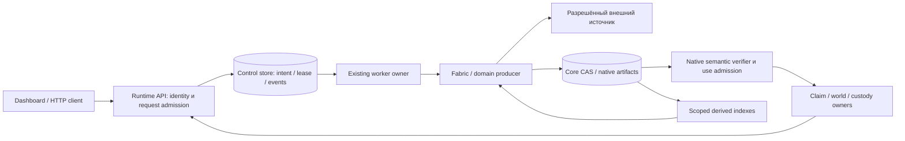

# Deployment profiles, вычисления и доступ к программе

Часть [проекта](../12-acquisition-storage-and-deployment.md). Рекомендации для будущего commissioning, не выполненный deployment. Source C = `635413bcd1bd1d7e7b829d9123765e28e6bf23d6`; topology contract G = `33c8e8d7b2a425cb637ee64b734b42269071d7d7`. Перед реализацией сверить delta рабочего E02 candidate. Никакие инфраструктурные ресурсы этой работой не создавались.

## 1. Минимальная архитектура

Это логические владельцы. Их не требуется немедленно разделять на microservices. Начать с минимального числа процессов/хранилищ, которое поддерживает реальные isolation, durability и resource contracts. API, network fetch, decode/compute и index build имеют разные ресурсные профили; объединение их в один процесс не даёт bounded memory автоматически.

Практическая последовательность: persistent local prototype → одна организация/cell на сервере → разрешённый remote worker/compute pool → shared cloud object store только после parity → несколько cells при действительной потребности. Private-source hybrid можно добавить раньше shared-cloud CAS: raw остаётся у custodian, а наружу выходит только разрешённый результат. Универсальность не требует одинакового физического размещения всех данных.

## 2. Что уже есть и чего presence не доказывает

| Static evidence | Вывод и ограничение |
|---|---|
| `runtime/http/app.py::create_runtime_api_app`; [deploy how-to](../../../../how-to/deploy-runtime.md) | HTTP app factory, OpenAPI/dashboard и configuration seams. Историческая bootstrap запись в how-to не является новой production проверкой. |
| `runtime/http/execution_policy.py::RuntimeExecutionPolicyResolver` @C | `research/governed/production` требуют durable control: postgres/external worker, кроме явно выбранного research local-control waiver; governed/production требуют security. Physical topology не равна execution profile. |
| `runtime/http/services/control/run_lifecycle.py` @C, constructor block `_worker` | В прочитанном composition path `ControlWorker` создаётся/стартует только при `embedded`. Выбор `external` не запускает автоматически внешний runner. Конструкция `ControlWorker(` не найдена вне этого места в bounded search `src/polisyos` + `tools/ops_runners`; dynamic/external deployment paths этим поиском не исключены. |
| `core/artifacts/backends/config.py` @C | Remote backends представлены, explicit tenant/cell ownership factory пока FS-only. Подробнее [storage](03-storage-and-reuse.md). |
| `ops/release/deployment-topology.toml` @G | `status = "contract_only"`. Наличие declarative targets/runbooks не доказывает полный install. |
| `ops/cloud/helm`, `ops/cloud/terraform`, workload-specific cloud scripts @G | Есть части identity/cell/cloud infrastructure; ни один directory name не достаточен для обещания turnkey cluster. Перед reuse проверить actual modules/resources/inputs, без нового параллельного IaC stack. |

Для deployment surface нужны owner и связанный runner/handler/bootstrap, а не только ещё одна переменная env. Конкретный runtime/admission профиль выбирается по требуемым guarantees; нельзя ради запуска production снять security/ownership scope или выдать `dev` за governed deployment.

Server runner в следующей таблице — целевая композиция: `bridge_missing` / `implemented_but_not_orchestrated` до A5, не поставленный отдельный процесс. Air-gap здесь целевой профиль без принятой композиции: не называть его лишь `verification_missing`, пока не названы и не wired необходимые chains; следовать [правилу статусов](../12-acquisition-storage-and-deployment.md#как-читать-итоговую-версию). Shared/multi-cell remote CAS остаётся вне заявленного supported scope до A6; physically scoped one-cell store не доказывает multi-cell parity и тоже требует собственного read/write/restore подтверждения.

## 3. Варианты размещения

| Вариант | Конкретная целевая топология | Что остаётся доказать |
|---|---|---|
| Личный локальный | Runtime API на loopback, dashboard/typed client, embedded worker для поддержанного профиля, SQLite + FS CAS, local indexes; source/model calls только разрешённые | Persistent paths/backup, bounded compute, source handshake, restart/fresh read. Localhost не отменяет permissions; выбранный dev профиль не production claim. |
| Сервер одной организации | TLS reverse proxy, API, PostgreSQL, отдельный existing-worker runner, FS CAS на управляемом volume, identity/authz, bounded scratch и telemetry | External runner composition, lease/effect/restart, authorized readers и restore. Сначала один host допустим, но это single failure domain, не HA. |
| Hybrid | API/control в выбранной cell; authenticated site worker внутри private-data сети; локальные credentials/raw/compute; наружу permitted result/receipt | Durable scoped dispatch, request/receipt binding, retry/cancel/unknown effects, egress и rights propagation. Не прямой доступ произвольного cloud LLM к внутренней сети. |
| Cloud cell | API replicas, managed/self-managed PostgreSQL, worker pools по классам задач, private S3/GCS через conformance-qualified CAS adapter, scoped cache/index | Store ownership/bounded read parity; SQL/CAS/copy/restore binding; actual quotas/regions/encryption/IAM; load/recovery/rollout evidence. |
| Air-gapped | Те же owners внутри сети; local identity/model/method packages; controlled offline source/code/rule bundles | Проверить отсутствие скрытого egress, bundle provenance/anti-rollback, clock/freshness bounds и offline update. History usable при permission; неизвестная внешняя currentness ограничивает current claim. |

Для cloud hosts возможны VM/containers без Kubernetes. Kubernetes нужен, когда измеренные pool/failure/isolation/deployment требования оправдывают его operating cost. Managed PostgreSQL/object store уменьшают эксплуатационную работу, но не передают поставщику semantic custody PolicyOS. Azure Blob или любой S3-compatible storage не объявляются поддержанными из сходства APIs; native adapter/conformance либо честный unsupported scope.

## 4. Конфигурационные seams

Existing options @C / documented deploy surface:

- Runtime: `POLISYOS_EXECUTION_PROFILE`, `POLISYOS_CONTROL_WORKER_BACKEND`, `POLISYOS_CONTROL_STATE_STORE_BACKEND`, `POLISYOS_CONTROL_SQLITE_PATH`, `POLISYOS_CONTROL_POSTGRES_DSN`. `external` — selection, не команда запуска fleet.
- CAS: `POLISYOS_CAS_BACKEND`, `POLISYOS_CAS_ROOT`, `POLISYOS_CAS_BUCKET`, `POLISYOS_CAS_PREFIX`, `POLISYOS_CAS_REGION`, `POLISYOS_CAS_LOCAL_CACHE_DIR`. Defaults нельзя принимать за production layout; non-FS tenant restriction сохраняется.
- Identity/authz/tenancy: documented OIDC/JWT, OPA, cell routing, delegated-context and optional mTLS/attestation settings. Проверять фактический enabled profile, trusted issuer/audience, keys и failure behavior; перечень env vars не acceptance.
- Telemetry: OTLP endpoint/service identity, bounded logs/metrics; observability exporter не должен отправлять private queries/payloads по умолчанию.

Deployment inventory связывает exact build/lock/profile с locations каждого store, mount/volume/region, owners, secret handles, backup/restore window, ingress/egress, capability limitations и поддержанными workloads. Это минимальное заполнение существующих release/topology/runbook contracts, не второй configuration service. Secrets передаются штатным secret owner/поставщиком окружения; их значения не входят в committed config или manifests.

**Bootstrap posture:** `RuntimeExecutionPolicyResolver.from_env` @C читает `POLISYOS_EXECUTION_PROFILE`, default `dev`; `POLISYOS_ENV=production` сам не выбирает этот профиль. Для server release существующий bootstrap owner должен сравнивать effective posture с declared deployment unit и отказывать при missing/empty/weaker selection; local dev выбирается явно. Нельзя считать имя environment независимым security guard. Это уточнение commissioning, не уже исправленная конфигурация.

Qualified storage и рабочий external runner проверяются на выбранном host, не выводятся из env. Подробные шаги и live-backup граница — [операционный протокол §4](06-operational-continuity.md#4-реалистичный-путь-первого-развёртывания).

## 5. Доступ: интерфейсы и server-owned authority

**HTTP/API + dashboard — основной reuse.** @C `runtime/http/routes/acquisitions.py`, `acquisition_action_service.py`, `acquisition_surface_execution.py`, `acquisition_route_loop.py` и dashboard `useAcquisitionRoutes.ts`/`AcquisitionApprovalFlow.tsx` образуют source-visible route/action/job/readback flow. Typed Runtime API client нужен browser и другим callers; UI checks не заменяют server verification.

Конкретный имеющийся рисунок: fresh GET acquisition route → route/planner/replay pins → request decision (без source effect) → отдельное execute → durable ControlJob → leased worker re-resolves scope/current route → narrow WorldBank WDI producer → quarantine evidence/receipt → отдельное admission/world-growth → fresh route/growth GET. Job `completed` и captured bytes не означают admitted observations. Это статический рисунок @C, не новый runtime PASS и не generic acquisition gateway.

**CLI/automation:** для новой run-bound acquisition команды сделать thin client к тем же typed HTTP operations, с idempotency и fresh readback. Existing local Fabric report/replay CLI не выдавать за этот путь. Script/library path, который пишет authoritative state мимо owner admission, запрещён; sanctioned direct library access возможен только в том же owner/security contract и с теми же receipts.

**LLM-agent/MCP:** agent может планировать и вызывать разрешённые операции, но не выдумывать source grants/act или повышать candidate. Dedicated MCP acquisition server в bounded `src/`, `packages/`, `apps/` review не установлен; если нужен, это thin projection existing API, не новый control plane. MCP имеет собственные audience/scope/delegation требования; bearer passthrough между resource servers не shortcut. [MCP authorization](https://modelcontextprotocol.io/specification/2025-11-25/basic/authorization), [OAuth token exchange RFC8693](https://www.rfc-editor.org/rfc/rfc8693.html).

**Offline:** можно работать с разрешёнными historical captures и cached presentation с явным cut. Нельзя выдавать cached approval за current authority. Delayed execution возобновляется через fresh server resolution, не blind replay offline button. Browser storage/export тоже копия с permission/retention; очищенный server cache не отзывает уже скачанный файл.

## 6. Private connectors и выдача результатов

API identity, source credential и result-use permission — три различных binding. `AccessScope` @C задаёт identity/roles/PII/cell, но inspected path не доказывает case/purpose rights permit. `SourceProfile`/connection resolver задают transport/auth hints; generic secret-manager/token-exchange composition не установлена в исследованном WDI path. Не передавать API JWT в dataset source.

Расширить existing credential/auth owners: runtime operation получает short-lived audience-bound capability/credential reference для конкретного connector/profile, selected dataset/query constraints, actor/cell, purpose и operation. Grant не создаёт внешнего права: он ограничивает исполнение уже проверенного applicable permission. Upstream secret остаётся у source-side worker/secret owner; trace содержит безопасный binding. Rotation/revocation требует re-resolution на resume. Для hybrid предпочтителен outbound authenticated pull/lease channel из private network, если это соответствует deployment policy; удалённое выполнение arbitrary code не подразумевается.

External rights evidence производит реальный rightsholder/controller/custodian либо существующий источник применимого правового основания. Его scope и применимость разрешает соответствующий Legal/Lex/custody owner; security/credential owner только исполняет полученный ограниченный допуск. Runtime action owner связывает это решение с effect **до outbound query/fetch**, а Fabric проверяет binding в source call. Actual resolver/issuer verifier для generic remote/private source в @C не установлен — `bridge_missing`; `LocalSourceRightsDeclaration` о local file/hash не переносится на remote grant новым label. A4 должен выбрать конкретный source и назвать producer/verifier symbols, необходимое узкое расширение и trust root. Пока этого нет, именно protected remote route unsupported; permitted metadata discovery и альтернативные основания могут продолжаться. Token, terms URL и active profile не substitutes. Query-only grant может разрешать compute и output, запрещая local raw retention; правило проверяется перед временными копиями, логированием и передачей processor.

Все fresh reads — route, job, artifacts, index hits, export, live stream и agent response — должны проверять owner scope и disclosure. **Статический access finding @C:** `routes/control.py::get_control_job_status` передаёт только job ID, `run_lifecycle.py::get_job_status` читает `get_job(job_id)`, а `control_plane_store.py` выбирает по `WHERE j.job_id = ?`; target tenant/cell comparison в этих местах отсутствует. Middleware default resource использует caller scope, который не доказывает владение выбранной записью. OPA и реальный HTTP не исполнялись: actual disclosure/denial — UNRUN, не подтверждённый эксплуатацией дефект. Реализационный ответ: existing auth owner должен разрешать доступ по immutable creation-time execution scope **target job** или делать owner-scoped lookup до serialization; известный чужой ID без проверенного права доступа и отсутствующий ID получают одинаковую not-found projection без metadata. Явное source/output sharing между cells возможно через owner-bound applicable grant, не через доверие caller-supplied tenant или label `public`. Перечитать delta текущего candidate перед исправлением. HTTP artifact mediation не заменяет store-level checks для прямых consumers. Public direct bucket credentials/URLs не default: они обходят current rights fence. Если future delivery использует presigned links, отдельно доказать bounded grant, expiry/revoke/in-flight semantics и audience; до этого scoped API выдаёт bytes.

Отдельные auth failures, unavailable source, pending external act, incomplete capture, processing error, verification missing и scoped no-hit показываются пользователю через existing native outcomes. Не вводить общий «данных нет» и не делать новых status enums только для UI.

## 7. Адаптивные compute и storage

Начать с bounded fixed pools и измерить representative workloads. Общий resource admission — проектируемое расширение existing Runtime/Fabric owners: конкретный cross-process CPU/RAM/disk reservation owner и consumer не установлены inspected seams, и одиночный semaphore/lease их не заменяет. Инфраструктурный autoscaler исполняет capacity plan, не решает scientific/legal admissibility. Разделить network acquisition, interactive read, CPU methods, high-memory operators, GPU/model, index maintenance и recovery. Для job сохранять actual input/plan identity, resource estimates, reservations, enforced limits, checkpoint/spill/cancel support и permitted placement.

Scale-out учитывает возраст самой старой duty и work backlog по классу, service rate, reserve, DB/CAS headroom, source quotas, disk/spill, денежный предел и jurisdiction/region policy. CPU low может означать network/DB bottleneck, а queue length не отражает стоимость разных jobs. Не обещать «autoscaling решит OOM»: неподдержанный big member/global operator надо partition/stream/исполнить на подходящем ресурсе либо честно defer. Parent/child capacity, terminal reserve и memory-held waits следуют [resource protocol](../lifecycle/09-resource-execution-design.md).

Kubernetes HPA поддерживает resource/custom/external metrics; нужный metrics adapter всё равно следует установить и проверить. Pod memory limit может закончиться OOM kill и не заменяет bounded algorithm. [HPA](https://kubernetes.io/docs/concepts/workloads/autoscaling/horizontal-pod-autoscale/), [container resources](https://kubernetes.io/docs/concepts/configuration/manage-resources-containers/).

Storage scaling — independent capacity и policy: source partitions, bounded local cache, tiering, permitted compression, metadata/index maintenance, region-aware replication и retention. Capacity trigger учитывает outputs + spill + checkpoints + две живые generations при rebuild + recovery reserve, не только input bytes. Data locality ограничивает transfer; schema/profile/identity не меняются при migration. Удаление reproducible index возможно лишь если его rebuild реально доступен при required rights/resources. Нельзя выгрузить raw в cloud просто из-за локального disk pressure.

## 8. До первого реального развёртывания

Выбрать workload и named institution/cell, source permissions и allowed locations; задать конкретные availability/custody/recovery/disclosure ожидания. Затем выполнить [вертикали commissioning](05-implementation-and-review.md). Одновременно подготовить поддерживаемый source profile set, exact runtime/method builds, storage+secret inventories, backup restore и audit projection. Не создавать дорогостоящий кластер, пока не замкнут один producer→consumer и повторное использование второй задачей.

Pattern pass: P01/P02/P03/P05/P07/P08/P13/P27/P31/P32/P37/P38. Interface presence, pod Ready, backup-success и bucket prefix — proxies; future acceptance проверяет actual leased execution, scoped fresh reads, bounded resources и restore without resurrection. Всё UNRUN; authoritative SDD и код не менялись.
